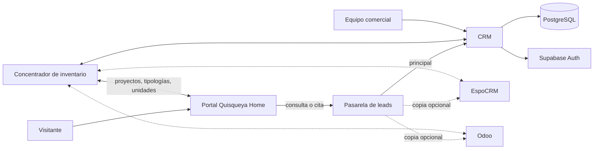

# CRM Quisqueya Home

CRM inmobiliario de Viltrum Tek, hecho para Quisqueya Home y preparado para configurarse en otras inmobiliarias. Conecta el portal público de proyectos con el trabajo diario del equipo comercial: el lead llega desde el portal, se asigna a un broker, se le da seguimiento, se convierte en negocio, avanza por el pipeline hasta el cierre y mueve las metas del broker, del equipo y de la compañía.

Este repositorio reúne todo lo hecho hasta hoy: el producto, la capa de integración con el portal que corre en la VPS y la documentación del proyecto, desde la investigación hasta la evidencia de cada corte.

## Estado

| Pieza | Estado | Detalle |
|---|---|---|
| Motor de reglas | Probado | Dominio, casos de uso, permisos por rol y alcance, auditoría, 84 tablas, 20 migraciones, más de 1.000 pruebas |
| Acceso y armazón web y app | Construido | Barra lateral en escritorio; cabecera, barra inferior y hoja «Más» en el móvil |
| Inicio | En revisión | Resumen del día y ritmo de la meta según el rol |
| Leads | En revisión | Lista con filtros y búsqueda, alta, ficha, tomar, asignar, seguimiento, convertir, descartar |
| Negocios | En revisión | Tablero por etapas, ficha con requisitos por etapa, propiedad, monto, cierre y pérdida |
| Contactos | En revisión | Cartera con búsqueda y paginación |
| Propiedades | En revisión | Catálogo de proyectos y unidades con disponibilidad |
| Tareas y Agenda | En revisión | Tareas pendientes y hechas; agenda de 7, 14 y 30 días |
| Metas | En revisión | Liga de metas con gráficos (compañía, equipo y broker) y alta de metas |
| Configuración | En revisión | Usuarios por tipo y matriz de permisos por rol |
| Pasarela de leads | En staging | Recibe el lead del portal y lo reparte al CRM, EspoCRM y Odoo |
| Concentrador de inventario | En staging | Sincroniza proyectos, tipologías y unidades entre sistemas |
| Comunicaciones, Brokers, Comisiones, Reportes, Reservas, Documentos, Academy, Posventa y demás | Pendiente | El motor existe; falta la pantalla |

«En revisión» quiere decir construido y verificado por quien lo hizo, todavía sin certificar. Un módulo pasa a «certificado» solo cuando cumple las condiciones de [crm/docs/certificacion.md](crm/docs/certificacion.md).

## Cómo encaja todo



- **CRM (`crm/`):** el producto. Next.js 15, React 19, TypeScript, PostgreSQL con Drizzle, Supabase Auth, Tailwind 4. Arquitectura hexagonal: las reglas no conocen la base de datos ni al proveedor.
- **Pasarela de leads (`integraciones/pasarela-leads/`):** un único punto de entrada para el portal. Idempotente por `externalId`, normaliza teléfonos, vincula el proyecto y reintenta los destinos que fallan.
- **Concentrador de inventario (`integraciones/concentrador-inventario/`):** sincronización en ciclos con fusión de tres vías por campo; un recurso nuevo es una entrada en `recursos.mjs` más un adaptador por sistema.

EspoCRM y Odoo son conexiones opcionales para una empresa cliente que ya los use; no forman parte del producto. La decisión y sus motivos de licencia están en [docs/03-arquitectura/03-plataforma-empaquetada.md](docs/03-arquitectura/03-plataforma-empaquetada.md).

## Mapa del repositorio

```text
crm/                          Producto (Next.js). Tiene su propio README
  src/domain/                 Reglas puras
  src/application/            Casos de uso y puertos
  src/infrastructure/         Base de datos, autenticación, integraciones
  src/app/                    Pantallas y API
  src/modules/registry.ts     Los 22 módulos y su estado de certificación
  config/empresas/            Una configuración por empresa (marca, idioma, monedas, tema)
  drizzle/                    Migraciones
  spec/                       Fichas funcionales por módulo
  docs/                       Diseño, certificación y guardas
integraciones/
  pasarela-leads/             Pasarela portal → CRM (Node, Docker Compose)
  concentrador-inventario/    Sincronización de inventario (Node, Docker Compose)
docs/
  01-descubrimiento/          Alcance, roles y los 22 módulos
  02-investigacion/           CRM abiertos, herramientas de diseño, inventario del sistema anterior
  03-arquitectura/            Arquitectura conceptual, integración y plataforma empaquetada
  04-diseno/                  Sistema de diseño, referencias y capturas del CRM nuevo
  05-plan/                    Hoja de ruta y preparación para construir
  06-analisis-documental/     Análisis de los documentos de Drive, uno por uno
  07-documento-maestro/       Documento final, casos de uso y matriz de comunicaciones
  08-diagramas-interactivos/  Siete diagramas navegables (abrir index.html)
  10-espacio-local/           Espacio de trabajo local y conexión a la VPS
  gobierno/                   Mandatos, decisiones, preguntas, revisiones y evidencia de cada corte
```

## Empezar

Requisitos: Node 22 o superior y PostgreSQL 15.

```bash
cd crm
```

```bash
npm ci
```

```bash
cp .env.example .env
```

```bash
npm run dev -- -p 9401
```

Con `CRM_EVAL_LOGIN=1` el CRM entra sin contraseña desde `localhost` y deja cambiar de rol para revisarlo; nunca se activa fuera de desarrollo. `CRM_MOSTRAR_EN_REVISION=1` muestra los módulos construidos que aún no están certificados.

Antes de dar algo por terminado:

```bash
npm run typecheck && npm run lint && npm test && npm run build
```

## Tipos de usuario

| Tipo | Ve y trabaja sobre |
|---|---|
| Administrador | Toda la empresa; configura usuarios, permisos, metas y catálogos |
| Gerente o supervisor | Su equipo: reparte y reasigna leads, fija metas de sus brokers, ve su avance |
| Broker | Lo suyo y la cola de leads sin responsable |
| Asistente | Apoyo operativo con alcance total de lectura y carga |

Cada cruce de recurso y acción tiene un alcance (sin acceso, lo propio, su equipo, todo) y se ajusta desde Configuración → Permisos por tipo de usuario. Las reglas se comprueban en el servidor, no solo en la pantalla.

## Cómo se trabaja

- Quien construye no aprueba: cada corte pasa por una revisión independiente antes de integrarse.
- Nada se integra sin tipos, lint y pruebas en verde.
- Toda pantalla resuelve seis estados: carga, vacío, error, sin conexión, éxito y sin permiso.
- Nada de una empresa vive en el código: marca, catálogos, etapas y metas salen de configuración.
- Producción requiere aprobación expresa del dueño.

La doctrina completa está en el repositorio de perfiles de Viltrum; la evidencia de cada corte, en [docs/gobierno](docs/gobierno).

## Próximos pasos

1. Probar el recorrido completo haciendo clic en la interfaz: lead del portal, asignación, seguimiento, negocio, cierre y meta.
2. Desplegar el CRM nuevo en staging con acceso por contraseña y la pasarela del portal apuntando a él.
3. Comisión por defecto, reparto automático de leads, recordatorios y notificaciones.
4. Google Calendar.
5. Módulos restantes, uno por uno hasta certificarlos.

## Licencia

Software propietario de Viltrum Tek. Todos los derechos reservados. Las dependencias de terceros conservan sus licencias; solo se usan bibliotecas con licencia permisiva.
