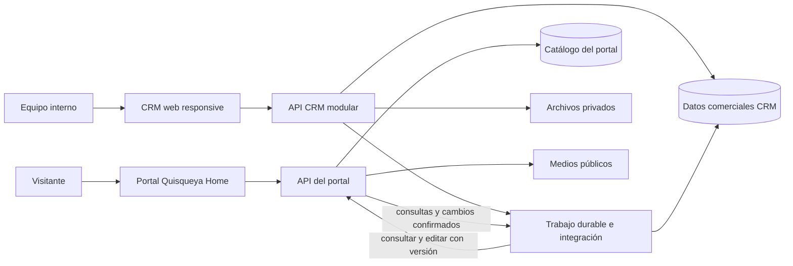

# Arquitectura conceptual v0.1

Fecha: 2026-11-06. Productor: Codex, D03. Estado: propuesta pre-C1; revisión humana pendiente. Una sola empresa confirmada. Ver inventario de código en `02-investigacion/03-inventario-portal-y-crm.md`; las piezas nuevas de este documento son propuestas, no capacidades verificadas.

## Recomendación inicial

Un CRM web independiente, organizado como **monolito modular**, conectado al portal por un adaptador con contratos explícitos. La API de negocio y un proceso de trabajos comparten código y base del CRM; pueden ejecutarse por separado para que una caída del integrador no bloquee al asesor. El portal conserva inicialmente su catálogo y edición editorial. No se comparte acceso SQL entre aplicaciones como contrato permanente.

Esto mantiene una operación abordable para una sola inmobiliaria. Separar más servicios solo si mediciones, equipos distintos o requisitos de disponibilidad lo justifican. No hay razón confirmada para Kubernetes, microfrontends, un bus Kafka ni una plataforma multitenant.



Las flechas entrantes del portal al trabajo durable expresan el objetivo propuesto; no certifican que exista ya una outbox/webhook confiable en el portal.

## Comparación de caminos

| Camino | Ventaja | Coste/riesgo | Condición para elegir |
|---|---|---|---|
| Adaptar CRM existente completo | contactos, permisos, pipeline y reportes ya construidos | encaje inmobiliario, UI, actualizaciones, licencia y módulos comerciales | piloto cubre los recorridos sin fork invasivo; licencia aceptada |
| CRM propio modular con bibliotecas | UX a medida, integración y reglas bajo control | más trabajo en permisos, auditoría, reportes y mantenimiento | diferencia de negocio justifica ese trabajo y se asigna capacidad |
| Extraer piezas de varios CRMs | piezas concretas cercanas a la necesidad | mezcla de licencias/modelos y pérdida de camino de actualización | solo piezas aislables con licencia, pruebas y contrato comprobados |

Recomendación provisional: comparar un piloto EspoCRM + inmobiliaria frente a un prototipo propio de los mismos tres recorridos; decidir por cobertura, experiencia, dependencia y costo de mantenimiento. La política Viltrum actual bloquea adoptar/adaptar AGPL/GPL por defecto; eso es una restricción interna y no una afirmación de que esas licencias prohíban uso comercial. La investigación puede estudiar su comportamiento. Ningún código externo entra en esta entrega.

## Organización si se elige construir propio

| Módulo | Posee | Expone / dependencia permitida |
|---|---|---|
| Identidad | usuarios, equipos, permisos y sesiones | actor autenticado y autorización; proveedor detrás de adaptador |
| Contactos | personas/empresas, canales, consentimiento, fusiones | ID de contacto y perfil autorizado |
| Captación | consultas, origen, asignación | convertir lead en oportunidad referenciando contacto |
| Oportunidades | demanda, etapas, cierre y motivos | próxima acción y referencias a propiedades; no edita catálogo |
| Agenda | tareas, visitas y responsables | disponibilidad y transiciones; no duplica oportunidades |
| Catálogo remoto | proyección local de ficha y mapa de IDs | búsqueda comercial; comandos a API del portal |
| Publicación | solicitudes y estado conocido de publicación | permisos/revisión; autoridad editorial en portal inicialmente |
| Integraciones | outbox/inbox, cursores, intentos y credenciales referenciadas | puertos de portal, mensajería y medios; no posee reglas comerciales |
| Auditoría | registro de acciones con política de acceso/retención | consulta restringida; no se usa como copia íntegra de PII |
| Reportes | proyecciones de lectura y definiciones de métricas | agregaciones respetando permisos y origen |

Un módulo modifica únicamente sus entidades mediante sus casos de uso. Reportes consume proyecciones/consultas explícitas, no escribe datos de otros. Composición de infraestructura en el arranque; dominio no importa clientes del portal, SDK de mensajería ni proveedor de autenticación.

Estructura posible (documental; no se ha creado código):

```text
apps/crm-web/       navegación, features y composición visual
apps/crm-api/       transporte HTTP y composición de módulos
apps/worker/        entrega durable, conciliación y tareas programadas
packages/domain/   módulos: domain, application, ports
packages/adapters/ PostgreSQL, portal, identidad, archivos y canales
packages/contracts/ schemas públicos de API/eventos versionados
packages/ui/       tokens, primitives, patrones, stories
docs/              requisitos, ADR, operación y procedencia
```

Stack candidato: React + TypeScript, Vite para el cliente interno; NestJS para API modular; PostgreSQL para transacciones, búsqueda inicial y cola durable basada en tablas; almacenamiento compatible S3 para privados; React Query para estado remoto; componentes shadcn seleccionados y documentados en Storybook. Versiones se fijan tras la prueba, con lockfiles. Elegir un solo ORM tras contrastar consultas/migraciones existentes. Next.js sigue siendo alternativa si aporta ventaja al equipo; SSR no es una necesidad confirmada del CRM privado.

Es una recomendación de ingeniería, no una combinación ya probada. [Nest documenta módulos y su encapsulación](https://docs.nestjs.com/modules); [React propone descomponer componentes y estados](https://react.dev/learn/thinking-in-react); [TanStack Query](https://tanstack.com/query/latest/docs/framework/react/overview) gestiona estado remoto. Ninguna biblioteca sustituye autorización o reglas del servidor.

## Fuente de verdad: decisión más importante

| Dato | Dueño inicial propuesto | Qué conserva el otro lado |
|---|---|---|
| ficha editorial/proyecto, precio publicado y medios aprobados | catálogo del portal | CRM guarda UUID estable, versión y proyección fechada |
| unidad comercial, reserva y disponibilidad exacta | por decidir; hoy el modelo de unidades se evidenció en CRM anterior, no API portal | mapear proyecto↔unidad; no asignar automáticamente estas entidades al portal |
| publicación, slug, SEO, traducciones | portal/editorial | CRM solicita y muestra resultado confirmado |
| consulta de visitante | portal conserva recepción durable; CRM gestiona seguimiento | vínculo de consulta origen→lead sin duplicar efecto |
| persona, asignación, oportunidad y tareas | CRM | portal solo recibe información explícitamente necesaria |
| notas, descuentos negociados, documentos y comisiones | CRM privado | no se proyectan al catálogo público |
| analítica de navegación | portal | agregados útiles; identidad solo con reglas aceptadas |

El formulario del CRM puede editar una ficha del portal mediante su API: es otra interfaz sobre el mismo dueño. No se permiten dos bases maestras que se sobrescriban con «la última fecha gana». Más adelante se puede trasladar la autoridad de catálogo al CRM con migración y corte explícitos, si aporta valor. No es requisito de esta fase.

El portal hoy acredita proyectos editoriales; alojar unidades/reservas allí sería ampliación de modelo/API y una decisión nueva. Alternativa: CRM posee inventario comercial y envía al portal una proyección de disponibilidad/precio aprobado. Antes de elegir, comprobar proyecto, unidad y operación del negocio; mantener Q-004/Q-005 abiertos. El precio negociado nunca se convierte automáticamente en precio público.

Separación propuesta de versiones: ficha de trabajo, revisión aprobada y revisión pública. Un borrador de una ficha ya publicada no cambia la revisión pública. La API actual del portal no acredita esa separación: habrá que implementarla o limitar el alcance a solicitudes de cambio pendientes de ejecución editorial. Retirada urgente y disponibilidad pueden tener transición inmediata con permiso específico si el negocio la autoriza; no se deduce del guardado genérico. Esta política queda a validar por campo.

## Decisiones reversibles y decisiones que requieren validación

| ADR propuesto | Elección inicial / alternativa | Qué la cambia |
|---|---|---|
| ADR-01 | monolito modular; alternativa CRM adoptado | resultado de piloto y capacidad del equipo |
| ADR-02 | catálogo portal, negocio CRM | limitación de API, editor y propiedad real de datos |
| ADR-03 | una empresa, equipos/roles; sin plataforma tenants | ampliación comercial explícita |
| ADR-04 | eventos al menos una vez + deduplicación | garantía real del transporte; no prometer exactly-once |
| ADR-05 | conservar IDs externos y usar IDs internos estables | inventario de relaciones y migración |
| ADR-06 | Postgres y separación de bases/esquemas/credenciales | operación y despliegue confirmados; SQL compartido solo transición documentada |
| ADR-07 | dinero decimal con moneda; UTC para instantes, zona local para agenda | monedas y procesos aceptados; nunca conversión implícita |
| ADR-08 | borrado lógico recuperable + supresión según retención | política de privacidad/retención; backups incluidos |
| ADR-09 | identidad central si se puede verificar; cuentas staff separadas de visitantes | esquema actual de roles/sesiones y coste de migración |

Estas son opciones para discutir, no ADR aceptados. Credenciales separadas y permisos mínimos son necesarios aunque el despliegue comparta VPS. Compartir proveedor Auth no da acceso automático a ambos productos.

## Modelo conceptual (no esquema definitivo)

Separar contacto de lead y de oportunidad. Un contacto puede tener muchos leads/oportunidades. Una oportunidad puede interesarse por varias unidades o proyectos y tener un historial de cambios. Una propiedad puede tener múltiples unidades; precio «desde» de proyecto no equivale a precio de una unidad disponible. Validar esta distinción contra el catálogo actual.

Entidades candidatas: Contact, ContactChannel, ConsentRecord, Lead, AssignmentHistory, Opportunity, Demand, OpportunityProperty, PropertyReference, Visit, Task, Activity, PublicationRequest, User, Team, Role, Permission, AuditEntry, InboxMessage, OutboxMessage y ExternalIdMapping. Propietario legal del inmueble es una relación de persona/empresa, no el usuario asignado en CRM. Adjuntos privados se vinculan con permisos al recurso dueño.

Catálogos administrables propuestos: etapas, motivos de pérdida, fuentes, tipos de operación, tipos de propiedad y equipos. Cambiar una etapa no reescribe historia. Estados técnicos de entrega y versiones de contratos se controlan como enums de aplicación. Fechas de negocio y auditoría no se sobrescriben para simular sincronía.

## Migración y reversión

1. Inventariar CRM anterior, catálogo y fuentes; clasificar datos e IDs sin copiar información personal a herramientas externas.
2. Crear mapeo origen→destino; ensayar con datos sintéticos y luego exportación autorizada en ambiente aislado.
3. Reportar conteos, duplicados, huérfanos, campos descartados y muestra de fichas/actividades. Contrastar relaciones además de totales.
4. Ejecutar piloto de lectura, luego consultas/leads, después edición/publicación. Cada fase tiene un solo escritor por dato.
5. En el corte, registrar watermark, pausar escrituras afectadas o capturar delta con garantía; hacer importación final y reconciliar.
6. Conservar acceso histórico restringido y plan de retorno. Si el CRM nuevo ya escribió, reconciliar el delta antes de volver: revertir binario no revierte datos.

Preservar URLs públicas y referencias de propiedades. No sincronizar bidireccionalmente bases completas; no ejecutar scripts de arranque/despliegue del proyecto anterior sin revisar su acceso real a producción.

## Operación y amenazas a validar

Ambientes separados (desarrollo con sintéticos, staging, producción), credenciales por servicio, backups cifrados y restauración ensayada. Medir antigüedad de outbox, reintentos, DLQ, retraso de catálogo, latencia API y divergencias; correlación de consulta→lead→publicación sin PII en logs.

Superficies: API pública de consultas, API staff, webhook servidor-servidor, exportaciones y subida de archivos. Controles candidatos: validación por lista de campos, autorización por registro/acción/campo, rate limit, protección CSRF si cookies, límites de carga y validación de medios, redacción de logs, URLs firmadas para privados, revocación de usuarios y rotación de credenciales. La firma de webhook no reemplaza deduplicación ni autorización del comando.

Riesgos de referencia: [OWASP API Security](https://devguide.owasp.org/en/07-training-education/07-api-top-ten/). Normativa local y plazos de conservación quedan a validar con responsable del negocio; este documento no fija obligaciones legales.
