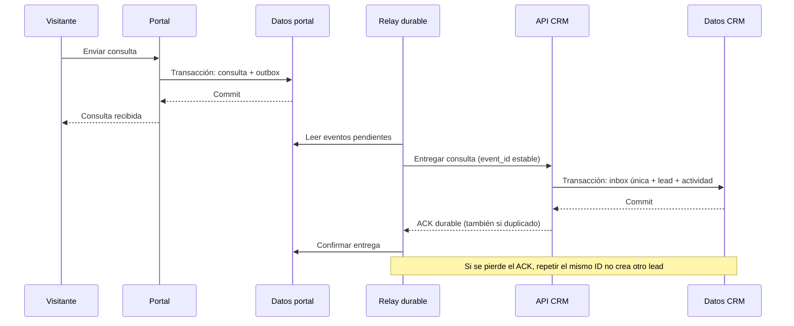
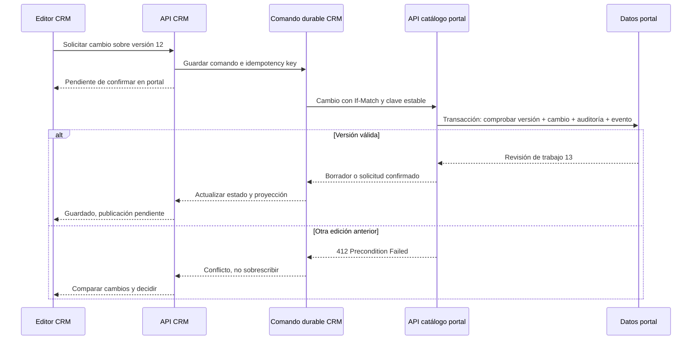

# API bidireccional y escenarios de fallo

D03 · propuesta conceptual · 2026-11-06. Revisión humana pendiente. Los endpoints `/integration/v1/*` siguientes son nombres propuestos; no existen por el hecho de aparecer aquí. Contrastar con rutas actuales del inventario.

## Tres recorridos que deben probarse antes de elegir base

1. Visitante consulta una propiedad → consulta persistida → lead único → asignación → tarea → visita.
2. Editor propone un cambio de ficha desde CRM → validación y control de versión en el dueño del campo → revisión/solicitud guardada → aprobación/publicación explícita → catálogo público actualizado y cache invalidada. Inventario/unidades y cambios urgentes dependen de Q-004/Q-005.
3. CRM o portal deja de responder → operación durable queda pendiente → recuperación/reintento → efecto único y estado final visible.

Outbox significa guardar el dato y la intención de entrega en la misma transacción; el relay entrega después. Inbox evita aplicar dos veces. Hay que añadir ambos controles donde falten; un POST después del guardado sin cola no garantiza recuperación. El relay puede ser un proceso con tabla de trabajos, sin broker externo al inicio. Referencias: [transactional outbox](https://microservices.io/patterns/data/transactional-outbox.html) y [idempotent consumer](https://microservices.io/patterns/communication-style/idempotent-consumer.html).

Un guardado no implica publicación. Esta secuencia crea un borrador/solicitud; la publicación ocurre con permiso separado y confirmación de la revisión pública. El portal actual no acredita versiones independientes de trabajo y publicación: esto exige ampliación o limitar inicialmente a solicitudes que ejecuta un editor. Una ficha publicada permanece en la revisión aprobada mientras se prepara la siguiente. Cambios urgentes por campo requieren política explícita del negocio; no se incluyen silenciosamente en PATCH genérico.

## Contratos mínimos a elaborar

| Operación propuesta | Garantía/condición |
|---|---|
| GET `/integration/v1/properties?cursor=...` | paginación estable, versión y proyección autorizada; distinguir proyecto/unidad |
| GET `/integration/v1/changes?cursor=...` | secuencia monotónica, tombstones, retención del log y reanudación; fecha sola no basta |
| PATCH `/integration/v1/properties/{id}` | permiso por campos, `If-Match`, idempotencia del comando y auditoría |
| POST `/integration/v1/publication-requests` | permiso de publicar, validación, resultado diferenciado de borrador |
| POST CRM `/integration/v1/inquiries` | identidad técnica, ID origen obligatorio, commit antes de ACK |
| POST `/integration/v1/events` | firma/autenticación, timestamp y tolerancia de replay, schema y origen permitidos |
| GET `/integration/v1/operations/{id}` | consultar resultado tras timeout; no deducir fallo por falta de respuesta |

Documentar HTTP con OpenAPI; [la especificación oficial actual lista 3.2.1](https://spec.openapis.org/oas/v3.2.1.html). Elegir formato soportado por generador, validador y clientes de la prueba; no declarar compatibilidad solo por publicar un YAML. Si se usa 3.1.x, registrar la razón de toolchain.

Envelope candidato de evento: `event_id`, `event_type`, `schema_version`, `aggregate_id`, `aggregate_version`, `source`, `occurred_at`, `correlation_id`, `causation_id`, `payload`. Solo campos autorizados; no enviar documentos o notas privadas por defecto. Inbox única por `(source, event_id)`; comandos con clave acotada por cliente/operación y hash de payload para rechazar reutilización con contenido distinto. Persistir resultado reutilizable y fijar retención según ventana de reintentos; no asumir que TTL corto cubre una caída larga.

Además, Captación exige **unicidad de negocio `(source, inquiry_id)`**, independiente del event_id de entrega. Conservar `externalId = portal_inquiry_<inquiryId>` y su recibo/mapeo al migrar. Reemitir el mismo inquiry con envelope nuevo devuelve el lead/recibo ya creado; dos consultas diferentes de la misma persona siguen siendo intereses distintos. El UUID de proyecto portal y, cuando exista, ID de unidad viajan como referencias explícitas: nunca convertir el nombre mutable en la identidad.

Orden de recepción de comandos: autenticar y autorizar según política vigente; buscar recibo por clave/cliente/operación; verificar hash y devolver el resultado previo si ya se aplicó. **Solo un comando nuevo evalúa `If-Match` de forma atómica con mutación y recibo.** Así, si se pierde el resultado de aplicar v12→v13, el reintento de la misma operación devuelve su resultado y no un falso conflicto; una clave nueva con v12 sí recibe 412. No mantener una transacción/bloqueo de base abierta durante HTTP: claim/lease durable, llamada fuera de transacción y ACK posterior. Para varios destinos, delivery y recibo por destino.

Versionar por agregado para ignorar eventos atrasados y detectar huecos. Preferir evento de invalidación + lectura de snapshot del dueño o snapshots versionados completos; un delta fuera de orden no se aplica a ciegas. Origen/causación impiden volver a emitir una réplica como nuevo comando.

Una única integración técnica con credenciales revocables, TLS y permisos mínimos. HMAC con secreto rotatorio y cuerpo crudo es opción para webhooks; cliente OAuth o credencial de servicio con scopes es alternativa para comandos. La elección depende del soporte real del portal. Nunca usar una clave administrativa de base de datos en el navegador.

## Matriz de contingencias

| Escenario | Respuesta propuesta | Evidencia de aceptación esperada |
|---|---|---|
| misma consulta llega dos veces | inbox única; devolver resultado anterior | un lead/actividad tras diez reentregas |
| consulta reemitida con event_id nuevo | unicidad por origen/inquiry y recibo legado | un lead para el mismo inquiry con dos envelopes |
| misma persona consulta otro inmueble | conservar nueva consulta/oportunidad según negocio; no deduplicar solo por teléfono | dos intereses con un contacto revisado |
| CRM no responde | portal conserva consulta/outbox, reintenta con backoff/jitter y límite | consulta recuperada tras caída simulada |
| portal no responde | comando pendiente; CRM usa lectura fechada, no confirma publicación | aviso visible y aplicación posterior |
| se pierde respuesta después del commit | repetir misma clave o consultar operación | una sola mutación/resultado |
| proceso muere durante recepción | inbox y efecto en una transacción; lease del trabajo recuperable | sin inbox huérfana que bloquee un efecto no aplicado |
| dos editores cambian ficha | control optimista; comparación humana | segunda versión obsoleta recibe 412, sin pérdida silenciosa |
| eventos fuera de orden | versión de agregado, ignorar antiguo/detectar hueco/refetch | versión anterior no revierte disponibilidad |
| webhook se pierde | reconciliación incremental por cursor | recuperar cambio sin depender del webhook |
| cursor vencido | resnapshot acotado con watermark; delta durante snapshot y conciliación final | mismo conjunto/versión que dueño al completar |
| eventos causan bucle | replicación no crea comando y se conserva source/causation | tráfico finito tras un cambio |
| dato inválido permanente | cuarentena/DLQ con motivo; no reintentar indefinidamente | operador corrige y reprocesa con efecto único |
| credencial vencida/401/403 | detener reintentos agresivos, alertar y rotar | recuperación sin exponer secreto |
| 429 o saturación | respetar Retry-After, backpressure y concurrencia limitada | no derribar portal al recuperar cola |
| propiedad retirada con leads abiertos | tombstone/archivado; conservar referencia histórica | tareas visibles y no nueva publicación accidental |
| publicación con medio inválido | rechazar o mantener borrador; no publicar ficha incompleta | validación y mensaje por campo |
| se edita borrador de ficha publicada | revisión de trabajo separada de revisión pública | público conserva versión aprobada hasta publicar |
| usuario pierde permiso durante edición | verificar al ejecutar, no solo al abrir | mutación denegada con sesión todavía abierta |
| exportación masiva | trabajo autorizado, archivo temporal privado, caducidad y auditoría | otro usuario no puede descargarlo |
| importación con huérfanos/duplicados | dry-run y cuarentena; no ignorar filas silenciosamente | reporte por fila y conteos conciliados |
| intento de borrar dato privado | flujo de retención/supresión con backups y réplicas contemplados | evidencia de ubicaciones y excepciones aprobadas |
| caída de DB/archivo | operación falla coherentemente; recuperar con respaldo probado | ensayo de restauración y comprobación de relaciones |
| asesor sin conexión | lectura cacheada señalizada; acciones críticas esperan conexión | no mostrar visita/publicación confirmada sin servidor |

La tabla cubre fallos críticos previstos; se amplía al conocer los procesos reales. No afirma cobertura exhaustiva ni pruebas ejecutadas.

Control de concurrencia HTTP: [RFC 9110](https://www.rfc-editor.org/rfc/rfc9110.html) especifica `If-Match` y el fallo de precondición; la semántica de idempotencia de negocio y la deduplicación persistente se diseñan además de HTTP.
