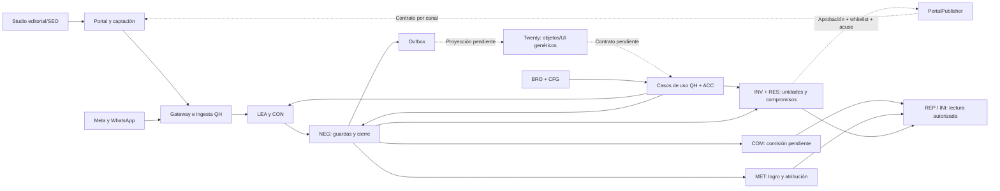

# Grupo comercial y control — análisis de once especificaciones completas

6 de noviembre de 2026. Productor: codex-comercial-documental, disciplina D01 y análisis conceptual D03. Once originales Markdown leídos de principio a fin, con notas individuales y SHA256; no se leyeron los PDF como evidencia independiente. Estado: investigación documental para integración y revisión independiente, sin implementación, nuevas pruebas ni aprobación de gates. El JSON compañero contiene 11 módulos, 40 entidades agrupadas, 79 relaciones con fuente/estado, 14 preguntas y 10 contradicciones.

La arquitectura híbrida Twenty Community + dominio QH es la **baseline registrada por los documentos recibidos**. Este análisis no reabre esa elección a causa de las alternativas del primer turno. Tampoco convierte los borradores, el ADR citado o etiquetas de QA en aceptación actual de implementación, licencia, seguridad o alcance comercial.

## Qué hay que conservar del producto completo

| Módulo | Núcleo documental y funciones declaradas | Futuro, parcial o pendiente que permanece en el mapa |
|---|---|---|
| ACC | Identidad, sesión, matriz, overrides, equipos/supervisión, ver-como y precio restringido | MFA, recuperación segura, auditoría preview, caducidad, transferencia antes de baja, membresía Twenty |
| CON | Directorio, CRUD, normalización/dedupe, responsable, export individual y borrado lógico | Privacidad por finalidad/canal, bajas, derechos, empresas, representación, fusión, timeline, demanda/matching/alertas y sync |
| LEA/ASG | Captura manual/portal/Meta/WA, sugerencia, asignar/reasignar/Tomar, calificar, descartar, convertir, voz parcial y primer contacto | CSV, fusión, round-robin/turnos/carga/idioma, ponds/SLA, protección, bandeja, CAPI comercial y click IDs |
| NEG | Conversión, tablero/lista/análisis, edición restringida, intereses/principal, guardas, pérdida, cierre atómico e historial | PDF/versiones/enlaces, descuentos/aprobaciones, bulk, vistas compartidas, archivo/reapertura, documentos por etapa, forecast completo y OUT publicitario |
| INV + cruce OBR | Proyectos/unidades, precios, matriz/inspector, CSV público, versiones, compromisos y fases/fotos parciales | Stock efectivo, publicación/retirada por canal, acuse/versión/aprobación, mapa, kit/PDF/mediateca, estructura/precios versionados, calidad, alertas y FX correcto |
| RES | Add-on: holds/reservas, partes/unidades, condiciones/hash, depósito, confirmación/evidencia, cambio de unidad y cancelación | Expiración robusta, cuotas/cartera/conciliación/excepciones, facturación/pasarela/e-CF por decidir, documentos y APR |
| COM | Núcleo: libro de comisiones, reparto, estados, CSV y propuestas derivadas | Motor M40, acuerdos/splits/hitos/devengo/clawback, lotes persistidos, aprobación dual, comprobante, migración de modelo y asesoría fiscal |
| BRO | Tablero/ficha, cartera/metas, proyectos por diff, mi espacio, preview, nivel y toma vía LEA | Onboarding verificado, claims/protección, cooperación, salida/traspaso, grants M:N/socios M50, Academy y niveles ratificados |
| MET | Mes compañía/broker/proyecto/equipo, targets/reset, atribución, ranking, ritmo y comparación | Evento firma+reserva, moneda/legado/reversas, alertas/gráfico/forecast/historial, otros periodos opcionales y KPI Twenty |
| REP | Nueve pestañas, filtros compartibles, 18 meses RD, asOf, CSV canales e impresión | Team/own, export auditado, programados/constructor/conciliación, CPL/conversiones, BI externo candidato |
| CFG | Usuarios/permisos/equipos, etapas/catálogos, papelera/auditoría, cuentas y estado outbox | Demos Centro/SEO/Capacidad, reset/badge/expiración overrides, retención, permisos reports/comms y espejo Twenty |

Estos catálogos no son un MVP recortado. La fase de cada función y sus condiciones de entrada deben derivarse del conjunto completo y validarse con negocio; una dependencia add-on no se vuelve núcleo por participar en un cierre.

## Autoridades y fronteras que cambian la primera hipótesis

1. **Inventario comercial es QH.** Proyectos, unidades, precios, compromisos y disponibilidad pertenecen al dominio. Twenty puede proyectarlos; Portal recibe material público aprobado y capta interesados; Studio conserva narrativa/SEO editorial. La hipótesis del primer turno que hacía al portal autoridad de todo el catálogo queda superada por la baseline documental. [INV:193](</E:/CRM Final Quisqueya Home noviembre/00-fuentes-drive/2026-11-06/originales/modulos/VT-CRM-ESP-INV_Inventario_v0.1_2026-11-06.md:193>).
2. **RBAC QH manda.** Permiso por recurso/acción/alcance, override reemplazante, supervisor por manager_scopes y preview solo lectura. Miembros/roles Twenty no pueden ampliar autoridad. Sin embargo, el mecanismo concreto para impedir que una UI/API genérica escriba directamente sigue sin contrato ni prueba: no se da por resuelto por dibujar un gateway. [ACC:64](</E:/CRM Final Quisqueya Home noviembre/00-fuentes-drive/2026-11-06/originales/modulos/VT-CRM-ESP-ACC_Acceso_v0.1_2026-11-06.md:64>), [NEG:220](</E:/CRM Final Quisqueya Home noviembre/00-fuentes-drive/2026-11-06/originales/modulos/VT-CRM-ESP-NEG_Negocios_v0.2_2026-11-06.md:220>).
3. **El cierre comercial tiene efectos de dominio.** NEG declara una transacción que protege unidad, registra venta/alquiler, congela atribución, actualiza metas/nivel, crea comisión pendiente y cancela actividades. No equivale a mover una tarjeta genérica ni a cobrar. [NEG:155](</E:/CRM Final Quisqueya Home noviembre/00-fuentes-drive/2026-11-06/originales/modulos/VT-CRM-ESP-NEG_Negocios_v0.2_2026-11-06.md:155>).
4. **COM y MET son dominios propios.** Twenty solo muestra KPI opcional en lectura; QH mantiene reglas e historia. RES es add-on con autoridad de holds/reservas/compromisos y finanzas futuras, no objetos de reserva autoritativos en Twenty. [COM:130](</E:/CRM Final Quisqueya Home noviembre/00-fuentes-drive/2026-11-06/originales/modulos/VT-CRM-ESP-COM_Comisiones_v0.1_2026-11-06.md:130>), [MET:157](</E:/CRM Final Quisqueya Home noviembre/00-fuentes-drive/2026-11-06/originales/modulos/VT-CRM-ESP-MET_Metas_v0.1_2026-11-06.md:157>), [RES:133](</E:/CRM Final Quisqueya Home noviembre/00-fuentes-drive/2026-11-06/originales/modulos/VT-CRM-ESP-RES_Reservas_v0.1_2026-11-06.md:133>).

### Frontera genérica Twenty frente a reglas QH

LEA/CON/NEG atribuyen a Twenty persona/contacto/oportunidad, listas, detalle, pipeline genérico y componentes. Simultáneamente dicen que identidad comercial, privacidad, guardas, asignación y cierre son autoritativos en QH. **No debe interpretarse como dos escritores libres sobre el mismo dato.** Falta una matriz campo/operación: dónde se origina, quién acepta el comando, quién persiste, cómo se proyecta y cómo se rechaza un cambio remoto inválido. Hace falta resolver identidad local/remota, versiones/orden, bajas/tombstones, reintentos, reconciliación y permisos, sin reabrir la selección de base. [CON:189](</E:/CRM Final Quisqueya Home noviembre/00-fuentes-drive/2026-11-06/originales/modulos/VT-CRM-ESP-CON_Contactos_v0.2_2026-11-06.md:189>), [LEA:285](</E:/CRM Final Quisqueya Home noviembre/00-fuentes-drive/2026-11-06/originales/modulos/VT-CRM-ESP-LEA_Leads_v0.2_2026-11-06.md:285>).

Propuesta de análisis, **no implementación acreditada**: UI propia/Twenty → comando QH autorizado → transacción → evento/outbox → proyección y adapters por destino. Datos puramente genéricos que el contrato permita mantener en Twenty deben quedar explícitos; los genéricos no autorizan eludir reglas QH. El callback remoto no puede publicar, reservar, cerrar o consentir por mera sincronización.

Las líneas punteadas indican contrato o entrega pendiente. Las continuas reflejan relaciones documentadas, no una prueba actual del sistema. CAPI es destino futuro distinto de la proyección CRM; outbox por sí solo no acredita envío publicitario.

## Invariantes y contradicciones que debe resolver la integración

| Tema | Evidencia y consecuencia |
|---|---|
| Stock efectivo | INV:158–160: status available no descuenta automáticamente holds; contador/snapshot no garantizan unidad libre. Compromiso/cierre deben validar bajo concurrencia |
| Firma/reserva frente a won | MET:133/210 exige firma y reserva confirmada para logro; NEG:147–155 no acredita esas evidencias. Definir hecho computable y no medir venta/cobro/comisión como lo mismo |
| Moneda | MET:250: acumulador legacy sin currency y unicidad sin moneda pueden mezclar USD/DOP aunque UI desglosa. Reconciliar consumidores/legado y objetivos simultáneos |
| Consentimiento | CON:135–146 corrige «nunca se guarda»: alta externa escribe fecha/origen sin prueba de voluntad. Capturar/token/UTM/hash no habilitan todo tratamiento ni marketing; baja no se revive por import/sync/fusión |
| Owner de contacto y proyecto | CON:269 own por broker_id, no por lead; INV:309 por projects.broker_id; BRO:143 asigna owner, grants M:N siguen futuros. Reasignar una entidad no concede silenciosamente todas las relaciones |
| Manager y mitigaciones | COM conserva ausencia histórica; ACC/CFG/MET describen 0017 y mitigaciones de escalada/duplicados. Código citado no demuestra migración desplegada; verificar ambiente con actor/permisos efectivos |
| Idempotencia | COM:124/MET:149 aplican claves en código pese auditoría anterior; RES:59 acepta clave pero si cliente omite genera UUID y no deduplica. Conversión NEG repetida409 no es replay exitoso |
| Publicación | INV bloquea isPublished=true de proyecto pero fase acepta flag sin mismas guardas; flag/SEO demo no significan entrega portal. Requiere aprobación, whitelist, versión, retirada y acuse |
| Export preview | ACC prohíbe export; INV:311 y REP describen Blob cliente. Un middleware que bloquea API export no acredita prohibición de descarga local |
| Cierre y reversas | NEG declara efectos atómicos; reapertura/archivo/reversas no tienen compensación definida de stock/metas/comisión pagada. No ofrecer reapertura moviendo stage |
| Etapas | NEG:134–157 enumera cinco open, no seis; entrada se valida por slug/kind, no secuencia obligatoria; próxima acción universal no está probada |
| Histórico/atribución | MET:135/250: sin regla congelada usa equipo actual; mover equipo puede cambiar pasado. No recalcular silenciosamente |

Los niveles de severidad P0/Alta/Crítica y resultados QA citados pertenecen a los documentos y su contexto. Este análisis no los cierra ni los transforma en observación de producción. El texto normativo y la fiscalidad no se certifican aquí.

## Preguntas y propuestas para el mapa integrado

El JSON conserva Q-COM-01 a Q-COM-14 con responsable, puerta y fuente. Agrupadas por decisión:

- Wilber/D03/D12: autoridad genérica Twenty/QH, matriz por rol/campo/registro/export, membresías y ausencia de bypass.
- Negocio/D11: disponibilidad efectiva, expiración, versión obligatoria, restauraciones y dueño del ledger de compromisos.
- Editorial/Wilber: catálogo comercial frente a contenido Studio; aprobación, canales, retirada, evidencia y vigencia.
- Responsable de datos/asesoría: finalidades/bases/evidencia, bajas, derechos, retención y reparación del legado sin inventar aceptación.
- Comercial: sugerencia frente a autoasignación, ponds/SLA, protección y cooperación; salida con transferencia.
- Comercial/contable: hecho de logro, moneda, comisiones por hitos, evidencia/aprobación/pago, reversas y transición a M40.
- Operaciones/producto: finanzas de RES, CAPI/atribución/delivery, BI/programados y coste operativo.

Propuestas de ingeniería derivadas, no decisiones aceptadas: contrato de comandos/proyecciones; ledger de compromisos y contribuciones; eventos con identidad/fecha/versión; segregación financiera; autorización en cada dispatch/export; publisher por canal con estado real; métricas canónicas por fecha/cohorte/divisa. Las fuentes mantienen todas las funciones futuras, pero su construcción espera alcance/gates/mandato aplicables.

## Evidencia y revisión

Notas individuales: ACC.md, CON-contactos.md, LEA.md, NEG.md, INV.md, RES.md, COM.md, BRO.md, MET.md, REP.md y CFG.md en `individuales/`. Cada una registra fuente completa, SHA256, lectura, funciones, roles/datos/reglas, estados, conexiones, privacidad, preguntas y comparación con la propuesta inicial.

`grupo-comercial.json` registra fuentes y hashes, módulos, entidades, comunicaciones dirigidas con líneas, decisiones atribuidas, preguntas y conflictos. Estados distinguen declaración actual no revalidada, contrato requerido, propuesta, candidato y baseline documental. `runtimeVerified=false` en cada relación evita presentar un diagrama como sistema comprobado. Revisión de integración por root y revisión independiente Luna pendientes al producir esta síntesis.

## Incidencia editorial declarada

A las 16:12:05 UTC una pasada de sustituciones de espaciado del productor apuntó por error a `individuales/*.md`, en lugar de limitarse a sus once notas. Reescribió treinta archivos: ACA, ACC, ADR, AGE, APR, AUT, BRO, CFG, CIERRE, COM, COMU, CON, DOC, INDICE, INI, INV, INVENTARIO, LEA, LEEME, MET, NEG, P0, PLAN, PLANTILLA, POR, POS, RED, REP, RES y TAR. No se modificaron originales de fuentes.

El diccionario literal completo de sustituciones y el procedimiento están en `grupo-comercial.json → editorialMutation.replacements`. No se guardó un hash previo ni diff; por ello no se afirma identidad de bytes. La operación volvió a escribir UTF-8, timestamps y salto final; el orden de iteración de Hashtable no se registró. El productor de operaciones comprobó once notas contra fuentes sin cambio material y root cotejó ocho notas de gobierno con su anexo sin cambio de texto. Se declaró el error y se congelaron ediciones ajenas. Cinco notas propias fueron después reescritas con prosa normal. Esta constancia no sustituye la revisión independiente final.
