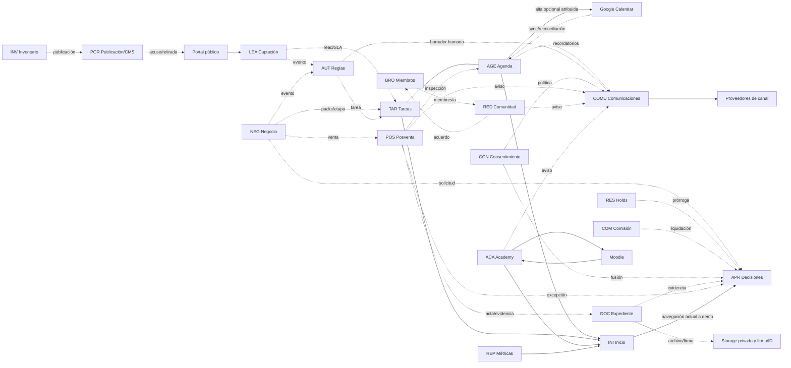

# Operaciones, experiencia e integraciones — análisis documental para Archify

6 de noviembre de 2026 · Productor real `codex-operaciones-documental` bajo D01, con lectura de experiencia D04 e interfaces D19. Integración root y revisión independiente Luna pendientes. Se analizaron completos **11 de 11 markdown** asignados, sin ejecutar instrucciones incluidas en ellos. Este paquete conserva capacidades actuales atribuidas y **todo el alcance futuro descrito**; no hereda el recorte del MVP anterior ni lo amplía como compromiso aceptado.

Cada fuente es un borrador v0.1. «Real/actual/cerrado en código» significa afirmación de lectura estática de la fuente sobre `capturas-wt/base@81ccf08`, no comprobación de esta sesión ni operación productiva. Checks marcados y «ADR ACEPTADO» no aprueban alcance, arquitectura, C1 o despliegue actual. No se consultaron credenciales, proveedores, datos personales ni aplicaciones; no se emitieron mensajes ni se construyó producto. Las referencias legales se atribuyen a los documentos y quedan para validación especializada.

El archivo hermano `grupo-operaciones.json` contiene 11 módulos, 37 grupos de entidades, 122 relaciones dirigidas (77 relaciones documentales agrupadas descompuestas por par), 11 decisiones abiertas y 16 preguntas. Cada relación conserva fuente, líneas y estado; los pares extraídos de un grupo no prueban integraciones independientes ni contratos ya implementados. Los documentos originales son la fuente, las notas son análisis y el JSON sirve para el mapa Archify.

## Inventario de lectura y trazabilidad

Las rutas fuente son relativas a `00-fuentes-drive/2026-11-06/originales/modulos/`. Los SHA256 completos están en cada nota y JSON, obtenidos sobre los bytes descargados; no se reconstruyeron desde PDFs. Los PDFs no se consideran contrastados en esta tarea.

| Código | Fuente leída completa | Líneas | Nota individual |
|---|---|---|---|
| AGE | VT-CRM-ESP-AGE_Agenda_v0.1_2026-11-06.md | 1–272 | individuales/AGE.md |
| TAR | VT-CRM-ESP-TAR_Tareas_v0.1_2026-11-06.md | 1–271 | individuales/TAR.md |
| COMU | VT-CRM-ESP-COMU_Comunicaciones_v0.1_2026-11-06.md | 1–276 | individuales/COMU.md |
| AUT | VT-CRM-ESP-AUT_Automatizaciones_v0.1_2026-11-06.md | 1–275 | individuales/AUT.md |
| APR | VT-CRM-ESP-APR_Aprobaciones_v0.1_2026-11-06.md | 1–245 | individuales/APR.md |
| DOC | VT-CRM-ESP-DOC_Documentos_v0.1_2026-11-06.md | 1–258 | individuales/DOC.md |
| POR | VT-CRM-ESP-POR_Portal_v0.1_2026-11-06.md | 1–258 | individuales/POR.md |
| POS | VT-CRM-ESP-POS_Posventa_v0.1_2026-11-06.md | 1–278 | individuales/POS.md |
| RED | VT-CRM-ESP-RED_Comunidad_v0.1_2026-11-06.md | 1–268 | individuales/RED.md |
| ACA | VT-CRM-ESP-ACA_Academy_v0.1_2026-11-06.md | 1–303 | individuales/ACA.md |
| INI | VT-CRM-ESP-INI_Inicio_v0.1_2026-11-06.md | 1–283 | individuales/INI.md |

Cada referencia `COD:línea` siguiente apunta al archivo de esa fila. Las referencias cruzadas a otros módulos expresan lo declarado por estos once originales; no sustituyen la lectura de sus especificaciones por los agentes asignados.

## Cobertura funcional completa

| Módulo | Presente según fuente, sin ratificar runtime | Capacidades futuras que debe mostrar el sistema completo |
|---|---|---|
| AGE | calendario semana/día/lista/responsable y mes; CRUD/reprogramación; resultado en texto; ICS; creación Google opcional | resultado/asistencia/siguiente paso estructurados; salas y recursos; choques servidor; visitas/viajes reales; recordatorios 24h/1h y confirmación; sync Google durable/bidireccional; CalendarPort Twenty |
| TAR | cola/tablero/broker; CRUD/completar/reabrir/cancelar/baja; packs 1–20; checklist/playbooks | evidencia íntegra; catálogo/versión de packs y disparo por etapa; recurrencia; SLA/escalamiento; carga team/paginación; próxima acción recalculada; task port/sync |
| COMU | plantillas variables/canal/desactivación; despacho/audit; canal; actividad 30 días; WA inbound captura lead | bandeja WA/IG e historial lead; conversaciones/mensajes/delivery/read/error/bounce; campañas/segmentación; consentimiento/opt-out por canal/finalidad; frecuencia/longitud; puerto único; archivo seguro plantillas |
| AUT | constructor en memoria, zod, monitor outbox real y copiloto ejemplo | reglas/versiones/runs persistidos; activar/pausar/reanudar; idempotencia; pausa global; retry admin; permiso por acción; IA supervisada; cuatro disparadores y acciones descritas |
| APR | shell demo, tabla financiera con hash/MFA/vencimiento, enlace INI | descuentos/prórrogas hold/liquidaciones/fusión; política tipo/monto; solicitud/asignación/decisión/expiración/invalidación; cuatro ojos/MFA; efecto recuperable y SLA |
| DOC | tres previews Documentos/Firmas/KYC y validación metadatos sin upload | storage privado/scan/cuarentena; versiones SHA256; permisos propios y URL firmada; firma/identidad/sellos/orden; KYC/listas/PEP/retención; actas POS y expediente POR |
| POR | cinco previews editor/publicación/catálogo/comprador/promotor; captura LEA externa | CMS/versiones/aprobación; publicar/retirar/acuse por canal; material/vigencia; filtros públicos; SEO/OG/canonical/sitemap/ES-EN; evidencia captación; protección broker; identidad externa own como hipótesis |
| POS | cuatro previews entregas/pendientes/casos/garantías, reglas solo texto | inspección/agenda; observaciones/plazos/fotos; acta; casos/SLA/reapertura; garantías versionadas/vigencia/excepciones; confirmación cliente; cierre verificado; cargo excepcional APR+consentimiento; seguimiento externo |
| RED | cuatro previews grupos/demandas/eventos/moderación | membresía/material/posts/comments; demandas anonimizadas; interés/acuerdo sin revelar contacto; cupos/inscripción; reportes/moderación/apelación independiente; avisos y reputación verificable candidata |
| ACA | adapter Moodle y cursos/matrícula/progreso; revisión/constancia/revocación; vigencia/rutas/equipo/deep-link | contenidos/prod comprobados; SSO; vigencia por curso; avisos COMU; posible gating onboarding/metas/comisiones por decisión del negocio |
| INI | KPI/cola/embudo REP/filtros/enlaces con scopes; meta y academy del actor | Mi día vencidas+citas+SLA; aprobaciones operativas; selector visible; comparativa anterior; metas equipo/proyecto; layout por rol; widgets de lectura con fuente/freshness |

Fuentes de cobertura: AGE:40–74,217–249; TAR:40–79,220–248; COMU:40–77,225–257; AUT:43–81,224–256; APR:41–73,200–226; DOC:41–75,212–239; POR:41–76,210–239; POS:43–79,228–259; RED:43–78,221–249; ACA:40–84,247–284; INI:40–73,230–259.

«Núcleo» y «Add-on» son clasificación de las fuentes; la prioridad baja de POS/RED no significa riesgo bajo al activarlos. Una demo no es un módulo operable. En el mapa futuro se representan como capacidades propuestas con dependencias, no como excluidas.

## Responsabilidades y entidades

| Frontera | Autoridad propuesta/atribuida | Precisión para arquitectura |
|---|---|---|
| Actividades AGE/TAR | tabla activities QH actual atribuida, reglas inmobiliarias QH | entidad compartida no permite mezclar task/cita/visita; SoT física futura Twenty/QH por decidir |
| COMU | dominio plantillas/consentimientos/historial; proveedor transporta | canal configured o id enviado no equivale a entrega/lectura; Twenty no es SoT |
| AUT | QH reglas/versiones/runs objetivo | outbox es infraestructura, no motor ni fuente de reglas |
| APR | QH solicitud/política/decisión | agregado negocio/hold/comisión/contacto conserva efecto; tabla financiera no acredita aprobación genérica |
| DOC | QH metadatos/versiones/retención; storage bytes; firma/ID externos | KYC no hereda deals:view; inmutabilidad de versión y autorización de descarga separadas |
| POR | fuente propone INV catálogo y QH editorial/publicación | contrastar portal existente y autoridad por campo; área externa es otra identidad/superficie |
| POS | QH casos/inspección/pendientes/garantías | unidad INV y venta NEG son referencias; entregar no equivale a vender/transferir jurídicamente |
| RED | QH grupos/posts/demandas/moderación | BRO membresía/co-broke económico; interés no libera contacto ni prioridad de reserva |
| ACA | Moodle cursos/contenido/matrículas/progreso/notas; QH revisión/constancia/vínculos | hash de constancia y aprobación no convierten CRM en LMS; progreso local y LMS deben distinguirse |
| INI | proyecciones de módulos, sin entidad operativa propia | cada tarjeta necesita definición/periodo/moneda/scope/fuente/freshness; no nuevo dueño de datos |

Entidades detalladas en notas/JSON: Activity, cuentas/calendarios/mapeo externo y recurso/resultado visita; packs/recurrencias/evidencia e idempotencia HTTP; plantillas/canal/cuentas/inbox/outbox/delivery/conversación/campaña/consentimiento; AutomationRule/Run; ApprovalPolicy/Request/Case; Document/Version/Envelope/Signer/KycCase; PortalPage/Publication/Seo/Access; Inspection/DeliveryIssue/HandoverAct/AfterSalesCase/Warranty; Group/Member/Post/Comment/Demand/Interest/Event/Registration/Report/Moderation; MoodleCourse/Enrolment/Progress, ExternalRef, Review/Certificate y DashboardProjection. El JSON agrupa entidades relacionadas para lectura, no prescribe 37 tablas.

## Comunicación entre módulos y sistemas

Diagrama de dependencias/recorridos objetivo; las aristas punteadas son propuestas. La situación concreta de cada interacción se consulta en JSON, no se deduce del dibujo.

Los cruces ACC y CFG atraviesan todo el dibujo: autenticación/autorización por operación/registro/campo, scopes own/team/all/none, ver-como, configuración y secretos. Twenty aparece únicamente como candidato de surface/adaptador genérico en AGE/TAR/INI; fuentes niegan que sea SoT de COMU/AUT/APR/DOC/POR/POS/RED/ACA. No hay integración Twenty acreditada por estos documentos.

Recorridos completos que deben figurar en el mapa maestro:

1. Consulta portal/WhatsApp → captura LEA → contacto/evidencia de finalidad → asignación BRO → tarea SLA TAR → cita AGE → resultado/siguiente acción NEG → INI/REP. El schema lead_id no basta si el input genérico de tarea/agenda no lo transporta.
2. Negocio cambia etapa → pack versionado TAR y próxima acción; AUT recibe evento y crea una sola acción autorizada. WhatsApp según fuente AUT permanece borrador para humano; no automatizar silenciosamente sin política.
3. Visita CRM guardada → Google opcional; fallo Google deja cita y aviso parcial. Editar/cancelar/sync entrante requiere vínculo externo durable; ICS export es otro contrato, no ese vínculo.
4. Inventario/editorial → revisión → PortalPublisher → canal/sitio → acuse/versión pública/retiro. Falla un canal deja parcial visible; CFG SEO e isPublished no acreditan publicación. Captación retorna con IDs estables y evidencia, no por nombre de proyecto.
5. Descuento/hold/liquidación/fusión → solicitud APR con política/hash/version/expiry → aprobador distinto y step-up cuando corresponda → decisión → efecto del dueño → recuperación/audit. DOC aporta evidencia autorizada; INI solo enlace/contador.
6. Negocio/contacto → DOC upload/scan/versión inmutable → firma/identidad → KYC separado/retención → expediente externo solo autorizado. La disponibilidad de archivo/firma no se infiere de validar metadatos.
7. Venta/unidad → inspección POS/AGE → pendientes DOC privados → subsanación → acta firmada → cierre de entrega sin críticos. Casos/garantía siguen vivos aunque unidad se marque entregada; cobro fuera cobertura necesita APR y consentimiento, no se convierte en pago automáticamente.
8. Broker acreditado → grupo RED → demanda anonimizada → interés sin PII → acuerdo BRO → acceso mínimo → cooperación. Reporte→moderación→apelación otro actor; inscripción evento→cupo→COMU con política vigente.
9. Usuario BRO → matrícula Moodle con ExternalRef → progreso/evidencia → solicitud ACA → revisor distinto → constancia/hash/revocación/vigencia → widget INI. Gating de onboarding/MET/COM queda decisión explícita, no acoplamiento automático.

## Hallazgos que cambian decisiones de arquitectura

| ID | Conflicto o vacío observado en fuentes | Tratamiento propuesto, sin aceptación |
|---|---|---|
| OPS-D01 | POR declara sitio .com y catálogo INV; inventario local anterior usa portal separado/dominio .tech y autoridad editorial inicial portal | confirmar dominio/repositorio/operador; distinguir estado actual y objetivo; decidir por campo/unidad/proyecto |
| OPS-D02 | «ADR ACEPTADO Twenty» coexiste con sync no acreditado y SoT genérica pendiente | atribuir aceptación histórica; diseñar contratos/mapeo/roles y probar antes de adoptar |
| OPS-D03 | AUT WA siempre borrador humano vs AGE recordatorios automáticos | precisar aprobación por envío, plantilla o regla, con opt-out/finalidad y política de ventana |
| OPS-D04 | APR quiere descuentos/holds/fusiones pero tabla batch XOR entry financiera; «transacción» y «parcial si falla efecto» ambiguos | aprobación tipada/versionada y operación de efecto durable/atómica según frontera; proveedor MFA antes de habilitar importes |
| OPS-D05 | Comprador/promotor POR solo hipótesis; RED miembros/co-broke no equivalen a multiempresa | identidades/superficies separadas, alcance y minimización claros; no crear SaaS por inferencia |
| OPS-D06 | DOC no tiene storage, TAR promete enlace seguro; POS depende de acta/foto/firma | elevar dependencia real; permisos sensibles, retención y asesoría antes de activar flujos |
| OPS-D07 | TAR description mezcla plantilla/resultado y PATCH parcial, next_action obsoleta; AGE no-show/cancelled y fecha/ICS divergentes | evidencias/resultados tipados, invariantes por estado efectivo y tiempo canónico; no borrar historia |
| OPS-D08 | COMU dos adaptadores y simulación; consent_at/OAuth no son evidencia de finalidad | un puerto de runtime, estado unknown/reconciliación, delivery, evidencia/opt-out por canal/finalidad |
| OPS-D09 | INI team∩team→own; meta actor, progreso local y conversión no cohorte | acordar scope y métricas canónicas, freshness/error; no elevar permisos ni fabricar cifras |
| OPS-D10 | DOC/POS/RED/POR usan guards de otros recursos; manager team asignación exige all | permisos específicos y rutas/casos de uso autorizados; no all como parche |
| OPS-D11 | Add-ons visibles como demos y prioridades históricas heterogéneas | mapa futuro completo con estado propuesto; producto activo solo tras criterios/aceptación, sin falsa operación |

Fuentes específicas: AGE:76,102–125,139–150,181–199; TAR:109,119–124,180–197; COMU:26,131–164,197–225; AUT:102,191–199; APR:117,194,200–210; DOC:35,52–60,212–250; POR:32–39,131–149,245–250; POS:192–226,267–269; RED:185–219,257–259; ACA:151–158,247–295; INI:115–121,161–170,255–259. El conflicto .tech procede del inventario local anterior, no se afirma que POR haya verificado ese dominio.

## Reglas transversales y escenarios a verificar

- **No perder ni duplicar efectos:** clave estable de negocio, versión/payload/recibo y reintento; outbox/inbox/claim/lease según frontera. Doble evento no duplica task/pack/inscripción/enrol/envío/publicación/decisión. Timeout externo significa resultado desconocido hasta conciliar, no fallo confirmado que habilita repetir.
- **Concurrencia:** slot/recursos, cupo evento, aprobación terminal, versión de documento/regla/publicación y vencimiento deben validarse en servidor. Aviso sobre citas visibles no prueba disponibilidad global.
- **Separar estados:** guardado/borrador/aprobado/público; recibido/procesado/entregado/leído; local/externo confirmado; completado/cancelado/no-show; entregado/cierre comercial/transferencia. Estado UI no sustituye estado de negocio.
- **No heredar permisos por proximidad:** ver dashboard no decide finanzas; ver negocio no ve KYC; ver propiedad no cierra posventa; ver broker no modera; OAuth de actor no autoriza cuenta del asignado; enlace externo no da identidad ni export.
- **Datos personales:** mínimo dato en logs/audit/WA.me/ICS y notificaciones; no cuerpos completos/identificadores en índice visual. URL firmada corta, hash y cifrado no reemplazan autorización, finalidad o retención. Revocación/opt-out mientras hay cola se revisan al ejecutar.
- **Experiencia completa:** inicial/carga/vacío/parcial/error/offline/éxito/sin permiso; conflicto/cancelación donde aplique. Conservar formularios; no ceros ficticios ni folios simulados. Alternativas teclado al arrastre, navegación móvil, alcance por tarjeta y origen/último éxito visibles.
- **Dependencia caída:** Google no borra cita; Moodle conserva constancias/solicitudes; fallo canal no convierte todo en éxito/fallo global; storage/scan no produce versión descargable; proveedor firma no cierra expediente; panel fallido no tumba INI entero.

Estas son derivaciones de análisis para diseño/QA, no resultados de pruebas. Umbrales SLA, frecuencia, retención, periodos legales y capacidad se acuerdan con dueños; no se inventan cifras por analogía.

## Preguntas para continuar sin repetir lectura

Los IDs OPS-Q01–16 del JSON enlazan pregunta, fuente/líneas, dueño y puerta propuesta. Primero resolver autoridad portal/unidad/dominio y SoT Twenty, política de publicación/consentimiento/WA, permisos team y decisiones financieras. Antes del diseño cerrado resolver recursos/resultados/fechas de actividad y las métricas INI/REP. Para DOC/POS/RED/ACA, fijar alcance completo, gobierno, identidades y dependencias como decisiones separadas. No cerrar ninguna pregunta por inferirla de un checkbox histórico.

Para integrar Archify: usar los códigos exactos (COMU Comunicaciones, COM Comisiones; fuente COMU usa inventario CRM-COM y debe desambiguarse), conservar `source/status` por módulo/relación, separar diagrama actual atribuido y objetivo completo, y marcar dependencias externas sin afirmar conexión. El revisor independiente debe cotejar estas notas contra los originales, especialmente políticas de autoridad, consentimiento, finanzas y alcance futuro; ningún productor aprueba su extracción.

Verificación mecánica de entrega: JSON parseado correctamente; 11/11 SHA256 coinciden con originales y 11/11 conteos de líneas corresponden; existen las once notas; 122 IDs de relación únicos. Esta validación acredita integridad/estructura del paquete, no implementación ni exactitud independiente de su interpretación. OPS-D03/OPS-Q07 conservan el conflicto AUT/AGE; OPS-D09/OPS-Q15 conservan la discrepancia de fuente Academy/Inicio.

## Addendum — control acotado tras pasada de espaciado

2026-11-06 · mismo productor `codex-operaciones-documental`; actividad `HOST-03c7f51c15ae468ea2506e6eea98d9cf`. D00 informó de una pasada del agente comercial sobre `individuales/*.md`, con posible alcance sobre notas de este grupo. Se solicitó al agente la lista exacta de sustituciones y archivos afectados; su declaración se añadirá cuando esté disponible. La advertencia no implicaba cambio de fuentes.

Se releen **solo las once notas de este grupo** para comprobar alteraciones materiales frente a la lectura anterior, los originales referenciados y `grupo-operaciones.json`; no se reabre investigación ni se ejecuta producto. No se dispone en esta comprobación de hashes previos de las notas anteriores a esa pasada, por lo que **no se certifica igualdad de bytes**. Sí se comprobó lo siguiente:

- Los once originales conservan sus SHA256 del JSON; las once cabeceras de notas conservan el nombre y SHA256 de su fuente correcta.
- Las once notas decodifican con UTF-8 estricto y ninguna contiene el carácter de sustitución U+FFFD; no se observó corrupción de tildes, flechas o símbolos en la lectura.
- Se conservan funciones futuras, roles/alcances, entidades, estados, interfaces actuales frente a propuestas, autoridad de datos y negaciones críticas: demo no operativo, borrador no aceptado, Twenty no SoT específico, no KYC por deals:view y no ampliación team a all.
- Permanecen los conflictos AUT/AGE (revisión humana frente a recordatorio automático), ACA/INI (LMS frente a progreso local), autoridad/dominio POR, tabla APR y estado efectivo/evidencia TAR. El JSON mantiene OPS-D03/D09/D10 abiertos y cada módulo en `draft_analysis`.
- **No se detectaron alteraciones materiales** que requieran corregir las once notas. No se editaron notas, JSON ni fuentes durante esta comprobación; solo se añade este registro al resumen del productor. Luna conserva su revisión independiente y no se aprueba ningún gate/arquitectura.

SHA256 del JSON cotejado: `5921EE494B22688CB5E5FA5741CA6BAA09347FD60CA190FFC6C8F673306BB10E`.

| Nota actual | SHA256 al comprobar |
|---|---|
| individuales/AGE.md | `E479A7D5E315BB3B09AA78D4FFE5EF83702E0D99E133991A636A81B105655711` |
| individuales/TAR.md | `B6BF791A193469140D959B61D11065A859C01967A58710D2E577B4B7A23259F4` |
| individuales/COMU.md | `F0432AF9FA8801FCD237D1A98F20BB8D9F14332223D1F892B3A3E871D4D7D0B2` |
| individuales/AUT.md | `2AEFD8A65D548A77326C7C864D222DC392D469043802A2727F8CDD542C9A4D8A` |
| individuales/APR.md | `11180BB576C568FAB08D89DEAE493C9678BEA5DC2BDBB0D968AD2D75B5F5A28D` |
| individuales/DOC.md | `A23DA65762874A6C17E7D5FB65EF40ED19F6BB788C18898D4DA9FFEC73FCE037` |
| individuales/POR.md | `11DC6F37E67ABD9030B6CD51F2878DEB39A7E39094A9025069FDBCF009F0063F` |
| individuales/POS.md | `A51FB1C74E7A12E5857DBF4F361826473C6FCE5729563F085A31090E1E9BBAD3` |
| individuales/RED.md | `0613E96DF215083501A21CB4C3A38A81C615E8844F223832439A43A6EE09C957` |
| individuales/ACA.md | `E9C7FED6F346FFA780D4EDFF7E2A320123E54C9AFD8F2500992A9688C565F0E3` |
| individuales/INI.md | `03B24B000C0EEE1687ABD10FE5AA1356742AA9C6FEC2D8B0AD069E938369ECF8` |
