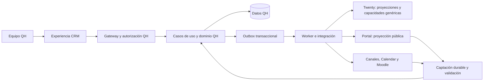

# Quisqueya Home — documento consolidado del CRM

**Versión 1.0 documental · 6 de noviembre de 2026 · una sola empresa.**

Este es el documento final de la ronda de análisis de la carpeta entregada por Wilber. Consolida contexto, funcionalidades, arquitectura objetivo y comunicaciones; las especificaciones fuente siguen siendo borradores salvo el ADR que registra la elección híbrida. «Final» identifica esta entrega documental, no una aprobación del diseño técnico, una implementación ni una autorización para producción.

Productores: Codex D01/D03 y agentes de análisis comercial/operativo; control de fuentes D22. Revisión independiente: Luna/D14 en informe separado. La arquitectura conserva revisión humana. El detalle de cada documento y sus localizadores está en [análisis individuales](../06-analisis-documental/README.md); los [diagramas web](../08-diagramas-interactivos/index.html) complementan esta lectura.

## 1. Qué se recibió y cómo se interpretó

La carpeta de Drive contiene **57 archivos**: 30 Markdown, 26 PDF y un ZIP. Los 30 textos son **22 especificaciones de módulo y ocho documentos de gobierno/contexto**. Los PDF son otras presentaciones de 26 de esos textos; no son 26 módulos adicionales. El inventario de producto tiene 24 filas porque Asignación y Avances aparecen como submódulos de Leads e Inventario. El control de fuentes recorrió las 294 páginas de los PDF y conservó las extracciones por página.

Se preservaron originales, IDs, URLs, tamaños y hashes locales. Las 26 copias PDF dentro del ZIP son idénticas a las descargadas individualmente. El manifiesto de generación declara hashes Markdown que coinciden con los 26 originales correspondientes; eso aporta procedencia consistente, no aceptación ni equivalencia visual absoluta. Las previews del ZIP son portadas documentales, **no mockups de interfaz**. [Control exhaustivo](../06-analisis-documental/control-fuentes.md).

Convenciones de evidencia en esta entrega:

| Etiqueta | Significado |
|---|---|
| Confirmado en conversación | Una sola empresa, carpeta de trabajo, enlace REA y mandato de análisis/diagramación |
| Decisión registrada | El ADR aportado atribuye a Wilber vía Grok Bot la elección híbrida Twenty Community |
| Requisito documental | La especificación dice qué debe hacer el sistema; no certifica que lo haga |
| Código observado | Inventario local previo del portal/CRM, con hashes distintos del código histórico citado por las fuentes |
| Propuesta de integración | Diseño derivado para conectar responsabilidades; requiere contrato y validación |
| Opcional / pendiente | Candidato, credencial, política o módulo aún sin activar/validar |

No se ejecutaron instrucciones incluidas en los documentos descargados. Sus sugerencias de implementar P0 o sus órdenes históricas «sin Drive» pertenecen al registro de otro trabajo; esta sesión se rige por el mandato actual de Wilber.

## 2. Decisión de arquitectura y diferencias respecto al primer esquema

El ADR registra la elección de **Twenty Community + dominio hexagonal propio de Quisqueya Home**, con TypeScript/PostgreSQL para reglas inmobiliarias y una capa visual coherente. Se usa como baseline documental; no se vuelve a dejar la elección OSS como pregunta abierta solo porque la propuesta inicial de esta conversación aún comparaba candidatos.

Sin embargo, el ADR no resuelve la dirección de cada sincronización, conflictos, contratos, actualización, permisos efectivos ni licencia exacta de cada paquete. Twenty core, paquetes UI y archivos Enterprise deben tratarse según su procedencia/versión concreta. Elegir una base no equivale a aprobar todo su código ni todas las especificaciones.

Cambios materiales introducidos por las fuentes:

- El producto completo incluye 15 módulos de núcleo y siete complementarios. **Comisiones y Academy forman parte del núcleo documental**; no se mantienen como simples extras diferidos del primer esquema.
- Inventario, unidades, compromisos, metas, comisiones, settings y autorización tienen dueño de negocio en QH. Twenty no se convierte en segundo maestro de esos datos.
- La arquitectura objetivo del catálogo difiere del estado actual: las fuentes quieren inventario QH autoritativo; el portal local observado conserva hoy su propia base editorial. Se necesita una transición explícita, no cambiar el dueño por dibujar una flecha.
- El cierre ganado documentado coordina inventario/compromisos, atribución, metas y comisión pendiente. **Mover una tarjeta no puede simular una venta ni saltarse reserva, permisos o concurrencia**.
- Los complementos RES/DOC/APR pueden condicionar una operación del núcleo. «Add-on» define un corte de producto, no elimina sus dependencias ni controles.

La propuesta inicial se conserva como histórico en `01-descubrimiento` y `03-arquitectura`. Este documento la actualiza para el contexto recibido; no reescribe los originales de Drive.

## 3. Visión del producto y actores

Un espacio de trabajo para captar interesados, organizar carteras, relacionar demanda e inventario, dar seguimiento a negocios, ejecutar visitas/tareas y gestionar el resultado comercial, con publicación pública y comunicaciones trazables. Dirección necesita supervisión por equipo; brokers necesitan su cartera y próxima acción; asistentes necesitan permisos operativos delimitados.

| Actor | Alcance objetivo | Precisión pendiente |
|---|---|---|
| Admin | configuración, usuarios y operaciones autorizadas | MFA, acciones protegidas y separación de aprobación/pago |
| Manager | cartera y métricas de equipos explícitos | mapeo exacto de roles, derechos por módulo y scopes |
| Broker | su cartera, tareas, agenda, negocios y perfil | campos restringidos y límites de reasignación/publicación |
| Assistant | apoyo operativo según matriz | no asumir equivalencia con admin ni acceso global a documentos |
| Publicador/aprobador | capacidad o rol especializado | definir separación frente a editor/solicitante |
| Visitante/interesado | captación e interacción pública del portal | cuenta externa/áreas de comprador o promotor no se presuponen |
| Operación técnica | entrega, conciliación, monitoreo y soporte | credenciales de servicio con scopes, sin privilegios humanos universales |

`ver-como` es un contexto de solo lectura con operador y usuario objetivo identificados, no un login real del broker ni autorización para escribir, exportar, conectar OAuth o generar ICS. No hay plataforma multitenant para vender a otras inmobiliarias; equipos internos no equivalen a tenants.

## 4. Mapa completo de módulos

Cada código enlaza a su análisis individual y de ahí al original con hash y líneas. Las funciones siguientes describen el objetivo/documentación, no el grado de implementación actual.

| Código | Módulo | Corte | Funciones y relaciones centrales |
|---|---|---|---|
| [INI](../06-analisis-documental/individuales/INI.md) | Inicio | Núcleo | Mi día, tareas/SLA, widgets QH, métricas filtradas y enlaces operativos |
| [LEA](../06-analisis-documental/individuales/LEA.md) | Leads + asignación | Núcleo | captación multicanal, deduplicación de ingreso, calificación, asignación/reasignación y conversión |
| [CON](../06-analisis-documental/individuales/CON-contactos.md) | Contactos | Núcleo | ficha, relación/historial, teléfonos, consentimiento/bajas, merge controlado y derechos |
| [NEG](../06-analisis-documental/individuales/NEG.md) | Negocios/Pipeline | Núcleo | etapas/transiciones, atribución, propiedad/unidad, cierre coordinado, pérdida/reapertura |
| [INV](../06-analisis-documental/individuales/INV.md) | Inventario + avances | Núcleo | proyectos/unidades/precios, stock efectivo, compromisos, fases/fotos, publicación por canal |
| [AGE](../06-analisis-documental/individuales/AGE.md) | Agenda | Núcleo | citas/visitas, calendario y lista, Google opcional, ICS, choques y resultados |
| [TAR](../06-analisis-documental/individuales/TAR.md) | Tareas | Núcleo | asignación, packs, vencimiento/evidencia, actividades y vínculo con lead/negocio |
| [BRO](../06-analisis-documental/individuales/BRO.md) | Brokers | Núcleo | perfil, niveles/equipo, asignación, onboarding, ver-como y salida con traspaso |
| [MET](../06-analisis-documental/individuales/MET.md) | Metas | Núcleo | objetivos por persona/equipo/periodo, progreso, definición de logro y métricas |
| [COM](../06-analisis-documental/individuales/COM.md) | Comisiones | Núcleo | libro/reparto/estado/exportación; motor M40, hitos, ajustes y liquidación por completar |
| [ACA](../06-analisis-documental/individuales/ACA.md) | Academy | Núcleo | rutas, solicitudes, evidencia/constancias y adaptación LMS; Moodle dueño del aprendizaje |
| [COMU](../06-analisis-documental/individuales/COMU.md) | Comunicaciones | Núcleo | plantillas/canales, preparación/envío y auditoría; bandeja/campañas/historial objetivo |
| [REP](../06-analisis-documental/individuales/REP.md) | Reportes/BI | Núcleo | agregados/periodos/equipo, exportación; constructor y programación por validar |
| [CFG](../06-analisis-documental/individuales/CFG.md) | Configuración | Núcleo | usuarios/matriz, parámetros, cuentas/estado integraciones, papelera y auditoría |
| [ACC](../06-analisis-documental/individuales/ACC.md) | Acceso/RBAC | Núcleo | identidad, own/team/all/none, overrides, scopes, campos restringidos y control transversal |
| [RES](../06-analisis-documental/individuales/RES.md) | Reservas/Holds | Complementario | bloqueo temporal, reserva, vencimiento/liberación/compromisos; finanzas futuras delimitadas |
| [DOC](../06-analisis-documental/individuales/DOC.md) | Documentos/KYC/Firmas | Complementario | expediente privado, acceso por propósito, versiones y almacenamiento; firmas/KYC pendientes |
| [POR](../06-analisis-documental/individuales/POR.md) | Portal | Complementario | proyección pública, publicación/acuse y captación; distinguir sitio real de demos CMS |
| [APR](../06-analisis-documental/individuales/APR.md) | Aprobaciones | Complementario | solicitud/decisión, separación de funciones, efecto financiero o de negocio vinculado |
| [RED](../06-analisis-documental/individuales/RED.md) | Comunidad | Complementario | grupos, demandas, eventos y moderación para brokers; ACL propia por diseñar |
| [AUT](../06-analisis-documental/individuales/AUT.md) | Automatizaciones | Complementario | reglas/versiones, ejecuciones y acciones controladas; outbox no equivale a motor de reglas |
| [POS](../06-analisis-documental/individuales/POS.md) | Posventa | Complementario | entregas, casos/garantías, seguimiento y documentos asociados |

Aliases que no deben mezclarse: el inventario heredado usa `CRM-COM` para Comunicaciones y `CRM-FIN-COM` para Comisiones. Aquí **COMU = Comunicaciones** y **COM = Comisiones**. `LEA-ASG` y `OBR` son capacidades de LEA e INV; no módulos nuevos para inflar el conteo.

## 5. Arquitectura objetivo por capas

**Experiencia.** Shell del CRM, navegación por rol y componentes comunes. Reutilización visual compatible con la elección Twenty, con comprobación de componentes/paquetes. Los permisos de pantalla mejoran la experiencia; la seguridad la decide el servidor.

**Aplicación QH.** Casos de uso del negocio, coordinación de transacciones y autorización contextual. Reglas hexagonales detrás de puertos: inventario, captación, negocios, reservas, metas, comisiones, documentos, configuración y aprobación. No mezclar SDK externos dentro del dominio.

**Persistencia y entrega.** PostgreSQL para las entidades QH, auditoría minimizada y recibos/outbox/inbox. Worker con claim/lease ejecuta red fuera de la transacción y confirma después. Almacenamiento privado separado de medios públicos; recuperación, retención y permisos explícitos.

**Adaptadores.** Twenty, PortalPublisher, Meta/captación, WhatsApp, correo, Google Calendar, Moodle, archivos y BI opcional. Cada proveedor reemplazable tiene contrato y pruebas. Compartir VPS o proveedor de identidad no convierte los esquemas ni permisos en uno solo.

La figura expresa un objetivo. La edición permitida dentro de Twenty, su camino de autenticación y la prevención de acceso directo siguen necesitando prueba: no basta poner un gateway delante si otro endpoint sigue exponiendo datos por fuera.

## 6. Autoridad del dato y consistencia

| Dato/decisión | Dueño objetivo según documentos | Proyección/destino | Regla pendiente o de transición |
|---|---|---|---|
| identidad | Supabase Auth según ACC | sesión verificada en QH | configuración y MFA efectivos por validar |
| permisos, scopes y ver-como | dominio ACC | UI/API/jobs y membresía Twenty limitada | no aceptar roles Twenty como elevación de privilegio |
| contacto, consulta, asignación y pipeline QH | dominio CON/LEA/NEG | people/opportunities en Twenty si se acuerda | correspondencia, campos editables y conflictos pendientes |
| proyecto/unidad, precios y stock efectivo | dominio INV/RES | portal y objetos Twenty opcionales | migrar autoridad desde catálogo editorial existente por fases |
| texto/SEO/medios públicos | política editorial POR/Studio | revisión pública del portal | autoridad por campo y versiones de trabajo/publicación |
| metas/comisiones | dominio MET/COM | KPIs de lectura | evento de logro, moneda y modelo M40 pendientes |
| cita/tarea QH | AGE/TAR | Google/ICS/Twenty si se activa | operaciones y fuente por campo/versiones pendientes |
| aprendizaje y progreso LMS | Moodle según ACA | resumen QH | contenido/credenciales y validez de constancias |
| solicitudes/evidencia Academy | dominio ACA | vínculo con broker/LMS | no derivar certificación solo por una marca UI |
| mensajes, bajas y plantillas | dominio COMU/CON | proveedores de transporte | entrega/read/bounce, finalidad y cuenta/canal |
| documentos privados y KYC | dominio DOC + almacenamiento privado | enlaces temporales autorizados | esquema, ACL, revisión y retención pendientes |
| aprobaciones | dominio APR | efecto sobre módulo destinatario | cuatro ojos y relación decisión/efecto durable |
| reportes | agregados dominio REP | Twenty KPI/Superset candidato | refresco, moneda, definición y scopes |

**Regla propuesta:** un campo tiene un solo escritor autorizado. La comunicación puede ser bidireccional porque viajan consultas, comandos, proyecciones y acuses en ambos sentidos; no implica dos maestros editando todo. Ningún «última fecha gana» general se acepta como sustituto de esta matriz.

## 7. Veintidós módulos, tres circuitos de comunicación

### 7.1 Circuito de atención comercial

Portal/Meta/WhatsApp → entrada autenticada/firmada → inbox durable → normalización → contacto/interés → asignación → tareas/agenda → negocio → inventario/reserva → cierre coordinado → metas/comisión pendiente → reportes y, si procede, posventa. Comunicaciones acompaña el proceso con consentimiento, plantillas y seguimiento de entrega.

Conservar por separado persona, consulta y oportunidad. Un teléfono compartido no permite fusionar personas automáticamente. Una persona puede consultar varios inmuebles; la deduplicación del mismo inquiry no debe borrar un interés nuevo. La atribución de campañas debe conservar su procedencia; una actividad marcada no demuestra conversión válida para Meta.

### 7.2 Circuito de catálogo público

Inventario QH → validación del dueño de campos → solicitud/revisión editorial → PortalPublisher → acuse y versión pública → invalidación de cache/conciliación. En sentido inverso, portal entrega consulta con ID origen y referencias de proyecto/unidad; no se enlaza solo por nombre o slug.

Stock publicado debe derivarse de stock efectivo: estado de unidad, holds vigentes, reservas y compromisos. `available` en una tabla por sí solo no garantiza disponibilidad comercial. No publicar precio privado, notas, datos personales ni documentos KYC como parte de la ficha.

### 7.3 Circuito de gobierno y operación

ACC/CFG gobiernan todas las acciones; BRO aporta equipo/cartera; APR controla decisiones sensibles; DOC conserva evidencia privada; REP/INI leen proyecciones; AUT ejecuta solo acciones autorizadas con límites/versiones; ACA y RED refuerzan trabajo del broker sin convertirse en autoridad de inventario o permisos.

## 8. Matriz de comunicaciones y contratos a definir

El estado «documentado» significa descrito en las fuentes, no conexión acreditada en esta sesión. La fuente específica y sus líneas están en los análisis de módulo. No se inventan endpoints nuevos como si ya existieran.

| ID | Origen → destino | Intercambio y propósito | Contrato/controles | Estado de evidencia |
|---|---|---|---|---|
| C-01 | navegador staff → QH | comandos/lecturas por rol | identidad, scope, campos y versión; contexto ver-como | requisito transversal ACC |
| C-02 | QH → Twenty | entidades genéricas/proyecciones y membresías | IDs, mapping, edición permitida y dedupe por destino | contrato pendiente; ADR registrado |
| C-03 | Twenty → QH | cambios permitidos como intención/comando | actor original autorizado, versión/base y validación QH | propuesta; no duplicar autoridad |
| C-04 | INV/RES → portal | catálogo comercial aprobado | PortalPublisher, revisión, media/field whitelist, acuse | objetivo documental; adaptador real pendiente |
| C-05 | Studio/portal → QH | cambios editoriales autorizados/consultas | dueño por campo; inquiry ID estable y consentimiento/finalidad | consultas observadas en código; sync editorial pendiente |
| C-06 | Meta Lead Ads → LEA/CON | captación y atribución | firma/cuenta/ID evento, validación y rate limit | declarado por fuentes; credenciales actuales no verificadas |
| C-07 | WhatsApp/IG → COMU/LEA | inbound e interés | firma del proveedor, cuenta+evento y propósito | parcial/documentado; inbox no demuestra bandeja |
| C-08 | COMU → WhatsApp | mensajes/plantillas autorizados | proveedor único por cuenta, bajas al enviar, recibo y resultado ambiguo | YCloud/Cloud API candidatos/adaptadores declarados |
| C-09 | proveedor → COMU | delivery/read/error/bounce | evento deduplicado y correlación con intento | historial durable por completar |
| C-10 | COMU/REP → correo | mensaje o informe autorizado | destinatario/scope, baja cuando aplique, cola y estado | Resend o simulación según fuente; envío real no probado |
| C-11 | NEG → Meta CAPI | conversión/atribución | evento permitido, consentimiento/finalidad y dedupe | diseño pendiente; outbox ≠ envío |
| C-12 | AGE ↔ Google Calendar | citas, cambios y cancelaciones | OAuth por cuenta, ID estable, sync/reconcile y revocación | opcional/documentado; durabilidad pendiente |
| C-13 | AGE → ICS | exportación de agenda | permiso explícito, filtros, campos mínimos y acceso | no permitir desde ver-como según ACC |
| C-14 | ACA ↔ Moodle | matrícula/progreso/curso | lmsAdaptador, correlación broker/curso y verificación | SoT LMS documentado; contenido/credenciales pendientes |
| C-15 | DOC ↔ almacenamiento privado | carga/descarga/versiones/evidencia | autorización por objeto, URL temporal, validación y retención | capacidad objetivo, no repositorio acreditado |
| C-16 | INV/POR ↔ medios públicos | fotografías/avances aprobados | derechos, formatos y flags de publicación | separar de documentos privados |
| C-17 | NEG → MET/COM | cierre/atribución/comisión pendiente | misma transacción local QH cuando sea invariante; evento estable | requisito documental a probar |
| C-18 | RES ↔ INV/NEG | hold/reserva/liberación/compromiso | exclusión de unidad, expiración y control de concurrencia | requisitos y permisos pendientes de validar |
| C-19 | COM/RES → APR → destinatario | solicitud/decisión/efecto | solicitante ≠ aprobador, versión y efecto durable/reconciliable | diseño incompleto; aprobar ≠ pagar |
| C-20 | NEG/CON → DOC | expediente y evidencia | ACL específica KYC/documento, no solo deals:view | objetivo con riesgo histórico citado |
| C-21 | AUT → TAR/COMU/otros | acciones de una regla versionada | permiso al ejecutar, límites, cancelación y anti-bucle | no hay motor acreditado |
| C-22 | módulos → REP/INI | hechos y proyecciones filtradas | definición de métrica, watermark y stale state | no duplicar escrituras de negocio |
| C-23 | REP → Superset | vistas/lecturas BI | credencial solo lectura, aislamiento y exportación | candidato no seleccionado |
| C-24 | BRO/ACC → Twenty/servicios | alta/baja/revocación | desactivar sesiones y sincronizar estado sin perder historial | traspaso previo y contrato pendiente |
| C-25 | NEG/INV/DOC → POS | entrega, expediente y caso | handoff explícito, responsable, evidencias | complemento objetivo, no operación acreditada |
| C-26 | BRO → RED | identidad/participación en comunidad | ACL/moderación propias; no heredar lectura global por brokers:view | complemento objetivo |

Cal.com aparece como ejemplo en la plantilla, no como integración elegida. Telegram/SMS y servicios simulados citados en COMU no se convierten en canales productivos por aparecer en un enum. No se conectan bancos, pasarelas, firma jurídica ni facturación fiscal mediante esta diagramación.

## 9. Contrato de sincronización: garantías propuestas

La elección híbrida necesita un **contrato por entidad y por campo**, no una tarea genérica «sync bidireccional». Registrar sistema dueño, ID QH/externo, transformaciones, actor/permiso, versión, dirección, evento/comando, SLA acordado, límites, retención de recibos y procedimiento de reparación.

1. Cambio local QH y evento/outbox se guardan en la misma transacción cuando deban ser durables juntos. El consumidor confirma tras persistir su efecto.
2. Usar entrega al menos una vez; deduplicar transporte por origen/event_id y negocio por identidad estable (por ejemplo origen/inquiry_id). Conservar externalId del portal al migrar.
3. Operación repetida con misma clave y mismo payload devuelve recibo previo; misma clave con payload distinto produce conflicto. Para una operación ya aplicada, resolver su recibo antes de tratar la versión vieja como comando nuevo, manteniendo autorización vigente.
4. Un comando nuevo valida versión de forma atómica con la mutación. Resolver conflictos con comparación y política por campo; nunca sobrescritura silenciosa general.
5. Claim/lease del worker, red fuera del bloqueo SQL y ACK posterior. Reintentos con backoff/jitter y presupuesto; 429 respeta Retry-After; errores permanentes a cuarentena con dueño.
6. Un delivery tiene estado por destino. Entregar a Twenty no implica que portal o correo hayan recibido. Audit/proyección no deben marcar «enviado» si el adaptador fue simulación.
7. Eventos con versión de agregado y source/causation evitan reordenación y bucles. Una réplica no genera de nuevo la misma acción. Detectar huecos y releer snapshot del dueño.
8. Webhook más conciliación por cursor/watermark, incluyendo retiradas/tombstones y resnapshot si el log expiró. Fecha de modificación sola no resuelve empates ni cambios durante la copia.
9. Timeout tras envío tiene resultado desconocido, no prueba fallo. Consultar proveedor/operación o reintentar con identidad estable; no duplicar mensaje, visita, cierre o pago manual.
10. Revalidar baja/permiso/consentimiento al ejecutar trabajo pendiente. Un opt-out durante la cola debe impedir un envío todavía no realizado según la política acordada.

Especificaciones exactas de API/eventos, autorización y tiempos siguen siendo entregables de contrato. Esta lista propone garantías que deben verificarse; no las acredita por escrito.

## 10. Transacciones e invariantes inmobiliarios

**Conversión de lead.** Conservar origen, contacto, responsable, intereses, historial y vínculo al negocio sin duplicar tras doble clic/reentrega. La regla exacta de contacto compartido/merge necesita evidencia del negocio.

**Reserva/hold.** Un hold tiene titular, unidad, estado, vencimiento y motivo. Verificar stock efectivo y exclusividad en transacción; vencimiento/liberación son transiciones auditadas e idempotentes. Definir prórroga, cancelación y excepción con aprobación cuando corresponda. No depender solo de un reloj del navegador ni de `units.status`.

**Cierre ganado.** NEG coordina precondiciones, permisos, versión/estado del negocio, compromiso de inventario, atribución y registros de meta/comisión pendiente. Si comparten persistencia QH, la unidad de trabajo puede hacer atómicos los efectos locales requeridos sin que módulos escriban tablas ajenas arbitrariamente. Twenty, Meta y portal reciben eventos después del commit; una caída externa no revierte mágicamente la transacción comercial.

**Reapertura/cancelación.** Definir qué libera stock, qué ajusta meta y qué anula/recalcula comisión; conservar historial con compensaciones, no borrar el cierre anterior. Debe haber reglas para comisión ya pagada y documentación relacionada antes de automatizar efectos.

**Aprobación/liquidación.** Separar solicitado, aprobado, ejecutado y conciliado. Cuatro ojos requiere solicitante distinto del aprobador, evidencia y alcance. La tabla financiera de APR no representa automáticamente todo tipo de descuento, merge o hold. Registrar decisión y efecto mediante transacción o workflow reconciliable; pago no se deduce de aprobación ni del estado `paid` sin evidencia definida.

**Baja de broker.** Traspasar cartera/tareas/responsables, revocar acceso y mantener autoría histórica. No borrar relaciones ni dejar oportunidades huérfanas. El espejo de membresía Twenty también debe revocarse y conciliarse.

**Logro de meta.** MET describe como condición deseada contrato firmado + reserva confirmada, mientras cálculos históricos citados usan ganado/closed_at. Definir el evento computable antes de automatizar incrementos. La moneda forma parte de la dimensión de cálculo: una cifra en centavos sin moneda no permite sumar USD y DOP. El objetivo semanal es una extensión opcional, no un calendario ya disponible.

**Aprobación de mensajes.** AUT exige borrador/revisión humana para WhatsApp, pero AGE contempla recordatorios automáticos. Conservar la tensión como decisión por tipo de acción, canal y finalidad. Hasta definirla, una regla automática no debe asumir permiso para enviar; distinguir preparar, aprobar y despachar. La baja y la autorización se comprueban al enviar, incluso si la regla fue aprobada antes.

## 11. Modelo conceptual y catálogos

Familias de entidades a concretar, sin fijar aquí DDL definitivo:

| Familia | Entidades conceptuales | Relaciones/invariantes |
|---|---|---|
| identidad | User, Role, Permission, Override, Team, ManagerScope, ViewAsSession | actor verificado, scope explícito/no transitivo, revocación y auditoría |
| relación comercial | Contact, Channel, Consent/OptOut, Inquiry, Lead, Assignment, Opportunity | persona ≠ consulta ≠ negociación; origen y responsable trazables |
| inventario | Project, Property/Unit, Price, ProgressPhase, Media, Publication | proyecto ≠ unidad; precio público ≠ precio restringido; revisión pública |
| compromiso | Hold, Reservation, InventoryCommitment, ApprovalRequest | exclusión por unidad, expiración y decisión versionada |
| trabajo | Activity, TaskPack, Evidence, Visit/Appointment | responsable, contexto lead/negocio y resultado |
| rendimiento | Goal, Achievement, CommissionEntry, Split, Batch/Adjustment | definición de logro, periodo/moneda y pago separado de aprobación |
| contenidos privados | Document, DocumentVersion, AccessGrant, KycCase/SignatureRequest | ACL propia y finalidad; firma/validez no inferidas |
| desarrollo broker | LearningRequest, EnrollmentReference, CertificateEvidence, CommunityGroup | Moodle SoT de progreso; ACL de comunidad y evidencia |
| integración | ExternalMapping, Inbox, Outbox, DeliveryAttempt, DeadLetter, SyncCursor | identidad estable, recibos y estado por destino |
| operación ampliada | AutomationRule/Version/Run, AfterSaleCase, Handover/Warranty | permisos al ejecutar, límites, responsables y cancelación |

Catálogos de negocio (etapas, fuentes, motivos, tipos, equipos, monedas, niveles y políticas) deben tener dueño y tratamiento de valores inactivos. Estados técnicos/versiones de contratos no se confunden con catálogos editables libremente. Dinero usa precisión decimal y moneda explícita; no sumar importes de monedas diferentes como un único KPI. Instantes en UTC y presentación/calendario con `America/Santo_Domingo`; no perder zona de citas externas.

## 12. Seguridad, privacidad y límites de integración

La autoridad de autorización es ACC/QH. Cada lectura/escritura, exportación, job y archivo comprueba recurso, acción, registro, equipo y campos. `none` revoca; overrides reemplazan la celda correspondiente; `team` no significa todos los equipos conectados transitivamente. Los detalles exactos de assistant/manager y administradores protegidos requieren la matriz aceptada.

El modo ver-como es de lectura con rastro del operador; no da permisos para exportar/OAuth/ICS o ejecutar comandos indirectos. El dato restringido debe filtrarse en el servidor, no solo ocultarse en pantalla. `deals:view` no basta para KYC, firmas, comprobantes o documentos privados.

Twenty necesita una prueba explícita contra bypass: API directa, UI nativa, exportación, búsqueda, metadatos y jobs. Dos caminos posibles de integración (a validar): shell QH que consume servicios controlados, o extensiones Twenty con controles equivalentes comprobados. Un iframe/SSO por sí mismo no hace que QH gobierne su autorización. Usar cuentas técnicas limitadas, identidad original para comandos y credenciales fuera del cliente.

Las fuentes mencionan Ley 172-13 y Ley 155-17. Se preservan como requisitos/alertas documentales; esta entrega no establece aplicabilidad legal, plazos o suficiencia de consentimiento/KYC. Recibir una consulta no acredita automáticamente permiso para campañas. Definir finalidad, canal, evidencia, baja, retención y atención de derechos con el responsable competente. Logs/telemetría minimizan PII y no copian cuerpos/documentos completos.

Archivos privados requieren validación de formato/tamaño, cuarentena según riesgo, permisos por objeto, URLs temporales y política de borrado/retención incluidas copias y réplicas. Medios públicos tienen ciclo de aprobación y derechos propios. No reutilizar cookie Studio ni credencial administrativa de base como token del integrador.

## 13. Arquitectura del diseño y experiencia

La UI debe representar las funciones reales y su estado. Los prototipos sirven para decidir; un botón de demo no se presenta como una operación hecha. Todo módulo indica cuándo los datos son parciales, antiguos, simulados o pendientes de confirmación externa.

Proceso propuesto: tareas/roles → arquitectura de información → recorridos → dos direcciones visuales → tokens → componentes → estados → contrato de datos/permisos → pruebas con usuarios. Usar un lienzo (Figma/Penpot) y un generador para exploración (Stitch/Claude Design), no siete herramientas como dependencia obligatoria. Con Twenty elegido, contrastar la UI soportada y los paquetes permitidos antes de adoptar una plantilla paralela. 21st/PXIL aporta piezas puntuales con procedencia/licencia; no define reglas ni garantiza accesibilidad.

Capas visuales: tokens semánticos, controles base, patrones (tabla/filtros/formulario/inspector) y componentes QH (propiedad/unidad, timeline, estado de publicación, tarjeta de oportunidad, ficha de comisión, evidencia). Las reglas del negocio y SDK de proveedor viven fuera de los componentes visuales. Storybook, cuando exista código, conserva variantes y estados; las fuentes de esta carpeta todavía no constituyen ese catálogo ejecutable.

| Vista/familia | Experiencia que debe comprobarse |
|---|---|
| Inicio | indicadores accionables, ámbito/periodo y estado de actualización |
| Leads/contactos/negocios | contexto conservado al navegar, próxima acción, historial y cartera visible |
| Inventario/publicación | proyecto/unidad/precio separados; revisión de trabajo y estado público inequívocos |
| Tareas/agenda | lista equivalente al calendario/kanban, cancelación/reagendado sin pérdida de contexto |
| Metas/comisiones/reportes | definición, moneda, fecha de corte y permisos; cifra no equivale a cobro |
| Academy/brokers | progreso/evidencia real, estado de solicitudes y responsabilidades |
| Documentos/aprobaciones/reservas | permiso específico, confirmación, conflicto recuperable y efecto durable |
| Integraciones/configuración | último éxito, pendiente/fallido, causa y reproceso permitido |
| Comunidad/automatizaciones/posventa | rotular fase disponible; no presentar mock como motor/caso activo |

Estados obligatorios: carga, vacío, error, sin conexión, éxito y sin permiso; añadir parcial, conflicto, cancelado, en cola y resultado desconocido según recorrido. «Guardado», «aceptado por proveedor» y «publicado/entregado» tienen significados distintos. Teclado, foco, contraste, mensajes de campo y alternativa al arrastre se prueban en escritorio/móvil, con datos sintéticos y accesibilidad manual además de herramientas automáticas.

## 14. Operación, rendimiento y recuperación

Separar desarrollo/staging/producción, datos sintéticos, cuentas y secretos por ambiente. No arrancar scripts del portal/CRM anterior sin revisar a qué base apuntan: la evidencia local no autoriza una operación remota. No se ha creado infraestructura en esta entrega.

Métricas objetivo a acordar: usuarios concurrentes, inventario/contactos/actividad, p95 por recorrido, disponibilidad, antigüedad tolerable de proyección/cola, plazo de atención de fallos, RPO/RTO y presupuesto. Las cifras de ejemplo del primer alcance siguen siendo hipótesis de ensayo, no requisitos aceptados ni SLA de este paquete.

Observar edad del trabajo más viejo, intentos/DLQ, retraso por destino, conflictos, consultas sin asignar/próxima acción, fallos de firma/permiso, exports y errores de proveedor. Correlación inquiry→lead→negocio→publicación sin datos personales innecesarios. Alertas tienen responsable/runbook y no se convierten en spam por reintento.

Backups y restauración ensayada con relaciones/medios, no solo estado «backup OK». Reversión de versión de aplicación no revierte datos: después de un corte, capturar y reconciliar el delta antes de volver al CRM anterior. Exportación de salida debe incluir IDs/relaciones/catálogos/auditoría permitida/medios y mapa externo; CSV de contactos no restaura el sistema.

## 15. Riesgos y contradicciones que el diseño debe conservar

| ID | Tema | Tratamiento de esta entrega | Cierre/evidencia futura |
|---|---|---|---|
| R-01 | Twenty genérico vs dominio dueño de LEA/CON/NEG | baseline híbrida; no dual master | contrato por campo, permisos y prueba de actualización sin pérdida |
| R-02 | inventario QH objetivo vs catálogo portal actual | separar estado observado de destino | mapeo, política editorial y piloto de transición |
| R-03 | .com documental vs .tech local observado | no asumir equivalencia de hostname/ambiente | confirmar URL y contrato efectivos antes de conectar |
| R-04 | fuentes citan código 81ccf08 y rutas /workspace ausentes | evidencia histórica atribuida | repositorio/commit/árbol verificables para trabajo de implementación |
| R-05 | planes antiguos dicen OSS/add-ons pendientes | índice v2.4 + ADR + ESP actuales prevalecen por recencia | mantener registro de supersesión sin modificar originales |
| R-06 | role manager presente/ausente según módulo | desfasaje documental, no inventar permisos | matriz recurso×acción×scope y pruebas negativas |
| R-07 | reservas complemento pero cierre depende de stock/hold | dependencia explícita | activar mínimos necesarios o limitar el flujo ofrecido |
| R-08 | documentos/KYC visibles con permiso genérico según fuente | riesgo histórico; privacidad desde diseño | storage/ACL real y pruebas de descarga/API |
| R-09 | fuentes COMU con varios adaptadores/simulación | elegir puerto/proveedor por cuenta | evidencia de envío y delivery real, timeout/opt-out probados |
| R-10 | aprobación, comisión y pago confundidos | estados/efectos separados | cuatro ojos, evidencia y conciliación de liquidación |
| R-11 | fuente PLAN-P0-01 oculta DOC pero P0-09 necesita storage | ocultar no construye capacidad | dependencia DOC storage+ACL explícita antes de evidencia de pago |
| R-12 | outbox se presenta como automatización/CAPI listos | separar mecanismo de entrega de función | consumidor/motor/ruleset/proveedor reales y pruebas |
| R-13 | Moodle presente pero contenido/cuentas pendientes | SoT LMS documental con conexión no acreditada | curso/contenido, matrícula/progreso y evidencia validada |
| R-14 | núcleo Twenty AGPL, UI/Enterprise de condiciones distintas | revisión por paquete/commit y política vigente | D12/responsable valida estrategia antes de integrar código |
| R-15 | stock available versus efectivo, reapertura y ajustes | invariantes/compensaciones señaladas | pruebas concurrentes y criterios aceptados de negocio |
| R-16 | meta por won frente a contrato firmado/reserva | dos reglas distintas en evidencia histórica y objetivo | evento de logro y verificación de firma/reserva/moneda |
| R-17 | AUT exige borrador WA; AGE propone recordatorio automático | no escoger una regla por silencio | política de aprobación por acción/canal y pruebas de envío |
| R-18 | progreso Academy local en INI frente a Moodle SoT ACA | widget como proyección, no progreso independiente | fuente canónica, fecha de actualización y reconciliación |

Los P0 del paquete describen riesgos del sistema histórico, no vulnerabilidades reproducidas por esta sesión. Se conservan como **checklist de diseño y revalidación**, no como autorización de parchear producción.

## 16. Pruebas que deben demostrar la arquitectura

| Escenario | Resultado esperado por acordar/verificar |
|---|---|
| dos eventos distintos del mismo inquiry | un lead/recibo de negocio, sin perder interés legítimo diferente |
| dos editores / versión obsoleta | conflicto visible sin sobrescritura silenciosa |
| caída portal/Twenty/Google/canal | dominio guarda estado local coherente; entrega pendiente visible y recuperable |
| timeout después del commit/envío | recibo/consulta de estado y cero efectos duplicados |
| usuario de otro equipo, campo precio, KYC, exportación | denegación en API y UI, sin filtrado insuficiente en cliente |
| modo ver-como | lectura permitida según scope; comandos, export/OAuth/ICS denegados |
| dos reservas simultáneas / hold vencido | exclusión y transición auditada según política; stock público conciliado |
| cierre/reapertura repetidos | compromiso/meta/comisión coherentes y efectos locales únicos |
| baja del broker con cartera | traspaso, revocación y conservación de autoría |
| opt-out llega mientras mensaje espera | reevaluación antes de envío, baja y evidencia conservadas |
| documento privado y enlace compartido | ACL por objeto, expiración y revocación comprobadas |
| aprobación por solicitante o decisión sin efecto | bloqueo de autoaprobación y reconciliación del estado |
| evento viejo, cursor vencido y borrado | no revertir estado, resnapshot y tombstone consistentes |
| motor de automatización reacciona a sí mismo | límite/causación y cancelación sin bucle |
| restauración/importación/corte | conteos, relaciones, medios y delta conciliados |

Priorizar contrato, invariantes y permisos sobre pruebas que solo comparen una pantalla con su propia implementación. La revisión de Archify comprueba diagramas/navegador; no sustituye ninguna prueba de esta tabla.

## 17. Plan de ejecución por dependencias

| Oleada | Entrega | Condición para avanzar |
|---|---|---|
| A · contexto y contratos | validar roles/procesos/volúmenes; mapear dato por campo; Twenty y portal; experiencia de recorridos | decisiones pendientes, contratos y alcance registrados |
| B · plataforma de confianza | identidad/RBAC, auditoría, consentimiento, archivos donde sean necesarios, entrega durable | pruebas negativas y recuperación; nada demo presentado como real |
| C · circuito comercial | CON/LEA/NEG/INV con BRO/TAR/AGE e INI, lectura/reportes mínimos | consulta→asignación→actividad→negocio probado por rol |
| D · inventario y canal público | unidad/stock efectivo, política de revisión, PortalPublisher y captación estable | concurrencia, publicación/retirada y conciliación probadas |
| E · núcleo completo | MET/COM/COMU/REP/CFG/ACC/ACA con dependencias DOC/APR/RES necesarias | evidencia de reglas/comisiones/consentimiento/LMS y salidas verificables |
| F · complementos completos | RES/DOC/APR y después AUT/RED/POS conforme a prioridades | flujos y permisos propios; no inferir función por un mock |
| G · migración y operación | corte con mapa de IDs, dry-run, capacitación, restore y rollback | aceptación humana del corte y observación de métricas reales |

Núcleo/complementos se preserva del paquete; el orden técnico puede requerir piezas de un complemento antes para no romper el núcleo. No se cotizan fechas o dinero sin capacidad, volumen, alcance y prueba de encaje. No se ha construido producto ni aplicado la checklist P0 histórica.

## 18. Decisiones abiertas y fuentes no incluidas

Se mantienen abiertos: política de conflictos/edición Twenty, autoridad editorial por campo, denominación/host del portal, matriz de roles y ver-como, cierre/reserva/reapertura, logro de metas y monedas, motor M40 y evidencia/liquidación, consentimiento/retención, canales/cuentas, Google/ICS, Moodle/contenido y Superset candidato. Son decisiones específicas; no se vuelve a preguntar si el CRM es para varias inmobiliarias o cuál es REA.

Los documentos citan materiales **no incluidos en esta carpeta**: `DOCUMENTO-MAESTRO-CRM-VILTRUM-2026-11-06.md`, su espejo ESPEC, auditoría de módulos, manual Cuba de 278 casos, capturas funcionales, PLAN-EQUIPO, INTEGRACIONES-LISTAS, resultados Lote A/B y código `/workspace/...@81ccf08`. Sus conclusiones se atribuyen a las ESP; no se afirma haber leído esos originales ni haber revalidado sus resultados. El inventario local previo corresponde a otros HEAD y se conserva como evidencia separada.

## 19. Entregables y guía de continuación

- [Originales e inventario Drive](../00-fuentes-drive/2026-11-06/inventario-drive.json): descarga y procedencia.
- [Control de PDF/ZIP](../06-analisis-documental/control-fuentes.md): páginas, parejas, variantes y límites.
- [Análisis uno por uno](../06-analisis-documental/README.md): 30 notas con fuentes y localizadores.
- [Catálogo de casos de uso](catalogo-casos-de-uso.csv): filas funcionales extraídas con módulo, archivo y línea; no IDs globales inventados.
- [Mapa de comunicaciones](comunicaciones.csv): contratos C-01…C-26 y estado de definición.
- [Relaciones detalladas](relaciones-detalladas.csv): cruces extraídos de las especificaciones con fuente/estado. Una relación documental no equivale a una API ni a una integración operativa independiente.
- [Paquete interactivo](../08-diagramas-interactivos/index.html): vistas conectadas, fuente JSON y recibos de validación.
- [Revisión Luna](../06-analisis-documental/revision-luna.md): consistencia/cobertura y riesgos residuales de esta entrega.

Para continuar, usar este consolidado y sus preguntas como contexto vigente, resolver contratos antes de implementar sincronización y validar los recorridos con personas del equipo. La elección registrada de Twenty y las funciones aquí descritas no prueban integración, capacidad, seguridad o cumplimiento legal. Esas evidencias se producirán en sus etapas.

<!-- ANEXOS-ANALISIS -->

# Anexos — lectura individual de los 30 documentos

Los textos siguientes son análisis producidos en esta ronda, no copias de los originales. Las referencias F:L remiten al archivo fuente identificado al principio de cada nota. Los hashes y la cobertura están en cobertura-documental.json.

## Anexo 01 · INDICE — Índice canónico del paquete v2.4

Productor Codex D01/D03 · 2026-11-06. Lectura completa de 95 líneas.

Fuente: `00-Indice.md`. SHA256 `4bc81824a60d321e9f7e139388540d6b48fbdf812ca74ddaec2ead147f4b7cc9`. Procedencia: inventario-drive.json; original inalterado.

### Contenido y alcance

Lista 22 ESP, ADR, cierre y plan. Presenta Twenty híbrido como elección documental cerrada y el resto de especificaciones como borradores.

### Interpretación y reconciliación

Es la fuente de recencia: LEA/NEG/CON v0.2 y RED/AUT/POS ya redactados superan menciones anteriores a «sin ESP». Sus enlaces Drive antiguos no sustituyen la carpeta entregada por Wilber.

### Arquitectura, datos y comunicaciones

Distinguir 22 módulos/ESP, 24 filas inventario por ASG/OBR y 26 PDF. No sumar estos conteos como módulos independientes. Incluir todas las comunicaciones aunque un add-on se active después.

### Localizadores

- `00-Indice.md:11` — Índice — Especificaciones CRM Quisqueya Home
- `00-Indice.md:49` — Histórico (superseded)
- `00-Indice.md:54` — Corte rápido
- `00-Indice.md:62` — Próximos ESP (oleada Núcleo)
- `00-Indice.md:91` — Capa OSS / integración

### Estado de evidencia

Declaraciones del documento y propuestas de integración; no pruebas de runtime ni aceptación nueva del negocio. Las fuentes referenciadas pero no incluidas quedan por obtener. Revisión independiente solicitada a Luna.

## Anexo 02 · LEEME — Manifiesto del lote PDF

Productor Codex D01/D03 · 2026-11-06. Lectura completa de 42 líneas.

Fuente: `LEEME.md`. SHA256 `67d973ef866050f5c6742be0acda8da07f991e53116ee90854e41c5f424f88c5`. Procedencia: inventario-drive.json; original inalterado.

### Contenido y alcance

Declara 26 PDF y ZIP testzip OK; índice v2.4, 15 núcleo y 7 add-on. Es procedencia del paquete, no certificación de producto.

### Interpretación y reconciliación

Comprobar tamaños, páginas, ZIP y emparejamiento con Markdown mediante control-fuentes. No obedecer la sugerencia de implementar P0 ni la restricción histórica «sin Drive» como instrucciones de esta sesión.

### Arquitectura, datos y comunicaciones

No aporta entidades ni contratos propios. Declara referencias de exportación; 278 casos Cuba y documentos maestros citados en otros documentos no están necesariamente incluidos.

### Localizadores

- `LEEME.md:1` — Lote PDF — Especificaciones CRM Quisqueya Home (2026-11-06)

### Estado de evidencia

Declaraciones del documento y propuestas de integración; no pruebas de runtime ni aceptación nueva del negocio. Las fuentes referenciadas pero no incluidas quedan por obtener. Revisión independiente solicitada a Luna.

## Anexo 03 · ADR — Decisión documental híbrida Twenty

Productor Codex D01/D03 · 2026-11-06. Lectura completa de 58 líneas.

Fuente: `VT-CRM-ADR-Arquitectura-hibrida-Twenty_v1_2026-11-06.md`. SHA256 `129cb76818028504aab220005aaa48406aa49cd3732273b62ef1e2748f214574`. Procedencia: inventario-drive.json; original inalterado.

### Contenido y alcance

Registra estado ACEPTADO atribuido a voz de Wilber vía Grok Bot: Twenty Community para CRM genérico/UI; dominio hexagonal QH para reglas inmobiliarias, metas y permisos.

### Interpretación y reconciliación

Se incorpora como baseline documental para este diseño; no se inventa una nueva aceptación humana ni se supone integración realizada. Política de conflicto, IDs, permisos efectivos y alcance exacto de paquetes permanecen pendientes.

### Arquitectura, datos y comunicaciones

Twent​y no sustituye SoT inventario/metas/comisiones/configuración, ni RBAC de QH. «twenty-ui MIT» requiere verificar paquete/commit concreto; núcleo AGPL y Enterprise separados. Rutas DOCUMENTO-MAESTRO y ESPEC espejo citadas no están en la carpeta suministrada.

### Localizadores

- `VT-CRM-ADR-Arquitectura-hibrida-Twenty_v1_2026-11-06.md:12` — ADR — Arquitectura híbrida con base Twenty Community
- `VT-CRM-ADR-Arquitectura-hibrida-Twenty_v1_2026-11-06.md:17` — 1. Contexto / problema
- `VT-CRM-ADR-Arquitectura-hibrida-Twenty_v1_2026-11-06.md:21` — 2. Decisión
- `VT-CRM-ADR-Arquitectura-hibrida-Twenty_v1_2026-11-06.md:28` — 3. Alternativas consideradas
- `VT-CRM-ADR-Arquitectura-hibrida-Twenty_v1_2026-11-06.md:36` — 4. Consecuencias
- `VT-CRM-ADR-Arquitectura-hibrida-Twenty_v1_2026-11-06.md:43` — 5. Relación con ESP-LEA / ESP-NEG / ESP-CON
- `VT-CRM-ADR-Arquitectura-hibrida-Twenty_v1_2026-11-06.md:47` — 6. Qué NO implica
- `VT-CRM-ADR-Arquitectura-hibrida-Twenty_v1_2026-11-06.md:53` — 7. Referencias

### Estado de evidencia

Declaraciones del documento y propuestas de integración; no pruebas de runtime ni aceptación nueva del negocio. Las fuentes referenciadas pero no incluidas quedan por obtener. Revisión independiente solicitada a Luna.

## Anexo 04 · INVENTARIO — Inventario por corte y estado histórico

Productor Codex D01/D03 · 2026-11-06. Lectura completa de 145 líneas.

Fuente: `VT-CRM-INV-Modulos_v0.2_2026-11-06.md`. SHA256 `5ada8657f905d4f66f96c9c35ed33b9c86e2c08652f6e473e46aeb21ef42d92e`. Procedencia: inventario-drive.json; original inalterado.

### Contenido y alcance

24 filas: 17 núcleo (incluye asignación y avances como submódulos) y siete add-on. Expande a 22 ESP: 15 núcleo y siete add-on. Indicadores históricos: 7 completos, 10 parciales y 7 bloqueados/demo según auditoría citada.

### Interpretación y reconciliación

El encabezado actualiza elección OSS; tablas heredadas que dicen sin ADR están supersedidas. Los iconos no son resultado de QA actual ni del nuevo CRM. Referencias Cuba/Lote A/B no incluidas se registran como ausentes.

### Arquitectura, datos y comunicaciones

Conflicto de código: inventario CRM-COM es Comunicaciones y CRM-FIN-COM Comisiones; usar COMU para comunicaciones y COM para comisiones en nuevo catálogo con aliases explícitos. Portal citado .com frente a portal local .tech: hostname de producción pendiente de verificar.

### Localizadores

- `VT-CRM-INV-Modulos_v0.2_2026-11-06.md:15` — Inventario de módulos — CRM Quisqueya Home (v0.2)
- `VT-CRM-INV-Modulos_v0.2_2026-11-06.md:46` — Tabla de inventario
- `VT-CRM-INV-Modulos_v0.2_2026-11-06.md:77` — Conteos (v0.2)
- `VT-CRM-INV-Modulos_v0.2_2026-11-06.md:79` — Por corte de producto (Grok Bot)
- `VT-CRM-INV-Modulos_v0.2_2026-11-06.md:88` — Por estado real (auditoría)
- `VT-CRM-INV-Modulos_v0.2_2026-11-06.md:96` — Críticos / Alta abiertos
- `VT-CRM-INV-Modulos_v0.2_2026-11-06.md:103` — Implicación reconstrucción vs parche
- `VT-CRM-INV-Modulos_v0.2_2026-11-06.md:111` — Lote A (lectura Cuba) — cerrado
- `VT-CRM-INV-Modulos_v0.2_2026-11-06.md:122` — Lote B (fixes UI, sin push)
- `VT-CRM-INV-Modulos_v0.2_2026-11-06.md:131` — Fuentes

### Estado de evidencia

Declaraciones del documento y propuestas de integración; no pruebas de runtime ni aceptación nueva del negocio. Las fuentes referenciadas pero no incluidas quedan por obtener. Revisión independiente solicitada a Luna.

## Anexo 05 · P0 — Checklist P0 documental

Productor Codex D01/D03 · 2026-11-06. Lectura completa de 113 líneas.

Fuente: `VT-CRM-PLAN-P0_Checklist_v0.1_2026-11-06.md`. SHA256 `560590c9c37a9d9503ee53ef84f07176faeffc98cc191ed5b5b34c2a98a0e71e`. Procedencia: inventario-drive.json; original inalterado.

### Contenido y alcance

Doce ítems: DOC privado, demos, permisos RES, sync Twenty, E2E scopes, team REP/TAR, consentimiento, baja/MFA, COM, Moodle, Google/ICS y APR.

### Interpretación y reconciliación

No ejecutar esta checklist ni cambios de producción en una tarea de análisis. Preservar dependencias y convertir a evidencias esperadas de futuras fases. Corrección: ocultar DOC no crea storage privado; P0-09 necesita implementación storage/DOC real adicional.

### Arquitectura, datos y comunicaciones

D-01 Superset candidato; D-02/03 credenciales Meta/Moodle; D-04 conflictos Twenty; D-05 CAPI; D-06 legal; D-07 mapeo roles. Sus plazos legales o riesgo no se certifican: asesoría específica pendiente.

### Localizadores

- `VT-CRM-PLAN-P0_Checklist_v0.1_2026-11-06.md:11` — Plan P0 — Checklist de implementación (REV-CIERRE)
- `VT-CRM-PLAN-P0_Checklist_v0.1_2026-11-06.md:13` — 1. Identificación
- `VT-CRM-PLAN-P0_Checklist_v0.1_2026-11-06.md:26` — 2. Alcance
- `VT-CRM-PLAN-P0_Checklist_v0.1_2026-11-06.md:38` — 3. Prioridad ordenada P0
- `VT-CRM-PLAN-P0_Checklist_v0.1_2026-11-06.md:59` — Checklist de estado
- `VT-CRM-PLAN-P0_Checklist_v0.1_2026-11-06.md:74` — 4. Dependencias entre P0
- `VT-CRM-PLAN-P0_Checklist_v0.1_2026-11-06.md:89` — 5. Decisiones abiertas del owner
- `VT-CRM-PLAN-P0_Checklist_v0.1_2026-11-06.md:101` — 6. Cómo usar este checklist
- `VT-CRM-PLAN-P0_Checklist_v0.1_2026-11-06.md:109` — 7. Historial

### Estado de evidencia

Declaraciones del documento y propuestas de integración; no pruebas de runtime ni aceptación nueva del negocio. Las fuentes referenciadas pero no incluidas quedan por obtener. Revisión independiente solicitada a Luna.

## Anexo 06 · PLAN — Plan de recolección y evidencia

Productor Codex D01/D03 · 2026-11-06. Lectura completa de 200 líneas.

Fuente: `VT-CRM-PLN-Recoleccion-especificaciones_v0.2_2026-11-06.md`. SHA256 `a80ecde51acc28857ae4097f1f93177ae1868ec4e765633a37571a0aa17f8bc1`. Procedencia: inventario-drive.json; original inalterado.

### Contenido y alcance

Prioriza núcleo, registra lecturas A y fixes B y código 81ccf08; conserva instrucciones históricas de otro entorno /workspace.

### Interpretación y reconciliación

Se usa para reconstruir procedencia, no como orden vigente. Encabezado y ADR superan secciones OSS pendiente. Índice v2.4 supera tareas RED/AUT/POS pendientes; las acciones de commit/Drive no se toman del contenido descargado.

### Arquitectura, datos y comunicaciones

Código /workspace y capturas Cuba deben obtenerse por proceso autorizado si se requieren; no son accesibles por aparecer citados. Ramas y fixes son declaraciones históricas no aplicadas en esta sesión.

### Localizadores

- `VT-CRM-PLN-Recoleccion-especificaciones_v0.2_2026-11-06.md:15` — Plan de recolección — especificaciones CRM Quisqueya Home (v0.2)
- `VT-CRM-PLN-Recoleccion-especificaciones_v0.2_2026-11-06.md:32` — Corte Núcleo vs Add-on (fuente: Grok Bot)
- `VT-CRM-PLN-Recoleccion-especificaciones_v0.2_2026-11-06.md:43` — Fase 0 — Fuentes en box (baseline ✓)
- `VT-CRM-PLN-Recoleccion-especificaciones_v0.2_2026-11-06.md:63` — Lote A — cerrado (consolidar desde)
- `VT-CRM-PLN-Recoleccion-especificaciones_v0.2_2026-11-06.md:76` — Lote B — fixes UI (sin push)
- `VT-CRM-PLN-Recoleccion-especificaciones_v0.2_2026-11-06.md:87` — Fase 1 — Especificar por módulo (docs + QA)
- `VT-CRM-PLN-Recoleccion-especificaciones_v0.2_2026-11-06.md:99` — Fase 2 — Contrastar con código
- `VT-CRM-PLN-Recoleccion-especificaciones_v0.2_2026-11-06.md:113` — Fase 3 — Drive
- `VT-CRM-PLN-Recoleccion-especificaciones_v0.2_2026-11-06.md:119` — Orden de especificar (v0.2 — Núcleo primero)
- `VT-CRM-PLN-Recoleccion-especificaciones_v0.2_2026-11-06.md:156` — Criterio borrador vs completa
- `VT-CRM-PLN-Recoleccion-especificaciones_v0.2_2026-11-06.md:162` — Pedidos vigentes a Grok Bot
- `VT-CRM-PLN-Recoleccion-especificaciones_v0.2_2026-11-06.md:173` — Capa OSS / integración (ampliación voz Wilber 2026-11-06) — **PENDIENTE elección**
- `VT-CRM-PLN-Recoleccion-especificaciones_v0.2_2026-11-06.md:187` — Propuesta ADR (Grok Bot 2026-11-06) — **PENDIENTE OK escrito del owner**

### Estado de evidencia

Declaraciones del documento y propuestas de integración; no pruebas de runtime ni aceptación nueva del negocio. Las fuentes referenciadas pero no incluidas quedan por obtener. Revisión independiente solicitada a Luna.

## Anexo 07 · CIERRE — Revisión cruzada núcleo

Productor Codex D01/D03 · 2026-11-06. Lectura completa de 119 líneas.

Fuente: `VT-CRM-REV-Cierre-nucleo_v0.1_2026-11-06.md`. SHA256 `7fa5f9f6465fad9450a0c9bc07fd6b5ecdcf2437d4131d561b7b56fb67ad221b`. Procedencia: inventario-drive.json; original inalterado.

### Contenido y alcance

Consolida 15 ESP y cuatro add-on contra código histórico 81ccf08. Identifica SoT por módulo, dependencias y huecos P0. «Cerrado en docs» significa borrador completo, no implementación ni aprobación de cada ESP.

### Interpretación y reconciliación

Sus referencias a RED/AUT/POS sin ESP y LEA/NEG pendientes fueron superadas por índice v2.4 y archivos actuales. Conservar los riesgos, no reactivar preguntas de elección OSS ya superadas.

### Arquitectura, datos y comunicaciones

INV/RES/NEG se cruzan por reserva/disponibilidad; COM requiere DOC/APR para evidencias/liquidación; CON bloquea COMU/POR por consentimiento; ACC gobierna todos. Prioridades P0 son riesgos declarados de un commit histórico, no hallazgos reproducidos hoy.

### Localizadores

- `VT-CRM-REV-Cierre-nucleo_v0.1_2026-11-06.md:11` — Cierre de núcleo — Revisión cruzada CRM Quisqueya Home
- `VT-CRM-REV-Cierre-nucleo_v0.1_2026-11-06.md:13` — 1. Identificación
- `VT-CRM-REV-Cierre-nucleo_v0.1_2026-11-06.md:26` — 2. Alcance del cierre
- `VT-CRM-REV-Cierre-nucleo_v0.1_2026-11-06.md:34` — 3. Matriz SoT por módulo
- `VT-CRM-REV-Cierre-nucleo_v0.1_2026-11-06.md:57` — 4. Dependencias cruzadas núcleo ↔ add-on
- `VT-CRM-REV-Cierre-nucleo_v0.1_2026-11-06.md:66` — 5. Huecos P0 consolidados del núcleo (top)
- `VT-CRM-REV-Cierre-nucleo_v0.1_2026-11-06.md:78` — 6. Huecos P0 de add-ons que bloquean un núcleo usable
- `VT-CRM-REV-Cierre-nucleo_v0.1_2026-11-06.md:85` — 7. Decisiones abiertas
- `VT-CRM-REV-Cierre-nucleo_v0.1_2026-11-06.md:97` — 8. Criterio «núcleo cerrado en docs» vs código @81ccf08
- `VT-CRM-REV-Cierre-nucleo_v0.1_2026-11-06.md:107` — 9. Próximos pasos sugeridos
- `VT-CRM-REV-Cierre-nucleo_v0.1_2026-11-06.md:115` — 10. Historial

### Estado de evidencia

Declaraciones del documento y propuestas de integración; no pruebas de runtime ni aceptación nueva del negocio. Las fuentes referenciadas pero no incluidas quedan por obtener. Revisión independiente solicitada a Luna.

## Anexo 08 · PLANTILLA — Contrato de especificación

Productor Codex D01/D03 · 2026-11-06. Lectura completa de 251 líneas.

Fuente: `VT-CRM-TPL-Especificacion-modulo_v0.1_2026-11-06.md`. SHA256 `c875aa094279f16cb42f172cea2c6090555c0a8da65723f79b289139af4571b6`. Procedencia: inventario-drive.json; original inalterado.

### Contenido y alcance

Diez secciones: alcance, casos de uso, pantallas, estados, acciones, conexiones, métricas, metas, reglas/permisos y datos. Exige negativos, fuentes y revisión distinta del autor.

### Interpretación y reconciliación

Aplicable como checklist de cobertura, no como requisito funcional nuevo. Cada hueco debe rastrearse a módulo, dueño y aceptación. Toda pantalla debe representar carga, vacío, error, sin conexión, éxito y sin permiso, además de conflicto cuando aplique.

### Arquitectura, datos y comunicaciones

Exige dirección y estado de integración, RBAC own/team/all, idempotencia y distinción UI sin API/API sin UI. Mención Cal.com en plantilla es ejemplo, no integración elegida para QH.

### Localizadores

- `VT-CRM-TPL-Especificacion-modulo_v0.1_2026-11-06.md:13` — Plantilla: especificación por módulo — CRM Quisqueya Home
- `VT-CRM-TPL-Especificacion-modulo_v0.1_2026-11-06.md:24` — Bloque de control documental (obligatorio al inicio de cada espec)
- `VT-CRM-TPL-Especificacion-modulo_v0.1_2026-11-06.md:44` — VT-CRM-ESP-<COD> — <Nombre del módulo>
- `VT-CRM-TPL-Especificacion-modulo_v0.1_2026-11-06.md:61` — 1. Propósito y alcance
- `VT-CRM-TPL-Especificacion-modulo_v0.1_2026-11-06.md:73` — 2. Casos de uso (actores)
- `VT-CRM-TPL-Especificacion-modulo_v0.1_2026-11-06.md:87` — 3. Pantallas / vistas (layout, componentes, rutas)
- `VT-CRM-TPL-Especificacion-modulo_v0.1_2026-11-06.md:101` — 4. Estados y transiciones (pipelines, status, flags)
- `VT-CRM-TPL-Especificacion-modulo_v0.1_2026-11-06.md:115` — 5. Funciones / acciones (CRUD, filtros, bulk, handoffs)
- `VT-CRM-TPL-Especificacion-modulo_v0.1_2026-11-06.md:131` — 6. Conexiones (WA/IG, Cal.com, Supabase, catálogo Meta, otros módulos)
- `VT-CRM-TPL-Especificacion-modulo_v0.1_2026-11-06.md:146` — 7. Reportes y métricas
- `VT-CRM-TPL-Especificacion-modulo_v0.1_2026-11-06.md:156` — 8. Metas de negocio / KPIs del módulo
- `VT-CRM-TPL-Especificacion-modulo_v0.1_2026-11-06.md:168` — 9. Reglas de negocio y permisos
- `VT-CRM-TPL-Especificacion-modulo_v0.1_2026-11-06.md:170` — 9.1 Reglas de negocio
- `VT-CRM-TPL-Especificacion-modulo_v0.1_2026-11-06.md:176` — 9.2 Permisos RBAC
- `VT-CRM-TPL-Especificacion-modulo_v0.1_2026-11-06.md:193` — 10. Datos (entidades, campos clave, relaciones)
- `VT-CRM-TPL-Especificacion-modulo_v0.1_2026-11-06.md:207` — Cierre de cada espec (obligatorio)
- `VT-CRM-TPL-Especificacion-modulo_v0.1_2026-11-06.md:209` — Huecos
- `VT-CRM-TPL-Especificacion-modulo_v0.1_2026-11-06.md:213` — Preguntas abiertas (para owner / Grok Bot / código)

### Estado de evidencia

Declaraciones del documento y propuestas de integración; no pruebas de runtime ni aceptación nueva del negocio. Las fuentes referenciadas pero no incluidas quedan por obtener. Revisión independiente solicitada a Luna.

## Anexo 09 · ACA — Academy: lectura individual completa

Fuente `VT-CRM-ESP-ACA_Academy_v0.1_2026-11-06.md`, SHA256 `AEAAF41DBD29AD7F0BD92A4E2B8FEB17135D88B65CADD7D51B518FBDD05EDC15`; leídas líneas 1–303. Borrador Núcleo histórico. Hechos de código son atribuidos a 81ccf08; fuente dice Moodle 4.5, default local 9330, prod/SSO pendientes. No se consultó LMS ni credencial. «Cerrado en código»/checks no equivalen a E2E ni aceptación actual.

### Funciones y alcance completo

Biblioteca, cursos/categorías Moodle asignados, matrícula por rol/persona y asegurar usuario, progreso parcial/checklist, rutas por categoría, vista equipo, solicitud revisión, aprobar/rechazar/revocar y constancia/hash/código servidor; crear curso/nota mínima (1–100, default 80) y consulta por persona, deep-link course/view. Vigencia calculada 12 meses y ventana 60 días. Futuro: contenidos reales, prod verificada, SSO seguro, vigencia por curso, recordatorios COMU y posible gating onboarding/metas/comisiones (decisión negocio, no requisito cerrado). Fuente:40–84,130–143,247–284.

### Roles, entidades y reglas

academy view/edit own/team/all. Admin all edita/crea/matricula/decide; UI administración además roleSlug admin. Broker own consulta/avance parcial y solicita, sin autocertificar 100%; gerente view team/equipo y seed por validar; asistente view no verificado; ver-como sin escrituras. Q-C1-03 decisor distinto de cursante, servidor+check BD atribuidos; completar 100%/checklist exige edit. Moodle SoT cursos/contenido/matrículas/progreso/notas; QH SoT solicitudes/constancias/vínculos/checklist local y cálculo vigencia/rutas. ExternalRef(system=moodle,entity/local/external ID), AcademyItem/Checklist/Progress, ReviewRequest(broker/course/evidence hash/progress/status/decisor), Certificate(review/hash/code/status/issued_at), AuditLog, perfil moodleUserId. Fuente:145–169,197–245.

### Eventos, APIs y conexiones

APIs `/api/academy`, cursos/matriculas/solicitudes/revisiones/`[id]/progreso`/checklist; MoodleAdaptador REST WS core/enrol_manual/gradereport/completion y comprobarSalud. Dominio valida Q-C1-03, emite/revoca con hash; BRO perfil y alta persona, ACC RBAC, CFG configuración/env, INI widget, MET/COM posible gating no definido; COMU solo vía MessagingPort futuro sin wiring/outbox actual ACA→COMU; Twenty opcional enlace/UI no SoT. Matrícula asegurar usuario→enrol→external_refs tiene frontera remota y recuperación pendiente de contrato. Fuente:36,64–84,130–170.

### Estados, UX y privacidad

Matrícula sincronizada/fallida; revisión pendiente/aprobado/rechazado/revocado; certificado BD vigente/revocada; vigencia derivada vigente/por_vencer/vencida/revocada, revocada no revive; progreso LMS %/nota/completado separado de checklist local. LMS caído conserva solicitudes/constancias sin inventar progreso; vacío/carga/error/permiso/offline matrícula y éxito respuesta válida. Deep-link no SSO; token nunca cliente, usuarios/progreso educativo con scope y no compartir por ranking libre. Fuente:86–111,203–229.

### Contradicciones y decisiones

Maestro/módulo antiguo dicen vigencia/rutas/equipo faltan; fuente los observa presentes en código pero E2E pendiente. Auditoría 0 contenidos y autocertificación mitigada, no certificada. INI usa academy_progress local y marca Moodle fuera de su ESP: widget no representa automáticamente progreso LMS autorizado; acordar agregado y fechas. Definir si 100% local con edit basta o siempre evidencia LMS para certificar, hash de evidencia y versionado/expiración; gating no debe colarse a comisiones sin negocio; reconciliar matrícula si enrol tuvo éxito y falló external_refs; SSO solo si verificado. Fuente:46,53–62,106–111,152–158,247–295.

### Aceptación pendiente

Cursos/contenidos y conexión prod reales; own/team/all/ver-como; matrícula repetida sin duplicar usuario/enrol; 100% broker denegado, revisión propia denegada y evidencia válida; revocación/caducidad/cálculo fronteras; LMS caído y callback/relectura recuperables. Revisión root/Luna pendiente.

## Anexo 10 · ACC — Acceso/RBAC: lectura integral

Fuente: `00-fuentes-drive/2026-11-06/originales/modulos/VT-CRM-ESP-ACC_Acceso_v0.1_2026-11-06.md`, 234 líneas. SHA256 `C719055940A70C1B1896EA200EC18582C1A02E1C5BB5E50A5320653BDA0047B0`. Leído completo. Borrador v0.1; sus verificaciones se atribuyen a `81ccf08`, no fueron reejecutadas. `F:Lx` remite a ese archivo/línea. Análisis D01 e implicaciones conceptuales D03; ninguna decisión se acepta hoy por aparecer en la fuente.

### Alcance y funcionalidades completas

F:L43–69 incluye identidad/Supabase Auth, login, recuperación, invitación/alta/baja, matriz rol×recurso×acción×scope, overrides individuales, equipos/scopes gerente, ver-como, traspaso cartera, precio restringido y auditoría. Login con límites declarado real; recuperación sin límite, MFA ausente, E2E matriz/ver-como ausente. Fuera de esa versión: SSO/SAML, permisos de campos genéricos salvo precio real, ACL KYC y RBAC externo; no inferir exclusión del producto completo.

Casos F:L73–88: iniciar/recuperar sesión, invitar, editar matriz, override motivado, asignar equipo, iniciar/salir preview, baja con traspaso, login de evaluación solo dev. Negativos: gerente concede permisos, override admin protegido, escritura preview y preview fuera equipo. Vistas F:L90–100: login, recuperar, configuración usuarios/permisos, forbidden, banner preview; traspaso no es flujo entregado.

### Roles, entidades e invariantes

Admin, manager, broker, assistant; readOnly es estado preview. Datos F:L175–189: users, roles, permissions, user_permission_overrides, teams/team_members, manager_scopes, broker_profiles, audit_log, http_idempotency; propuestas view_as_sessions/eventos y portfolio_transfers.

F:L104–121,154–173: sin permiso=none; servidor decide; override reemplaza celda incluyendo none; admin protegido; team=actor+manager_scopes sin transitividad; no anidar preview; preview solo GET/HEAD/OPTIONS, sin export/OAuth/ICS; quitar unit_real_price sin permiso; no baja con cartera abierta sin transferencia ni alterar autoría histórica. scopeCondition centraliza filtrado. Usuario invitado→activo→inactivo→soft-delete; override vigente→revocado; expiración pendiente.

### API y conexiones

F:L75–88: POST /api/auth/login, /api/auth/recuperar, /api/usuarios; PATCH /api/roles/[id]/permisos, /api/permisos/usuarios/[id], /api/permisos/equipos/[id]; POST/DELETE /api/ver-como. Son contratos atribuidos, no endpoints implementados aquí. Supabase autentica, dominio autoriza. Arquitectura declarada cerrada híbrida y RBAC dominio autoritativo; users→Twenty membresías como espejo, job pendiente (F:L34,41,123–131). BRO perfil/salida; MET equipos; COM aprobación dual por definir; LEA/NEG/CON/INV owner broker y actividades assignee. Auditoría parcial; eventos start/stop preview propuestos.

### Errores, privacidad y métricas

Sesión vencida/anónima, credencial inválida, bloqueo IP/correo, 403 y 404 evaluación fuera dev. Recuperación con origen de petición: riesgo host-header/phishing, falta límite/dominio fijo. MFA admin requerido propuesto, gerente por decidir. Export explícito+audit; preview registra operador/destino/duración sin copiar expediente. Ley 172-13 es requisito citado, no dictamen nuevo. KPIs F:L133–161: cero escrituras preview/cross-team/admin sin MFA/carteras huérfanas y 100% E2E crítica; objetivos, no resultados medidos.

### Pendientes y cambio respecto al inventario previo

F:L193–224: reset seguro, MFA, preview audit, transferencia, expiración overrides, 0017 efectiva, assistant, E2E, sync y mapeo roles. Preguntas: MFA gerente; preview solo brokers; reparto transferencia; caducidad; precio assistant. Amplía roles genéricos iniciales con equipos/preview/traspaso. La híbrida «cerrada» debe cotejarse con ADR y aceptación humana; no reemplaza automáticamente opciones abiertas del primer turno. Tabla assistant tiene incógnitas: no inventar permisos.

Propuesta: autorización común UI/API/jobs, matriz negativa por registro/campo, transferencias atómicas o reconciliables y revocación de sesiones. Responsables de decisiones: Wilber/D12/D03; licencias Twenty aparte. Sin implementación ni pruebas nuevas.

## Anexo 11 · AGE — Agenda: lectura individual completa

Fuente: `VT-CRM-ESP-AGE_Agenda_v0.1_2026-11-06.md`, SHA256 `E88B9068ED37F37241729362DB7C17868F088FCB31D44FB18FFD4B02DB2C7EAA`. Leídas líneas 1–272 del original en `00-fuentes-drive/2026-11-06/originales/modulos/`. Estado de fuente: borrador; sus observaciones de código son evidencia estática atribuida a HEAD 81ccf08, no verificación nueva. «ADR ACEPTADO» es una declaración histórica de la fuente, no aceptación actual de Twenty.

### Funciones y alcance completo

Calendario semana/día/lista/responsable y mes de 42 días; creación, edición, reprogramación por modal/arrastre/teclado, cancelación, completar y resultado de visita; exportación ICS; cuentas Google opcionales múltiples y calendario propio seleccionado/predeterminado. Futuro: recordatorios 24 h/1 h, confirmación de cliente, sala/recurso, viajes y visitas operativos, sync bidireccional Google y adaptador Twenty. No se descartan por no entrar en un primer corte. Referencias: fuente:40–74,78–89,110–125.

### Roles, entidades y reglas

Admin all, manager team, broker own, assistant all según documento (seed/BD no confirmado), ver-como solo lectura. Scope por `assignee_id`, no autor; validar responsables activos y alcance; referencias autorizadas. `activities` comparte task/call/meeting/note/whatsapp/email con TAR; fechas, all_day, responsable/autoría, vínculos contacto/lead/deal/proyecto, lugar/enlace, estado/prioridad, completed_at/deleted_at; GoogleAccount/Calendar, ActivitySync y AuditLog. Estados persistidos pending/completed/cancelled; baja lógica aparte. Asistió→completed, no-show→cancelled y reprogramó→pending son mapeos UI atribuidos; resultado sigue en texto libre. Fuente:96–106,179–217.

### Eventos, API y comunicaciones

POST/PATCH/DELETE `/api/actividades`; GET `/api/actividades/ics?semana=`; `/api/integraciones/google/*`. Alta guarda CRM antes de intentar Google; error externo no revierte cita. Próximas citas/resultado alimentan INI/REP; TAR comparte activities; ACC autoriza; BRO aporta equipo/traspaso; CON/LEA/NEG/INV son vínculos; CFG define zona y políticas; COMU enviaría recordatorios/confirmaciones con opt-out y entrega reales. Twenty calendar/tasks es objetivo atribuido sin integración acreditada; SoT física, mapeo IDs y conflictos abiertos, sin dual-write. Fuente:110–152.

### Fallos, UX y privacidad

Carga/vacío/error/permiso, mensual offline/solo lectura y propuesta conservada; distinguir «cita guardada» de «evento creado». Conflictos solo de filas visibles del mismo responsable, advertencia no reserva global ni evita carrera. Cuenta Google es del actor y no automáticamente del responsable asignado. Minimizar descripción/lugar/ICS; OAuth técnico no prueba consentimiento del cliente. Ver-como bloquea escritura, ICS y conectar/callback de calendario, sin generalizar al login OAuth. Export necesita permiso/auditoría específicos por definir. Fuente:89–106,149–164,181–199.

### Contradicciones y decisiones abiertas

ICS descrito semanal pero código atribuido exporta lunes–viernes frente a vista lunes–domingo; incluye cancelled, sin all-day/STATUS/SEQUENCE. `activity_sync` existe en schema pero no vínculo durable usado: crear evento no acredita reintento seguro ni PATCH/cancelación/sync entrante. Manager team no puede asignar a otro porque validación exige all. `lead_id` existe pero entrada genérica no lo transporta. No-show cancelled difiere de auditoría histórica pending y no distingue cancelación. Fijar resultado estructurado, política de choques/salas, zona central, autoridad Twenty↔QH↔Google y sentido del sync. Fuente:76,102–125,139–152,221–249.

### Verificación pendiente

Casos: permisos/overrides/ver-como y referencias cruzadas; alta y reintento Google sin duplicación; editar/cancelar evento externo; ICS fin de semana/canceladas/día completo; choque oculto y concurrencia; resultado persistido y KPI sin inferencia por texto. Capturas citadas son históricas; fuente no ejecuta E2E. Fuente:251–272. Revisor de este análisis: root para integración y Luna independiente, pendientes.

## Anexo 12 · APR — Aprobaciones: lectura individual completa

Fuente `VT-CRM-ESP-APR_Aprobaciones_v0.1_2026-11-06.md`, SHA256 `6998FE8B2C1CA8EFCA6ADDCA6EAD87C04A736B300E7F3045E6FAD4544DC20412`; leídas líneas 1–245. Borrador Add-on; schema/código atribuidos a 81ccf08, no verificados aquí; ninguna aceptación comercial o técnica actual se deriva del «ADR ACEPTADO» histórico.

### Funciones y alcance total

Bandeja de decisiones con expediente/política/responsable/historial para descuento, prórroga hold, liquidación comisión y fusión de contactos. Futuro: solicitar desde módulos, asignar aprobador por política, aprobar/rechazar con motivo y MFA cuando importe, expirar y volver a solicitar, invalidar al cambiar expediente y ejecutar efecto aguas abajo. Actual atribuido: página/shell con dashboard:view, cuatro ejemplos/filtros/selector demo; tabla financial_approval_requests sin API/caso de decisión y recurso financial_approvals sin concesiones. Fuente:41–84,109–117.

### Roles, entidades y reglas

Ver no decide. Admin propuesto all y gerente team no propias; asistente y broker pueden ver según dashboard pero no decidir. Solicitante siempre distinto del aprobador; política tipo/monto versionada; motivo/MFA, vencida no decidible, hash fija expediente y una aprobada por lote. Entidad actual atribuida está orientada a finanzas: public_id, batch_id XOR entry_id, adjustment, object_version/hash, status, requested_by/decided_by/at, mfa_verified_at, evidence_id/expires_at y RLS. Descuentos sin entidad, fusiones sin flujo, holds hoy edit sin APR. Fuente:162–198.

### Eventos, API y comunicaciones

No inventar endpoints reales. Objetivo NEG/RES/COM/CON originan solicitud, DOC evidencia, ACC RBAC/MFA, APR fija decisión y política, módulos dueños aplican efecto, INI enlaza y REP futuro mide pendientes/SLA/aprobadas/rechazadas/bloqueos. Twenty no es SoT ni autoridad de decisión. Auth MFA pendiente de proveedor; audit requerido. Fuente:95–140,142–160,212.

### Estados, UX, fallos y privacidad

Solicitud pendiente→aprobada/rechazada y expirada propuesta; descuento solicitado→aplicado/rechazado. UI actual solo simula estados; éxito futuro requiere folio servidor, offline no encola. Efecto fallido tras decisión necesita estado parcial y recuperación; la fuente dice «Transacción; parcial si falla efecto» sin definir atomicidad local/remota. Ver por dashboard no debe filtrar expedientes sensibles; separar permiso ver listado/detalle/evidencias/decidir, equipos y ver-como. Fuente:75–117,162–198.

### Contradicciones y decisiones

Flujos abarcan descuentos/holds/fusiones pero tabla batch XOR entry parece limitada a comisión: decidir ApprovalCase general + tipos/evidencias o motores separados, sin declarar que tabla actual cubra todos. Umbral MFA en P0 enforcement vs proveedor MFA P2 es dependencia que bloquea cualquier decisión sensible hasta resolver proveedor/step-up. Concurrencia y vencimiento: dos decisiones simultáneas, contenido cambiado y ejecución efecto deben chequear versión/hash al commit. Solicitud de fusión necesita acceso a ambos contactos y consecuencias de reversión. Fuente:47–58,90–117,194–210,232–237.

### Aceptación pendiente

No autoaprobación ni concesión implícita por dashboard; MFA real ligado a operación/hash, expiración, clave/versión y auditoría; una sola decisión terminal; efecto aplicado una vez/reconciliable y política guardada. Ocultar demo/selector o rotular mientras no exista; INI no promete capacidad inexistente. Revisión root/Luna pendiente.

## Anexo 13 · AUT — Automatizaciones: lectura individual completa

Fuente `VT-CRM-ESP-AUT_Automatizaciones_v0.1_2026-11-06.md`, SHA256 `3ED71DFA9E64E3C73143DB1ACF0C31CD8918B836D3FB4B244DD8FBD5802EEB22`; leídas líneas 1–275. Borrador Add-on; afirmaciones de código a 81ccf08 son atribuidas, no probadas aquí. La etiqueta Add-on preserva etapa documental, no elimina el alcance futuro ni aprueba ADR histórico.

### Funciones y alcance total

Constructor desde plantilla/cero, validación de borrador, monitor de outbox y copiloto de ejemplo. Actual atribuido: borradores solo en memoria y conteos reales del outbox; no motor/rules/runs activos. Futuro: reglas persistidas/versionadas, activación/pausa/reanudación con motivo, ejecución idempotente, monitor runs/error, reintentos dead-letter admin, pausa global, permisos por acción y copiloto IA supervisado. Disparadores lead-meta/lead-nuevo/negocio-sin-accion/cambio-etapa; hasta cuatro acciones asignar/borrador-whatsapp/crear-tarea/avisar-supervisor. Automatizaciones multi-tercero complejas están fuera del compendio de esa fuente, decisión de alcance por validar hoy. Fuente:43–81,120–157,213–224.

### Roles, entidades y reglas

Actual `settings:view all` para página/monitor y edit all para borrador; admin objetivo único activador/reintentador. Broker/gerente sin acceso atribuido; gerente monitor team/borradores y asistente consulta son propuestas; readOnly sin constructor. FlujoBorrador (nombre≤100, condición≤500, acciones 1–4), Outbox/Dead, MessageTemplate y WebhookInbox actuales atribuidos; AutomationRule y AutomationRun propuestos, con disparador/condición/acciones/versión/estado/activado_por y run regla/evento/resultado/error. Dominio QH objetivo manda sobre reglas, no Twenty ni outbox. Fuente:51–63,94–102,181–224.

### Eventos, API y comunicaciones

LEA/NEG generan disparadores; TAR ejecuta crear tarea; BRO asigna; COMU prepara/envía mediante canal; CON aporta consentimiento/opt-out; ACC/CFG autorizan. Flujo objetivo disparador→condición→run→acción y WA siempre borrador→revisión humana→cola COMU. Único estado operativo atribuido es monitor lee outbox/outbox_dead y recarga; no endpoint de activación/retry real acreditado. WebhookInbox origen leads Meta parcial; IA no elegida. Fuente:104–157.

### Estados, fallos, UX y privacidad

Memoria en_edición→validado/con_errores; regla futura borrador→activa→pausada; runs ok/error (ampliar ejecución/unknown/reconciliación si efectos externos); outbox pendiente/enviado/fallido/dead. UI declara cargando/vacío/error/sin permiso/solo consulta/parcial/sin conexión; éxito significa borrador local, nunca activo. No convertir fallo de lectura en cero. Consentimiento vigente, opt-out/frecuencia y plantilla aprobada antes de mensaje; pausa global y dead visible. Fuente:83–102,124–130,183–199.

### Preguntas y riesgos

No motor no se resuelve por activar un diálogo; hace falta persistencia, scheduler/eventos, versión y unicidad (regla_id,event_id), con política de cambio de versión/replay aún no definida. Roles de acción no deben heredar poder ilimitado de settings. Elegir disparador inicial, gobierno de reglas/condiciones seguras, ventanas y prevención de bucles; revisar si retry requiere MFA. La obligatoriedad de humano para cada WA entra en tensión con recordatorios automáticos AGE: precisar si se aprueba plantilla/regla o cada envío, sin asumir excepción. Fuente:63,191–199,226–267.

### Aceptación pendiente

Reglas sobreviven recarga; doble evento crea una sola tarea/borrador; evento antiguo y regla versionada no repiten efecto; opt-out antes del despacho bloquea; humano decide mensaje; scopes y pausa global; reintento autorizado no duplica. Checkboxes de UI no certifican motor. Revisión root/Luna pendiente.

## Anexo 14 · BRO — Brokers: lectura integral

Fuente: `00-fuentes-drive/2026-11-06/originales/modulos/VT-CRM-ESP-BRO_Brokers_v0.1_2026-11-06.md`, 323 líneas. SHA256 `97F1CA3853C5B9F39BB074F5B7C2272B84DA69506D0E430BB1D9F25F43975729`. Leído completo. Borrador v0.1; `F:Lx` = fuente/línea; código y QA atribuidos, no reejecutados. Híbrida registrada, no aceptación nueva.

### Alcance y funcionalidades actuales/futuras

Directorio/red de asesores con cumplimiento mensual, cierres/cartera, perfil, proyectos, ver-como y toma de leads vía LEA. Tablero/ficha/agregados, diff de proyectos auditado, mi-espacio y perfil/nivel/especialidad/meta base se declaran reales; equipos vía MET. Onboarding/documentos, protección con vigencia/renovación/conflicto, cooperación con acuerdo y economía COM, salida ordenada/traspaso/revocación, grants M:N proyecto/derechos, shell /socios M50, Academy/recursos son futuros o demos. No confundir invitación con acreditación ni vista ejemplo con derechos (F:L52–97,132–150,256–278).

Vistas /brokers tarjetas/tabla/leaderboard/búsqueda/nivel/invitar/asignar; /[id] ficha; /mi-espacio redirige actor; /onboarding, /alcance, /proteccion, /cooperacion, /salida previews. Banner preview real. Falta loading local, error compartido/vacíos, dl mal formado, React418 onboarding y lentitud móvil4.7s históricos requieren nueva medición (F:L99–115,150).

### Roles, entidades e invariantes

brokers:view scopes none/own/team/all; asignación projects:edit all exclusivamente, gerente team no basta; admin/assistant asignan si permiso. Preview admin/manager, gerente solo equipo, siempre readOnly sin mutar/export; broker no Tomar en nombre ajeno; solo rol broker reclama lead. Invitar requiere users:create (F:L207–240).

users/auth_user_id/roles; broker_profiles 1:1 user con specialty/agency/handles_rentals/level/annual_sales_cents/monthly_target_deals; agencies; teams/team_members user único (un equipo/broker); manager_scopes varios equipos supervisados; overrides; cartera projects/units/contacts/leads/deals; goals (F:L242–260). Nivel junior/senior/senior_plus/top_producer/top_leader recalculado al cierre; umbralSeniorUSD500k respaldado prototipo según fuente, superiores provisionales, no ratificados. Meta base no sustituye meta aprobada. Baja lógica conserva historia y exige traspaso aún no implementado. No row_version propio observado.

### APIs y conexiones

PUT /api/brokers/[id]/proyectos projectIds[] valida broker/proyectos activos y all; aplica diff assign/unassign, audit solo cambios; no conIdempotencia explícita acreditada. POST/DELETE /api/ver-como; POST /api/leads/[id]/tomar; invitación reutiliza CFG/usuarios, no endpoint inventado (F:L138–149).

Twenty members/users mapping propuesto, QH users/perfil/nivel/equipos/RBAC autoritativos; domain-wins solo hipótesis de conflicto (F:L154–183). MET aporta goals/ranking/equipos; NEG open deals/cierre→ventas anuales/nivel; COM montos/nivel y co-broker futuro; LEA tomar/sugerir/asignar; CON own por contacto; INV projects.broker_id/precios saneados; ACC Auth/preview/baja; ACA formación; DOC expediente privado onboarding aún pendiente.

Asignación actual projects.broker_id no constituye grants N:M ni acceso a todo catálogo; INV confirma lectura por owner. Frente a primera propuesta, red interna tiene disciplina y ciclo completo; no es marketplace SaaS. El modelo de equipo único debe respetarse hasta decisión de cambio.

### Métricas, privacidad, preguntas y propuestas

Cumplimiento mensual desde goals, cartera open, ventas anuales/nivel y leaderboard UI visible; ranking formal MET no duplicar ni publicar; reportes brokers requieren reports hoy ausente broker. KPIs cobertura metas, SLA toma, onboarding completo y traspasos sin umbrales aceptados (F:L185–205). Rendimiento/nombre/email internos son datos personales; ranking/exports/Twenty mínimos, auditar preview/overrides, no copiar comprador. Consentimiento CON no inferido.

Pendientes F:L266–305: documentos privados verificados, claims/ventanas, acuerdos, transferencia atómica, ranking alineado, loading/semántica/performance, niveles, miembrosTwenty/frescura/conflicto, idempotencia/E2E y Academy. Historical team≈own/manager ausente contrasta0017; verificar entorno sin afirmar fuga actual. Preguntas dueño: niveles oficiales, gerente asigna o solo all, altas/bajasTwenty, documentos/ventana protección y receptor único o reparto transferencia. Propuesta D03: lifecycle de asesor y derechos separado de identidad genérica; transferencia inventariada/auditable con revocación y autoría intacta; contrato acceso coherente con owner actual y futuro grants, sin asumir bypass resuelto.

## Anexo 15 · CFG — Configuración: lectura integral

Fuente: `00-fuentes-drive/2026-11-06/originales/modulos/VT-CRM-ESP-CFG_Configuracion_v0.1_2026-11-06.md`, 315 líneas. SHA256 `1B47F392614E4005346A6315C2845698D00CCF15B1092F6911B7969375550166`. Leído completo, borrador v0.1. F:Lx remite fuente/línea. Sin leer credenciales, ejecutar pruebas ni modificar entorno; claims de código/QA atribuidos.

### Alcance y catálogo completo

Panel ?tab= usuarios por defecto, permisos por rol/persona/equipo, etapas, catálogos, papelera, auditoría e integraciones/proveedores. Usuarios: alta/edición/invitar/reenviar contra doble envío/baja; matriz protegida, overrides motivados y scopes; etapas pipeline, motivos de pérdida y fuentes; restaurar hasta30 por tipo; audit view/export; cuentas/outbox real o no disponible. Centro de ajustes, SEO y capacidad/costes son demos a persistir, rotular u ocultar. Badge personalizado/restablecer rol, caducidad, retención visible de papelera y etiquetas Twenty futuros. CFG no publica inventario ni sustituye Studio/PortalPublisher (F:L41–85,88–106,259–279).

Casos: abrir; invitar/reenviar; baja con transferencia ACC pendiente; matriz; override; equipos/supervisores; etapas/catálogos; restaurar; auditoría/export; estado integración; modo consulta; assistant limitado propuesto. Negativos: gerente/broker403, no-admin amplía matriz, admin protegido, demos y red. Loading/error/forbidden presentes; vacío de usuarios no revisado, éxito de correo reenviado, outbox parcial, banner readOnly y pausa offline en Avanzada no prueban uniformidad (F:L66–106).

### Roles, datos y estados

Página settings:view all; usuarios full scope; matriz/overrides solo admin, admin protegido, duplicados rechazados, motivo obligatorio. Un broker/un equipo; supervisor admin o gerente. Manager/broker sin settings; assistant catálogos/consulta propuesto sin seed verificado; preview no amplía acceso (F:L205–238).

Datos: users/roles/permissions, overrides únicos por user/resource/action, manager_scopes, teams/members, perfiles, stages, motivos/fuentes con posición, integration_accounts con proveedor/estado/fecha/credenciales cifradas, audit before/after y outbox/dead. Settings QH autoridad; Twenty nunca matriz autoritativa. 0014/0017 en repo no prueban aplicación; backup previo es requisito operativo atribuido, no ejecutado (F:L240–259).

Estados: usuario activo/inactivo/soft-deleted; rol protegido/activo; scope none/own/team/all; override vigente sin expiración; restauración deleted_at; integración status/frescura; outbox pending/sent/dead/no disponible; demo no persistida. Restaurar soft-delete no acredita compensar stock, vínculos o consentimiento ni supresión legal (F:L108–137).

### APIs y comunicaciones

Familias API de usuarios/permisos/roles/equipos/papelera; PATCH de matriz y acciones F:L139–153, paths precisados por ACC. No inventar APIs para demos. Guardas de acción deben probarse también directo por API. Auditoría antes/después; UI outbox solo lectura, fallo muestra no disponible en lugar de ceros o conexión inventada.

Supabase Auth invitaciones/reset por ACC; Postgres/RLS; outbox lectura; Meta/Google/YCloud/Cloud API/Resend config o presencia env, no evidencia de envío/OAuth/webhooks productivos. COMU cuentas/flags y permisos gerente; REP concesiones team/own pendientes; AGE/INI/REP zona RD; INV publisher; Twenty espejo genérico opcional sin sync de matriz. Métricas propias: eventos y cola, negocio en REP (F:L155–203).

### Privacidad, contradicciones y propuestas

Usuarios, credenciales cifradas y auditoría con before/after necesitan permisos, redacción y retención. No volcar secretos; CON decide evidencias/finalidad con asesoría. MFA/reset ACC, entrega COMU y publicación INV no quedan resueltos por mostrar configuración.

CFG dice mitigadas en código escalada, duplicados y ausencia manager; E2E pendiente. Esto matiza auditorías/COM/BRO históricas, sin afirmar reparación desplegada. Falta matriz definitiva de Wilber, reports/comms, assistant seed, 0017 real, demos, badges/restablecer/expiración, retención y credenciales Meta (F:L261–307).

Frente al inventario inicial, CFG administra controles y estado operativo, no solo un CRUD ni CMS. Propuesta D03: configuración versionada y auditada por familia; separar identidad/autorización/cuentas; secretos fuera del DTO, estado con fecha y prueba real; restauración valida invariantes por módulo. La matriz y contrato de membresía Twenty siguen pendientes.

## Anexo 16 · COM — Comisiones: lectura integral

Fuente: `00-fuentes-drive/2026-11-06/originales/modulos/VT-CRM-ESP-COM_Comisiones_v0.1_2026-11-06.md`, 241 líneas. SHA256 `56F2BEBC5CE24614372B5F192F545C9717E8839D13AFC458A7FAD16A4BD493D0`. Leído completo; borrador v0.1, núcleo CRM-FIN-COM. F:Lx remite al archivo y línea. Las afirmaciones sobre código/QA se atribuyen a la fuente; no se ejecutaron pruebas ni se aceptó producto.

### Alcance y funciones completas

Libro de comisiones por negocio ganado: importes, reparto interno broker/agencia, estados, indicadores, filtros y CSV. El cierre genera una comisión pendiente única. Repartos observados y propuestas agrupadas desde comisiones aprobadas son lecturas de datos reales según la fuente; reglas simuladas y lotes de ejemplo no son contratos ni órdenes bancarias. Se conservan como funciones futuras las reglas y acuerdos versionados, splits, devengo por hitos de cobro, evidencias, clawback, lotes persistidos y aprobación dual. La versión excluye órdenes bancarias, retenciones fiscales y reparto con agencias externas; Metas es consumidor y Reservas/Aprobaciones son add-ons (F:L54–85).

Casos: consultar libro; generar al cerrar; ajustar reparto mientras pendiente; aprobar; marcar pagada; anular; exportar; definir regla; preparar/aprobar lote; compensar una cancelación. Vistas: /comisiones, ficha, /reglas y /liquidaciones mixtas, detalle de lote y /ejemplo. Carga/error existen; vacío no verificado. Mensajes de éxito y conflicto deben incluir trazabilidad; hay deuda histórica de gráficas sin tamaño (F:L87–97).

### Roles, datos, estados e invariantes

Admin consulta/edita/exporta todo; assistant consulta todo; broker consulta propio por `commissions.broker_id`; manager consulta equipo nominalmente. COM dice que manager no existe, en contraste con ACC/CFG/MET y su migración 0017: es evidencia histórica desfasada, no conclusión sobre el entorno actual (F:L176–206).

`pending → approved → paid`; pending/approved pueden ir a void; paid/void son terminales. Repetir el mismo estado también devuelve 409. Reparto editable solo pending; broker+agencia=10000 puntos básicos, default observado 5000/5000, sin ratificación de negocio por proyecto. Montos en centavos; 450 bps=4,5%; no sumar USD y DOP ni convertir sin política. Una comisión por deal. Aprobación no equivale a pago; comprobante es requisito pendiente, hoy paid puede registrarse sin evidencia. Nueva regla no reescribe historia ni una tasa observada constituye contrato (F:L99–124,148–174).

Modelo activo `commissions`: deal único, broker, divisa, venta, tasa, total, reparto/importes, estado, fecha comercial, aprobador y pago. M40 solo esquema: reglas/versiones/acuerdos/splits/entries/events/adjustments, batches/lines, cuentas de beneficiarios, solicitudes de aprobación y FX. Estados M40: esperada/devengada/aprobada/exigible/pagada/retirada, con hito, evidencia y comando origen; mapeo y convivencia con modelo activo pendientes (F:L113,187–193).

### API y comunicaciones

PATCH /api/comisiones/[id] acepta estado y/o `brokerShareBasisPoints`, valida alcance y fila bloqueada, transacción, auditoría e idempotencia COMISION. GET /api/comisiones/export usa los filtros. Creación desde cierre NEG con cálculo y unicidad. Auditoría antigua dice clave ignorada, código citado la aplica: verificar despliegue y replay; sin bulk acreditado (F:L115–124).

NEG entrega cierre/importe/atribución y crea pending atómicamente; INV aporta unidad/proyecto vía negocio; COM alimenta MET/BRO/REP; RES/pagos no conectados a hitos/clawback; DOC debe custodiar comprobantes; APR sigue demo. ACC/auditoría/idempotencia son transversales. Twenty solo podría recibir KPI de lectura, nunca escribir la comisión. No hay emisión externa COM ni CAPI comercial demostrados (F:L126–150).

### Métricas, privacidad, preguntas y propuestas

Indicadores por estado/divisa; CSV; repartos por proyecto/tasa; propuestas por beneficiario. Faltan filtros de periodo/broker en Inicio, comprobantes PDF e informes programados. Objetivos: cero discrepancias pantalla/CSV, pagos sin evidencia y duplicados; tiempos aprobación/pago sin umbral aceptado. Las 17 comisiones históricas incluyen semilla y no prueban adopción (F:L152–162).

Rendimiento, cuentas beneficiarias y comprador indirecto son datos personales: minimizar, limitar export y revisar logs/retención. Retenciones, moneda de pago y FX requieren asesoría del cliente.

Pendientes: motor de reglas, lotes duales, comprobante, devengo/clawback, migración M40, idempotencia desplegada, FIN-001, manager y proyección KPI. Preguntas: firma o cobro como hito, reparto, proponente/aprobador, retenciones, convivencia de modelos (F:L197–231). Frente al inventario inicial, COM es núcleo documental y no queda simplemente diferido. Propuesta D03: una autoridad financiera, historia inmutable y ajustes compensatorios, segregación de responsabilidades y evidencia; sigue siendo propuesta.

## Anexo 17 · COMU — Comunicaciones: lectura individual completa

Fuente: `VT-CRM-ESP-COMU_Comunicaciones_v0.1_2026-11-06.md`, SHA256 `F5A809808EFAAA34591EF7EC905176E1449D46F92774C8B480008ED2F7B0D351`; leídas líneas 1–276. Borrador con evidencia estática atribuida a 81ccf08. Sus checks marcados no equivalen a aceptación ni envío real verificado. Código de inventario declarado CRM-COM colisiona semánticamente con COM/Comisiones: usar COMU para este módulo y resolver catálogo maestro.

### Funciones y alcance completo

Centro con CRUD-lite/desactivación de plantillas variables/canal, estado de canales, preparar/despachar auditado y actividad 30 días call/email/whatsapp. Webhook WhatsApp firmado captura/actualiza lead por teléfono, no bandeja. Futuro: bandeja WA/IG e historial en lead, mensajes/conversaciones, delivery/read/bounce/error, campañas segmentadas persistentes, consentimientos/opt-outs por canal, frecuencia/longitud, archivo seguro de plantillas, automatizaciones e informes por correo. Bandeja/campañas actuales son demos. Fuente:40–89,118–164,213–257.

### Roles, entidades y reglas

Admin/asistente all gestionan y despachan; broker view all/create own ve/crea pero no despacha; gerente sin fila seed/0017 y sin acceso según fuente, decisión abierta. Actividad requiere además activities:view; ver-como solo lectura. `message_templates` (name/category/channel/body/variables/is_active/autoría), IntegrationAccount con credenciales cifradas, WebhookInbox, Outbox/Dead, AuditLog y activities. Conversaciones, MessageDelivery, ConsentChannel y CampaignDispatch son entidades futuras faltantes, distintas de marketing_campaigns de gasto. Fuente:184–225.

### API, eventos y comunicaciones

GET/POST `/api/comunicaciones/plantillas`, PUT `[id]` sin DELETE; GET canales; POST despachar exige create=all; webhook `/integraciones/webhooks/whatsapp` con firma YCloud/Meta e inbox system+account+event. Domina QH: plantillas/validación/auditoría y futuro historial/consentimientos; Twenty no es SoT de mensajería. Dos adaptadores: módulo multicanal (Telegram/WA o sim; email/SMS sim) y proveedores-externos (WA YCloud o Cloud API; Resend o sim). Canales enum incluye webhook. CON autoriza destinatarios/bajas; AGE dispara recordatorios/confirmación; REP programa correo; CFG canales/flags; LEA consume inbound; AUT usa reglas; INI muestra actividad. Fuente:118–164.

### Estados, fallos y UX

Plantilla activa/inactiva; despacho ok/error/simulación rechazada; canal activo/configurado; inbox recibido/procesado; outbox pendiente/enviado/dead, no bandeja COMU. Variables `{variable}` (no dobles llaves), fiscal Confotur/IPI/exención bloqueado hasta revisión, WA/SMS E.164. Rechazar IDs sim_/wa_sim_/tg_sim_; si auditoría falla tras envío, `auditado:false` no significa que no se envió. Estado parcial por canal y error inline; carga/error propios y vacío no acreditados. Fuente:48–58,89–134,188–198.

### Privacidad y preguntas

Auditar destinatario enmascarado sin cuerpo; no presumir consentimiento comercial por consent_at. Fuente exige consentimiento/baja antes de campañas/recordatorios; legalidad y plazos requieren validación responsable, no dictamen de esta nota. Plantilla Meta aprobada fuera de ventana 24 h es requisito documental, enforcement actual pendiente. Elegir proveedor runtime canónico y un puerto único; definir derechos manager y scope team de mensajes; política de longitud/frecuencia; DNS/SPF/DKIM/DMARC y correo listo; idempotencia/reconciliación tras timeout/envío sin audit; consentimiento por finalidad/canal y acceso a cuerpos. Fuente:134,162–182,227–268.

### Verificación pendiente

Demos rotuladas, simulación no cuenta entrega, firmas/cuentas/eventos duplicados y ordenados, permiso directo por API, opt-out durante cola, delivery real e historial privado, auditoría después de resultado ambiguo. No se envió mensaje ni se llamó proveedor. Revisión root/Luna pendiente.

## Anexo 18 · CON — Contactos: lectura integral

Fuente: `00-fuentes-drive/2026-11-06/originales/modulos/VT-CRM-ESP-CON_Contactos_v0.2_2026-11-06.md`, 354 líneas. SHA256 `A4EDE127E4D8809A1BF735C80117F6E53959A1523311D992DB5CFB03D8113C3E`. Leído completo; borrador v0.2. `F:Lx` = fuente/línea. Código/QA atribuidos a fuente, sin comprobación actual ni aceptación legal.

### Alcance y funcionalidades, también futuras

Identidad comprador/inversionista/propietario/referido. CRUD, normalización/dedupe, responsable, ficha, export individual y soft-delete se declaran reales. Consentimientos/bajas por finalidad/canal, derechos, empresas/representantes, timeline, fusión, demandas/matching/alertas y sync Twenty parciales/futuros (F:L61–84). Pipeline→NEG, reparto→LEA, campañas→COMU, KYC→DOC; tener identidad no autoriza publicidad.

Casos F:L86–108: alta manual/externa, buscar/abrir/corregir/reasignar/exportar/borrar, consentir/revocar/opt-out, derechos, timeline/handoff, fusión/empresa/demanda. Negativos: export ajeno, reasignar own/team, dedupe con PII ajena y envío tras baja. Vistas F:L110–129: directorio tabs Personas/Empresas/Demandas, inspector ?contacto=, ficha [id], privacidad/relaciones mixtas; empresas/demandas demo; negocio usa ?deal=. Móvil dock/scroll/foco y orden global requieren prueba.

### Roles, entidades, invariantes

Contacts view/create/edit/import/export/delete con none/own/team/all. Admin all; assistant sin delete; manager team sin import/export sembrado; broker own; titular no usuario implícito. Export exige intersección view/export; reasignar contacto edit all, distinto LEA. Own real por contacts.broker_id, no por relaciones; alta externa puede dejarlo nulo (F:L256–271).

Datos F:L273–294: contacts identidad/medios/país/ciudad; source/broker/notas/last_interaction_at; consent_at/source; autores/fechas/deleted_at; leads/deals/activities 1:N; audit/papelera. Futuro: consentimiento/preferencias/solicitudes con canal/finalidad/evidencia; empresa/representación; demanda por zona/divisa/presupuesto/habitaciones/área/operación/prioridad/estado; IDs Twenty/versiones/tombstones. Sin row_version. Tel/email no únicos: carreras y crear_igual permiten duplicados.

Dedupe exacto E.164/email→409 con candidatos visibles; forzar exige confirmación. Nombre requerido, medio no obligatorio. PATCH ausente conserva/null limpia; validaciones POST/PATCH distintas, edición sin dedupe acreditado; país/ciudad no contrato manual. Fusión conserva relaciones/historial y no inventa aceptación (F:L150–168,237–250).

### Estados, APIs y privacidad

Contacto no tiene pipeline. Alta manual no escribe consentimiento; externa nueva escribe consent_at=ahora y portal_externo sin evidencia de voluntad; existente reutilizado no actualiza. Corrige auditoría histórica «nunca se escribe» y simplificación LEA. Token/UTM/timestamp no prueban aceptación. Baja durable antes de dispatch/reintento/enlaces, sin revivir por import/sync/fusión, pendiente. Derechos requieren identidad/rol/plazos/retención asesorados; JSON y soft-delete no equivalen a export/supresión integral. Mutaciones auditan antes/después con PII potencial; export solo campos/formato; redacción/retención pendientes (F:L59,131–148,233–254).

F:L152–164: POST /api/contactos; PATCH/DELETE /api/contactos/[id]; GET /api/contactos/[id]/exportar. Bulk/fusión/preferencias/empresa sin API integral acreditada. 403 sin permiso, 404 ajeno/borrado, 409 duplicado; formulario conserva datos. Cambios navegación/offline en otros worktrees no acreditan base/productivo.

### Conexiones y métricas

LEA/gateway/portal identidad; NEG relación; AGE/TAR actividad/cache; COMU YCloud/Cloud API/Resend; Meta Ads/CAPI atribución indirecta; INV matching futuro; DOC expediente privado; CFG audit/papelera; Supabase auth/datos. Twenty persona/cuenta/UI proyección, QH autoridad privacidad/identidad; sync IDs/campos/dedupe/versiones/tombstones/reconciliación P0 documental. Calendar indirecto, Cal.com sin evidencia. NegocioCambioEtapa→crm.reflejarNegocio NO es CAPI automático (F:L170–204).

F:L206–231: total filtrado/última interacción/export; futuros evidencia consentimiento/bajas bloqueadas/duplicados/demanda. KPI identidad, evidencia, bajas, continuidad, derechos y matching sin umbrales aprobados. Matching puro presupuesto40/zona30/habitaciones20/área10, excluye no disponible/operación/divisa distinta sin FX; no persistencia ni alertas (F:L292).

### Preguntas, contradicciones y propuestas

F:L298–331: reparar legado sin inventar consentimiento; finalidades/canales/base/evidencia; derechos/export completo; responsable único/compartido y cascada al reasignar lead; reactivación; fusión/empresa/timeline/matching; sync/RLS; QA autenticado/POST-PATCH. Historial y tests de terceros no reejecutados.

Amplía ficha simple del primer inventario a privacidad/derechos/demanda. Conflicto ownership contacto vs lead puede ocultar contacto al nuevo broker. Propuesta: autoridad explícita identidad/preferencias, transferencia/fusión con permiso por relación y concurrencia, evidencia legal separada de origen y enforcement de opt-out en cada envío. Asesoría/D12 deciden bases/plazos; ningún artículo/plazo se inventa.

## Anexo 19 · DOC — Documentos, firmas y KYC: lectura individual completa

Fuente `VT-CRM-ESP-DOC_Documentos_v0.1_2026-11-06.md`, SHA256 `437DC3C1B8C0B3FBEEE55D666F3A05C1EFEA9ED92572227CD2CC4DA613ABC2CC`; leídas líneas 1–258. Borrador Add-on. Todas las leyes/proveedores son referencias de la fuente para validar con asesoría; esta nota no confirma obligaciones ni validez jurídica de firma. Lectura de código 81ccf08 es histórica atribuida, no ejecución actual.

### Funciones y alcance completo

Expediente por negocio con contratos/versiones, sobres/firmantes y revisión KYC; listado/filtros Contrato|KYC, preparar revisión con asunto/motivo/confirmación y metadatos PDF/JPEG/PNG≤10MB. Actual solo shell/ExpedientesPrevia, sin upload ni tablas DOC. Futuro íntegro: storage privado, subida/scan/cuarentena/vínculo, versiones inmutables SHA256, descarga con URL firmada corta y audit, firma verificable e identidad/sello temporal/orden, revisión KYC/listas/PEP, retención, actas Posventa y portal documental. Fuente:41–87,112–147,199–223.

### Roles, entidades y reglas

Guard actual deals:view para tres páginas es provisional y no autoriza KYC real. Recursos documents/signatures/kyc propuestos aún fuera de recursos RBAC. Admin all+retención, gerente team sin firmar ajenos y sin KYC, broker own limitado sin KYC, asistente carga/consulta autorizada sin firma/KYC. Entidades futuras Document(negocio/tipo/nombre/estado/responsable), DocumentVersion(número/ruta privada/hash/autor), SignatureEnvelope(versión/estado/orden), Signer(identidad/firmado/sello/evidencia), KycCase(contacto/estado/responsable/retención). ENTITY_TYPES.file no equivale a tablas/servicio. Fuente:169–210.

### Estados, eventos/API y conexiones

Documento borrador→revisión→vigente→archivado; versión inmutable; sobre borrador→enviado→parcial→completo/anulado; firmante pendiente→verificado→firmado/rechazado; KYC pendiente→revisión→aprobado/rechazado. No endpoints ni proveedores productivos acreditados. Dominio QH metadatos/retención y storage bytes; NEG/CON vínculos; TAR enlaza evidencia sin sustituir almacenamiento; RES/APR evidence IDs; POR expediente de cliente; POS actas futuro; ACC permisos específicos. Twenty no es SoT. Fuente:89–147,199–223.

### UX, fallos y privacidad

Estados simulados cargando/vacío/error/offline/permiso; modal aclara no guardó, sin éxito real ni parcial scan implementados. Diseñar progreso seguro de upload/scan, fallo conservando referencia, cuarentena y reintento; estado de firma desconocido requiere conciliación antes de reenviar. Nunca bucket público; revalidar acceso al descargar y firma corta no sustituye permiso/retención. Cédula/pasaporte/bancarios/evidencias son sensibles, listados enmascarados y acceso/descarga auditados; cifrado, retención/purga/legal hold y acceso externo a definir. Fuente:35,60–75,87,118–122,175–210.

### Contradicciones y preguntas

TAR promete enlace seguro 155-17 sin servicio DOC; POR reutiliza misma vista previa sin identidad externa real; no heredar deals:view como autorización a archivo/KYC. Definir sujeto obligado/retención con asesoría (155-17/172-13), proveedor firma/identidad, evidencia legal (126-02 referencia), storage ya contratado y política menú demo. Separar clasificación y permisos de documentos comerciales/KYC para evitar fuga por vínculo a negocio. Declarar finalización de scan/firma por callbacks versionados/idempotentes y no sobrescribir versión vigente. Fuente:32–37,52–60,124–147,212–250.

### Aceptación pendiente

Acceso cruzado por documento rechazado incluso con deals:view; upload→scan→vínculo→firma→KYC reproducible y privado; versiones no reemplazables, hash verificable, URLs caducadas/invalidadas, callback duplicado/no ordenado, export auditado y supresión/retención definidas. Sin proveedor elegido ni pruebas ejecutadas. Revisión root/Luna pendiente.

## Anexo 20 · INI — Inicio: lectura individual completa

Fuente `VT-CRM-ESP-INI_Inicio_v0.1_2026-11-06.md`, SHA256 `637FD25E816923A1BBCD2C2CA3026A65885658CA360A3017EF19DA758D9C5FFC`; leídas líneas 1–283. Borrador, evidencia estática atribuida a 81ccf08 y capturas históricas; no ejecución actual. ADR Twenty aceptado en fuente no supone adopción actual.

### Funciones y alcance completo

Entrada operativa de lectura: KPI por rol/recurso, leads recientes/sin asignar, cartera/pipeline/cierres, embudo canónico REP, citas hoy/semana, tareas pendientes, metas/Academy/proyectos, cola/enlaces y crear lead mediante módulo destino. Filtros URL compartidos REP y cortes RD día/lunes/mes. Futuro conservado: Mi día (vencidas+citas+SLA), aprobaciones reales, selector visible periodo/broker, comparativa periodo anterior, metas equipo/proyecto, layout por rol, widgets dominio y posible surface Twenty. Fuente:40–85,110–155,211–238.

### Roles, entidades y reglas

Sin tabla propia: agrega LEA/NEG/stages/activities/projects/units/goals/academy/users. Recurso página dashboard:view más permiso de cada recurso; admin all, manager team (0017), broker own, asistente all operativo sin precios internos (seed no verificado), ver-como broker efectivo solo lectura. Meta y academy actuales del actor.userId, no equipo. Inicio no escribe; todo destino reautoriza, leads:create controla CTA. Ocultar sin permiso, nunca mostrar cifra detrás de disabled. Fuente:188–226.

### Eventos/API y comunicaciones

consultarDashboard→repos locales QH y consultarReportesBi para embudo; dashboardQuery/leerFiltros comparten periodo y zona con REP. AGE meetings pending hoy/semana; TAR pending task; MET metas mes actor; LEA leads/status/received/first_contacted; NEG pipeline/cierres; INV disponibilidad no-broker; ACA academy_items/progress; APR solo enlace demo; COMU WA.me actual desde lead, no entrega/mensajería certificada; CFG mostrarDemo/roles/zona; Twenty dashboard shell/lectura objetivo no integrado. Fuente:110–170,213–226.

### Métricas, estados, UX y privacidad

No máquina de negocio propia. Cargando→listo completo/parcial/error, panel vacío, 403, offline preserva UI. Fallo parcial de consulta debe dejar resto (pendiente certificar). Conversión actual cierres del mes/leads del mes son poblaciones distintas, no cohorte; pipeline USD display no FX validado. Citas pending meeting y tareas pending no widget vencidas/SLA completo. Aprobaciones count null, no cero falso. Minimizar nombres/datos en WA.me query; deep-link no prueba consentimiento/opt-out. No rankings globales own/team, no PII en telemetría/PDF. Fuente:93–124,157–172,188–209.

### Contradicciones y preguntas

Fórmula dashboardScopes: página team y recurso team→own, no intersección team esperada; documentar decisión o corregir, sin elevar all. Módulo dice «dentro cola jornada» pero Mi día completo/SLA no operativos. Enlace aprobaciones demo/KPI allowed true no da bandeja real; widgets de metas solo actor y Academy local no prometen agregado equipo/Moodle. Definir KPI canónico/cohortes/moneda/periodo, filtros visibles, degradación y freshness, fuente/alcance por tarjeta; Twenty solo visual o también series, contrato por decidir. Fuente:46,83,108–121,145–170,230–259.

### Aceptación pendiente

Por tarjeta scopes own/team/all/overrides/ver-como, mismo embudo/filtro que REP, cortes RD medianoche/lunes/mes, sin aprobación demo/cero falso, un panel fallido no derriba todos, CTA recurso destino reautoriza, móvil 390/teclado y KPI con fecha/definición. Capturas/test filenames no son resultados ejecutados. Revisión root/Luna pendiente.

## Anexo 21 · INV — Inventario/Propiedades: lectura integral

Fuente: `00-fuentes-drive/2026-11-06/originales/modulos/VT-CRM-ESP-INV_Inventario_v0.1_2026-11-06.md`, 404 líneas. SHA256 `7C5BB6FF979780B123DA27B551EA7F217601E6E0B0BC40A8A2573C92518F0B0F`. Leído completo, incluida recuperación separada L183–226 por truncamiento de salida. `F:Lx` fuente/línea. Borrador; evidencia de código/QA atribuida, sin pruebas actuales. Híbrida baseline documental, no elección reabierta.

### Alcance funcional completo

QH autoridad de proyectos/unidades/precios/compromisos/disponibilidad, Twenty inventario opcional como proyección/UI; Studio narrativa/SEO con workflow; Portal proyección pública/captación. No doble SoT ni last-write-wins stock (F:L49,64,189–224). Catálogo/fichas/CRUD, matriz/inspector/búsqueda/filtros/CSV público/precios restringidos/concurrencia/holds/fases/fotos. Futuros: dossier estructura/torres/precios versionados/kit/mediateca/calidad, mapa geográfico/polígonos, PDF inmueble/import/bulk, publicación por canal/retirada/acuse, demanda/alertas y control de calidad/sync. RES/Portal siguen add-ons; satélite OBR no se omite (F:L66–117).

Casos: buscar/abrir, crear/editar proyectos/unidades, consultar stock/holds, exportar, asociar/cerrar NEG, fases/fotos, publicar canal, matching y cotizador. Negativos403/404, CRUD status409, expectedVersion obsoleta409, isPublished=true403, sold no recodificar/borrar409 (F:L98–117).

### Datos, estados e invariantes

F:L139–162,315–337: projects blueprint/presale/under_construction/delivered/rental; units available/reserved/sold/unavailable, operación sale/rent, precio one_time/monthly; held no es enum, es inventory_commitments separado. Alta available+row_version1, CRUD nunca cambia status. Venta→sold+unit_sales, alquiler→reserved. Compromiso ajeno bloquea cierre; propio/expirado requiere resolución. Contador status available no descuenta hold por sí mismo: no disponibilidad efectiva ni inventario en vivo garantizado. No borrar/recodificar sold; resto compromisos/restauración por probar.

PATCH/DELETE unidad expectedVersion opcional API hoy (UI lo envía); CAS si presente e incremento; proyecto/fase sin versión. unit code raw único activo por proyecto y normalizado para compromisos/ventas. Fases pending/in_progress/completed/delayed, promedio derivado; plantilla8 solo sin existentes, posición única. isPublished proyecto true bloqueado, fase flag no repite guardas UI; flag no entrega portal. false/isActive no prueba retirada remota.

Modelo: projects identidad/slug/zona/tipo/developer/descripción/video/precio interno/rango público/Confotur/avance/owner/flags; units atributos torres/pisos/áreas/dormitorios/baños fracción, moneda/precio/estado/código/notas/versión; inventory_commitments kind/status/refs/expira/versión con unicidad activa por unidad e identidad; holds/reservation_units; unit_sales durable; deal_properties; construction_phases; files privados con metadato visibility que no hace bucket público; audit/outbox/external_refs; mapping/publicaciones/demandas propuestos (F:L317–335).

### Roles, API, UX y errores

projects/units/unit_real_price/construction_phases y holds/reservations permisos independientes. Admin no bypass publicación. Manager team projects/units sin precio/fases sembrado; assistant all según concesión sin fases create/delete; broker own/fases view. Own real projects.broker_id y unidad hereda proyecto; N:M asignación BRO no sustituye esos filtros. CSV FloorMatrix no recibe permiso export separado y Blob podría operar en preview: no dar por resuelto bloqueo export API (F:L296–313).

F:L164–187: /api/proyectos POST/PATCH/DELETE; /[id]/unidades POST, /[unitId] PATCH/DELETE; fases/subrutas y fotos; BRO /api/brokers/[id]/proyectos. Campos esquema no siempre API: sin tower/floor/currency/owner/internalNotes unidad; PATCH proyecto no slug/moneda. SnapshotCSV whitelist/BOM/fechaUTC/versión y filtros propios matriz; no sincronía asumida con filtros tabla. Holds DTO cliente mínimo no garantiza minimización endpoint. CRUD no Idempotency-Key demostrado; claves holds/lead distintas de publicación.

Vistas catálogo tarjetas/lista/mapa esquemático, ficha slug, unidades/matriz/inspector, dossier mixto, /avances, /portal/publicacion y catalogo demo, cotizador. Vistas guardadas en memoria; reporte dato incorrecto demo. Loading/error locales citados no presentes: herencia por probar. Vacío/permiso/error/parcialStorage/offline/recuperación, móvil dock/foco y controles44px no auditoríaAA (F:L119–137). Slug ficha eq, LIKE generador: no trasladar vulnerabilidad sin contraste.

Cotizador: denominación no FX, tasa60.5 sin evidencia temporal, fallback20/30/50 inválidos, salida impresión/WA y sello obsoleto/texto fiscal excesivo documentados; no tasas/certificación nuevas (F:L187).

### Eventos, dependencias, métricas y privacidad

Dominio→Twenty opcional; PortalPublisher OUT catálogo/updates/retiro saneados, IN acuse/captación; portal→LEA externalId/UTM/proyecto no import bidireccional automático; NEG interés/cierre↔INV/RES compromisos; cierre→COM/MET/BRO; OBR/Storage fases; CON matching futuro; REP/INI agregados; COMU ficha/alertas; Meta captura/conversión/catalog social contratos distintos; Calendar indirecto y Cal.com sin evidencia (F:L205–248).

Estados de publicación preparado/aprobado/pendiente/entregado/error/retiro son propuestos. Whitelist sin precios/notas/titulares/URLs privadas; cambio comercial remoto es comando QH, no overwrite de stock. CON consentimiento implícito/own y NEG outbox≠CAPI se heredan.

F:L250–275: conteos por status, absorción(total-disponibles)/total incluye reserved/unavailable no venta pura, promedio fases no certificación, CSV, BI parcial; calidad/sync/demanda futuros. KPIs oferta confiable, cierre único, demora acuse, confidencialidad/completitud/matching, sin umbrales aceptados. Divisas separadas, sin FX supuesto; Ley172-13 y KYC asesorados, no PII holds pública.

### Cambio al inventario previo y decisiones pendientes

Contradice hipótesis inicial portal fuente catálogo: baseline documental sitúa inventario comercial en QH, Studio editorial separado. Amplía unidad/proyecto+compromiso+avance+cotizador. F:L341–361 pregunta disponibilidad efectiva/SLA; quién publica/retira/canales/evidenciasConfotur; ownership BRO N:M vs proyecto; versión obligatoria/restauración; FX/coherencia; proyecciónTwenty/UI; PDF/alertas y consentimiento. Propuesta D03: read model efectivo derivado de compromisos, autoridad por campo/editorial, command API stock y publisher con aprobación/versión/acuse por destino. Ningún bypass/RBAC/sync está demostrado.

## Anexo 22 · LEA — Leads y asignación: lectura integral

Fuente: `00-fuentes-drive/2026-11-06/originales/modulos/VT-CRM-ESP-LEA_Leads_v0.2_2026-11-06.md`, 504 líneas. SHA256 `FEAFD4C875DD87043746FAE5CFBFCA9A15EA1D201633F0CDDBD23CAAB900BF58`. Leído completo, borrador v0.2; pie conserva v0.1 (F:L504). `F:Lx` = fuente/línea; código/QA sobre 81ccf08 y otros worktrees no reejecutados.

### Alcance y catálogo funcional completo

F:L52–97: recibir/calificar/asignar/convertir antes del negocio. Alta/dedupe, captura externa idempotente con atribución/mensaje, Meta/WA, sugerencia sin autoasignar, asignar/reasignar y Tomar solo broker, presupuesto/zona/horizonte/operación/proyecto, descarte motivado, conversión Nuevo, lista/ficha, primer contacto y audit. Pipeline→NEG, privacidad→CON, bandeja/campañas→COMU, secuencias→AUT, contenido→Portal/Studio. Protección prospecto/ponds futuros.

Casos F:L105–131,205–252: alta manual/portal/Meta/WA; sugerir/asignar/reasignar/reclamar; primer contacto; calificar/descartar/convertir; voz→propuesta; listas/cola/supervisión; export, CSV, fusión, reglas/round-robin, CAPI OUT. Negativos create sin permiso, Tomar no-broker, brokerId inválido, token inválido, duplicado sin confirmación, reasignar cerrado. CRM-LEA-ASG: sugerencia #21, Tomar #47, historial traspasos, cursor persistente/horarios/carga/idioma, SLA/reasignación, protección prospecto. No eliminar futuros del mapa.

Vistas F:L137–158: /leads, ?lead=, ?cola=1, alta/asignación/calificación/voz. Asignación/duplicados/importaciones/SLA son demos. Filtros q/status/source/página20; contador/orden+id reportados lote B sin despliegue probado. Móvil/PWA lista diaria pendiente.

### Roles, entidades, estados y reglas

Admin/assistant all con import/export nominal; manager team; broker own/Tomar; visitante/titular no operador; integración token/firma sin sesión. Seed/migración/E2E por comprobar (F:L103,384–397).

new→assigned→contacted→converted/discarded; primer contacto también desde new; calificar mantiene; descarte motivado; cerrados no reasignables/calificables/reconvertibles. Soft-delete aparte. Sugerencia NO asigna. Tomar requiere broker y sin dueño, idempotente si ya suyo assigned. Conversión crea deal Nuevo y converted_deal_id sin FK por decisión histórica. Presupuesto min≤max centavos, horizonte≥0 (F:L162–201,366–382).

Datos F:L401–435: leads→contacts, sources, projects/zones, broker/suggested users, marketing_campaigns/spend, payment_methods, activities, deals, audit. Identidad/external_id; campaign/UTM/video/mensaje; venta/alquiler/divisa/presupuestos/dormitorios/horizonte/Confotur; received_at/first_contacted_at/discard_reason/converted_deal_id/autores/fechas/deleted_at. External_id único parcial no borrados y recibo payload; no identidad global única. ad_id/gclid/fbclid dedicado, import jobs, fusión e historial consultable no vistos.

### API, eventos y conexiones

F:L209–222: POST /api/leads, /api/leads/externo con x-webhook-token; PATCH /api/leads/[id]; POST tomar/calificacion/descartar/convertir; audio /api/ai/audio-transcribe; Meta /api/integraciones/webhooks/meta. Sin API persistente CSV/round-robin/fusión. Repetir externalId mismo payload reutiliza, distinto conflicto; Meta meta_lead_<id>. sugerirBroker puro; planAssignments memoria/tests.

F:L256–327: Portal→gateway VPS crm-leads-gateway/espocrm-adapter→QH; Meta/WA→captura; CON identidad; NEG conversión; AGE/TAR contacto/followup; BRO/CFG candidatos; INV proyecto/zona; REP embudo; AUT SLA futuro; COMU plantillas/bandeja. CAPI adapter no envío automático por etapa/won: faltan configuración/elegibilidad/consentimiento. Google Offline Conversions pendiente; Calendar vía AGE, Cal.com sin evidencia; Instagram hipótesis. Twenty people/opportunity/UI no desplegado como base según fuente; QH autoridad inbound/atribución/reglas y sync P0 pendiente.

### Errores, métricas y privacidad

Deuda F:L224–237: NaN PATCH (preprocess requiere E2E), Tomar visible admin aunque403 correcto, voz fuerza crear_igual/min=max/sin aviso fallo tarea, webhook sin rate/max-body, audio~14MB sin cuotas, demos y HTML proyecto sin saneamiento BD. Son defectos atribuidos, no requisitos deseables. Carga/vacío/error/403/reintento y concurrencia de reclamación requieren pruebas.

F:L331–360: embudo/canales/dashboard/etiqueta minutos parciales; p50/p75 Speed-to-Lead, intentos, CPL y SLA futuros. Campo first_contacted_at existe, writers todos caminos no acreditados. KPIs toma/descarte/conversión/origen/duplicados sin metas aceptadas. PII mensaje/tel/email; UTM/hash no consentimiento, KYC→DOC. CON precisa escritura implícita externa que matiza LEA F:L406 «pendiente escritura».

### Pendientes y cambio al inventario

F:L441–481: sync, proveedores, E2E asignación/Tomar, voz/dedupe, límites API/IA, CSV/fusión/motor, writers/métricas, bandeja, click IDs, ponds vs #21, manager/reports y privacidad. STOP/push son contexto histórico de fuente, no órdenes ejecutadas. Amplía propuesta anterior con multicanal/voz/atribución/asignación; fase no aceptada. Proponer ingestión con recibo durable/ID negocio, conversión atómica, ownership y trazas. Resolver no-autoasignar vs round-robin/ponds y autoridad Twenty antes de automatizar.

## Anexo 23 · MET — Metas: lectura integral

Fuente: `00-fuentes-drive/2026-11-06/originales/modulos/VT-CRM-ESP-MET_Metas_v0.1_2026-11-06.md`, 312 líneas. SHA256 `7DC49F4F0119ACBD8C6BAE6FA7146DD694D2DD9E91F392014F7E7C954FAE379A`. Leído completo; borrador v0.1. F:Lx remite a fuente/línea. Código, pruebas y voz owner son atribuidos por el documento, sin nueva entrevista ni ejecución.

### Alcance completo

Objetivos mensuales de cierres e importe para compañía, broker, proyecto y equipo; atribución versionada, logro por moneda, ritmo, ranking y comparación histórica. Consultar AAAA-MM, fijar objetivos, reiniciar solo targets, administrar alcances/equipos y publicar regla. Alertas, gráfico de ritmo, forecast por etapas, informes programados e historial UI pendientes. Semana/trimestre u otros periodos son extensiones opcionales: no existe schema week ni endpoint semanal (F:L58–83,177–201,254–264).

Casos: consultar mes; fijar compañía/broker; reset; guardar/eliminar meta de proyecto/equipo; guardar equipo; publicar regla; computar cierre; ranking/línea base; negativos por dato inválido, permiso, carrera/reenvío y red (F:L87–102). Misma ruta /metas?periodo contiene tablas/cards, equipos, atribución y modales. Carga/error/vacío/sin permiso/éxito; offline conserva borrador sin prometer sincronización. Copy solo administración contradice manager edit team (F:L104–117).

### Roles, datos e invariantes

Admin all; manager consulta/fija broker de equipo con reaches; assistant consulta all; broker consulta own. Reset, compañía, alcances, equipos y regla exigen edit all; no ampliar reset de gerente por asumirlo. Pertenencia de equipo y supervisión son distintas. Lectura global antes de filtrar, hero/tendencias y proyectos compartidos requieren pruebas; no afirmar fuga ni aislamiento completo (F:L218–233).

goals tiene destinatario nullable (compañía), año/mes, targets/achieved/divisa/auditoría y unicidad por destinatario/mes, sin moneda en clave. scoped_goals tiene project/team/id/mes/targets/divisa, también una fila por alcance/mes. teams/members, attribution_rules versionada/aprobada/una activa, deals con atribución congelada, intereses/historial, perfil base, audit/recibos. Un broker pertenece a un equipo; manager puede supervisar varios (F:L235–250).

sin_meta/en_curso/cumplida son derivados. Cero explícito sin meta; vacío no cero. Fijar/reset no altera logro ni negocios; reset target0/importe null. Regla nueva no reatribuye cierres pasados. Legado sin versión usa equipo actual y puede cambiar historia (F:L119–135,205–216).

### Conflictos de negocio y moneda

Computable deseado: contrato firmado Y reserva confirmada. Lectura actual won/closed_at y guardas NEG de monto/unidad no acreditan firma/reserva. Definir evidencia, fecha, alquiler, legado, sin broker y reversas (F:L133/210/275).

El acumulador `incrementarMetaAlcanzada` suma amountCents sin currency y goals no divide por moneda. UI desglosa desde negocios, pero achieved_amount_cents legado puede mezclar USD/DOP. scoped_goals tampoco permite dos objetivos monetarios simultáneos para mismo alcance/mes. Reconciliar consumidores/datos antes de decidir (F:L250).

### API, comunicaciones y métricas

PUT /api/metas fija broker/compañía; año2000–2100, mes1–12, entero≥0, perfil válido; importe omitido conserva, divisa nueva USD del servicio. DELETE con JSON reinicia con all. PUT/DELETE /api/metas/alcances; PUT /api/metas/equipos (hasta100 miembros); POST /api/metas/atribucion. conIdempotencia META/META_ALCANCE/META_EQUIPO/META_ATRIBUCION contradice auditoría histórica: replay/actor/despliegue por probar. DELETE JSON en proxies y edición simultánea pendientes; no GET/bulk/import/export propio acreditado (F:L139–151).

NEG cierre→goals/atribución+comisión transaccional; INV principal; BRO equipo/nivel/meta base; COM paralelo, pago no es venta; INI/REP consumo; ACC scopes/audit. Twenty solo KPI agregado de lectura propuesto, nunca cuotas/objetivos autoritativos; faltan dimensiones, moneda, frescura, permisos y reconciliación. LEA/CON indirectos sin copiar PII; sin canal externo directo (F:L153–175).

Cumplimiento logrado/objetivo, null si objetivo≤0; monto en moneda meta; pace proyectado por días civiles RD; faltantes max0; ritmo requerido por siete días es auxiliar mensual, no objetivo semanal. Ranking por cierres y nombre, comparación mismo mes año anterior/meses registrados. No inferir adopción de 264 semillas ni confundir venta, comisión y cobro (F:L179–201).

### Privacidad, pendientes y propuesta

Rendimiento de brokers es dato personal: alcance mínimo, auditar cambios y no llevar datos de comprador a ranking/Twenty. Retención/export y agregados requieren política.

Pendientes: evento computable, moneda, evidencia FIN desalineada, manager/scopes/copy, legado/compensaciones, periodos opcionales, alertas/historial, concurrencia/idempotencia y KPI Twenty (F:L254–292). Añade dominio de metas, no simple gráfico del primer inventario. Propuesta D03: evento de logro distinto de etapa genérica/pago, contribuciones únicas por hecho y moneda, reversas compensatorias, reglas congeladas y reconciliación de legado. Sin aceptación nueva.

## Anexo 24 · NEG — Negocios/Pipeline: lectura integral

Fuente: `00-fuentes-drive/2026-11-06/originales/modulos/VT-CRM-ESP-NEG_Negocios_v0.2_2026-11-06.md`, 379 líneas. SHA256 `3383F2ACBFE6CCA62CD2EDB68B7DA675F5452429150C794EA6DB731FB8AE47FD`. Lectura completa; borrador v0.2; `F:Lx` remite al archivo/línea. Código/QA atribuidos a 81ccf08 y lotes, no reejecutados. Híbrida es baseline documental registrada; no aceptación nueva ni bypass RBAC resuelto.

### Alcance completo y actores

Desde conversión de lead hasta cierre ganado/perdido con próxima acción, evidencia, previsión, metas/comisiones. Alta solo desde lead; tablero/lista/análisis/inspector/filtros, edición permitida, intereses/principal, historial, pérdida estructurada y cierre transaccional. Propuestas PDF/versiones/enlaces privados, descuentos/aprobaciones, bulk, vistas compartidas, archivo/borrado/reapertura y requisitos documentales configurables por etapa quedan pendientes, no se descartan del producto (F:L60–84,159–181,321–344). RES/DOC/COM/COMU/AUT conservan sus responsabilidades.

Casos F:L92–109: convertir, consultar, mover, preparar negociación, asociar interés, perder/ganar, supervisar/ver-como, analizar/exportar, sync/CAPI, PDF/descuentos. Negativos contacto sin actividad, ajeno/sin permiso, versión obsoleta, cerrado y cierre incompleto/concurrente. Admin/manager/assistant/broker/sistema; titular no operador. deals:view/create/edit/export scopes efectivos. Manager team sin export sembrado; assistant all pero sin análisis/montos de rendimiento; monto editable admin/broker, comisión admin+commissions:view, precio real permiso específico (F:L179,282–296).

### Estados, guardas e invariantes

F:L132–157: Nuevo10%, Contactado25%, Presentación40%, Preselección60%, Negociación80% abiertos; Cierre100% won; Perdido0% lost. «Seis abiertas» histórico contradice cinco enumeradas. Conversión primera abierta por posición, no ID fijo. No secuencia obligatoria: al entrar destino, Contactado exige actividad de contacto DEL NEGOCIO; Presentación actividad pending vigente con responsable/fecha; Preselección interés; Negociación importe/probabilidad/comisión/fecha; Perdido motivo activo+comentario; Ganado unidad principal/importe/comisión/proyecto visible/stock compatible. Cerrados no editables/reabribles; misma etapa retorna sin nuevo efecto después validar expected*. Próxima acción universal no está demostrada.

Cierre declarado atómico: CompromisosPort protege venta/alquiler; importe/fecha; historial; metas broker/compañía; atribución congelada; anual/nivel si perfil; comisión pending única; cancelar actividades futuras; audit+NegocioCambioEtapa. America/Santo_Domingo. Bloqueo/unicidad contra doble venta/cierre; requieren E2E (F:L155). Ya excede cierre manual de la propuesta inicial.

### Datos, API y UX

F:L298–321: deals identidad/contact/lead/source/broker/stage; operación/divisa/importe centavos/probabilidad/bps/fecha/notas; next_activity, stage_changed_at, closed_at y pérdida; atribución regla/proyecto/equipo. pipeline_stages kind/slug/posición/activo; loss_reasons; deal_properties con proyecto/unidad/principal/baja/motivo, principal única; stage_history; activities; unit_sales única durable; commissions/goals/profiles; audit/outbox; referencias Twenty/ads futuras. next_activity y converted_deal_id sin FK por decisiones históricas. Sin row_version propio deals observado.

API F:L161–175: POST convertir LEA; PATCH /api/pipeline/[id] y /etapa con expectedStageId/expectedStageChangedAt; POST /propiedades, PATCH/DELETE /propiedades/[propId]. Monto entero≥0, prob0–100, bps0–10000, fechaISO; PATCH no moneda/brokerId. Retirar interés no principal y conserva mínimo en preselección/negociación; no borra deal. Export Blob cliente selección visible, no páginas completas. Conversión repetida409, no éxito idempotente; expected* + lock protege transición, Idempotency-Key etapa no verificado.

Vistas F:L113–130: /negocios, vista=lista/analisis, ?deal= y /[id]; ?negocio= no alias demostrado. Comerciales/bulk previews. Filtros resultado/broker/proyecto/stage en lista, monto/divisa/fechas/campo/orden/cursor; no q libre. Preferencias localStorage no compartidas. Vacío/carga/error+rollback,403/404, alternativa teclado al drag y móvil; NEG-005 requiere browser autenticado.

### Conexiones, eventos, métricas y privacidad

LEA→NEG conversión/origen; CON identidad; AGE/TAR next action/contacto/cancelación; INV/RES principal/compromiso; NEG→COM/MET/BRO cierre; CFG etapas/motivos/RBAC; NEG→REP/INI lectura; COMU contacto/propuesta; DOC/APR futuro (F:L183–220). Twenty oportunidad/stage como proyección; entrada UI debe pasar caso QH/guardas/transacción, contrato P0 sin implementar. Evento NegocioCambioEtapa `{id,stageId}` consumidor crm.reflejarNegocio NO CAPI. CAPI adapter Lead/Schedule/Contact/Purchase y prueba no cadena comercial: stage map/elegibilidad/event_id/timestamp/dedupe/reintentos/retrocesos/divisa/atribución/Events Manager pendientes (F:L222–228). Google OC pendiente, Cal.com sin evidencia, IG/catálogo solo indirectos.

F:L230–259: conteos/valor por etapa/divisa, abiertos/ganados/perdidos; ponderado amount_cents×prob/10000 y antigüedad sobre filas cargadas, no forecast completo/histórico etapa; faltantes contados, monedas separadas. Reportes pérdida/previsión/programados/ads futuros; KPI cohortes/cierre/próxima acción/velocidad/trazabilidad sin metas aceptadas. PII mínima/export controlado; hash no base legal; documentos privados/retención/KYC asesorados.

### Pendientes y propuestas

Resolver referencias ?deal, cinco/seis open, moneda PATCH y próxima acción universal; matriz manager/assistant/campos; sync e imposibilidad bypass; CAPI; propuestas/descuentos; reapertura compensando stock/metas/comisión; forecast completo (F:L325–344). Propuesta: contratos de comando distintos de proyecciones genéricas, transacción QH autoritativa, evento inmutable con secuencia/identidad y outbox por destino; no permitir que sincronizar Twenty ejecute un cierre sin caso de uso. Es propuesta, no capacidad validada.

## Anexo 25 · POR — Portal: lectura individual completa

Fuente `VT-CRM-ESP-POR_Portal_v0.1_2026-11-06.md`, SHA256 `0214EC9C683EE4B5CE3BA769771E57F41C475807B435182DD01B19A13A14A1F5`; leídas líneas 1–258. Borrador Add-on. «Real» en esta nota significa atribuido por la fuente a 81ccf08, no validación independiente. El módulo POR del CRM no debe confundirse con el repositorio del portal público que sí existe por separado.

### Funciones y alcance total

Cinco vistas: editor portada/bloques/marca/contenido, publicación por canal, catálogo/captación, comprador y promotor. Hoy shell/React state y modal sin red/persistencia; área comprador usa ExpedientesPrevia y promotor no crea cuenta. Futuro: CMS versionado/aprobado, material/vigencia por canal, publicar/retirar/acuse vía PortalPublisher, filtros públicos zona/precio, SEO/OG/canonical/sitemap/schema listing ES/EN, captura lead/UTM/consentimiento y protección broker; identidad externa comprador/promotor con acceso propio a expediente/inventario/avance/cuenta es hipótesis por decidir, se conserva como capacidad candidata. Fuente:41–90,115–149,194–239.

### Roles, entidades y reglas

Actual settings:view solo admin seed. Propuestos portal_contenido/publicacion/captacion; gerente team publicación, broker/asistente lectura fichas, externos own nunca roles internos. Leads/contacts consent y projects/units/construction_phases son dependencias existentes atribuidas. PortalPage(bloques/título/versión/autor/aprobador/estado), Publication(proyecto/canal/sync/material/vigencia), PortalSeo(metadata/idioma) y PortalAccess(usuario/rol/alcance/vencimiento) no existen aún en schema. Inventario sería SoT catálogo; dominio QH objetivo de editorial/publicación, Twenty no SoT. Fuente:127–149,171–208.

### Eventos, API y comunicaciones

Captación atribuida POST `/api/leads/externo` con token/Zod/idempotencia externalId/rate limit; LEA recibe y CON requiere evidencia de privacidad/consentimiento. No APIs propias portal ni adapter publish acreditado; PortalPublisher/INV objetivo publica y retira por canal tras aprobación/whitelist/acuse, CFG SEO demo no publica. DOC aporta documentos privados; RES advierte precio desde no garantiza stock hasta reserva; BRO protege cliente; CFG estado integración. Fuente:35–39,49–76,102–149,210–223.

### Estados, UX y privacidad

PortalPage borrador→revisión→publicado→archivado; publicación pendiente→sync ok/error; SEO borrador/publicado; acceso activo/vencido. UI selector simula estados; éxito aclara no publicó y parcial por canal no existe. Fuente exige consentimiento fecha/origen en captura pero webhook no lo exige atribuidamente; no rellenar consent_at como prueba. Enlaces documentales firmados y scope externo propio; nunca contratos/PII en catálogo público. Publicación no equivale a guardar SEO, isPublished o abrir enlace. Fuente:90–100,145–168,175–186.

### Contradicciones y decisiones abiertas

Sitio declarado `quisqueyahome.com`; inventario local previo de esta conversación usa portal distinto con dominio operativo `.tech`. Verificar dominio canónico/repositorio/operador y API, sin conectar por deducción. Fuente asigna catálogo a INV/CRM y publicación al dominio QH; arquitectura conceptual anterior proponía conservar inicialmente autoridad editorial en portal: comparar y decidir autoridad por campo/proyecto/unidad, no mezcla automática. Separar CMS, publicación catálogo y área privada externa. Exigir consentimiento en contrato legado es potencial breaking change; acordar versión/transición, finalidad/base legal y fallo seguro con negocio. Fuente:32–39,60,131–149,177–186,245–250.

### Aceptación pendiente

Publicar/retirar con permiso/version/hash y acuse real por canal; timeout no falso éxito; borrador no cambia versión pública; no filtrar precio interno/docs/PII; lead origen único/mapa IDs/consentimiento; acceso externo no cruza expediente. Ninguna identidad externa, CMS persistente o sync queda certificada. Revisión root/Luna pendiente.

## Anexo 26 · POS — Posventa: lectura individual completa

Fuente `VT-CRM-ESP-POS_Posventa_v0.1_2026-11-06.md`, SHA256 `06BF51E7BDED1EF21756F87B0504CD78075CCE0E1D83979E0CDBBDBE8D14301A`; leídas líneas 1–278. Borrador Add-on; prioridad histórica baja no elimina requisitos ni riesgos al activarlo. Shell/demo de 81ccf08 es afirmación atribuida, no implementación validada. Plazos de garantía/vicios requieren asesoría; esta nota no determina obligaciones legales.

### Funciones y alcance completo

Cuatro áreas: entregas, pendientes, casos/servicio y garantías. Futuro íntegro: programar inspección de unidad, observaciones/ubicación/plazos/fotos, acta firmada versionada, cierre de entrega sin pendientes críticos, casos con categoría/prioridad/SLA/responsable, gestión y reapertura, evaluación garantía y términos versionados/vigencia/excepciones, cierre verificado por cliente, cotización/cobro fuera de cobertura con APR+consentimiento, seguimiento externo comprador y contexto avances. Actual: cuatro tabs y textos de reglas, ninguna acción persiste ni tablas POS. Fuente:43–79,81–101,120–160,228–259.

### Roles, datos y reglas

Guard actual projects:view provisional; futuro aftersales view/create/edit/close. Admin all aprueba cobertura/cierres; gerente team; broker own ve/abre/agenda, no aprueba/cierra; asistente all/team ops agenda/observa sin aprobar garantías/cobros. Entidades propuestas Inspection(unidad/fecha/responsable/requisitos/estado), DeliveryIssue(inspección/descripción/plazo/evidencia/estado), HandoverAct(inspección/versión/firma), AfterSalesCase(unidad/negocio/categoría/prioridad/estado/responsable/SLA/confirmación), Warranty(negocio/versión/términos/inicio/vencimiento/excepciones). units/deals/unit_sales son referencias, no tablas POS. Fuente:184–226.

### Estados, eventos/API y conexiones

Inspección programada→en_curso→acta_pendiente→cerrada; pendiente abierto→subsanación→cerrado_verificado; caso abierto→gestión→esperado_cliente→cerrado/reabierto; garantía vigente/excepción/vencida; acta borrador→firmada. NEG venta origina POS sin confundir cierre comercial/entrega física/transferencia jurídica; INV unidad; DOC actas/evidencias/términos privados; AGE slot; COMU avisos; CON cliente/consentimiento; APR excepciones/cobros; ACC acceso; POR seguimiento futuro; Avances contexto no SoT. No API POS real acreditada. Fuente:93–160,188–201.

### UX, fallos y privacidad

Actual always-demo, vacío/carga/error propios ausentes; permiso 403, éxito no aplica y parcial solo copy. Futuro necesita estados por operación y evidencia privada. Marcar unidad entregada nunca cierra pendientes; acta/caso requiere evidencia+confirmación cliente y cierre de entrega sin pendientes críticos. Fotos pueden revelar comprador/interior/ubicación: storage privado, autorización por caso y audit; no bucket público. Falla DOC/firma/cliente deja pendiente recuperable, no cierre simulado. Fuente:51–62,81–101,124–131,192–226.

### Preguntas y dependencia crítica

Definir caso vs pendiente vs entrega, criticidad, SLA/pausas/categorías y responsable; quién confirma, cómo representar desacuerdo/no respuesta y reabrir; garantías contractuales/versionadas y plazos con legal; excepción/cobro no es pago ni contabilidad. DOC y APR no están operativos según fuentes: no activar promesas hasta contratos y evidencia; aftersales no debe heredar todo projects:view. Acta puede reutilizar sobre DOC, por decidir. Fuente:228–270.

### Aceptación pendiente

Inspección→pendientes→acta→cierre; pendiente crítico bloquea; foto privada, rol ajeno denegado; confirmación y motivo conservados; reabrir sin borrar historia; doble callback/firma/cobro no duplica efecto; alcance/garantía/SLA aceptados. Revisión root/Luna pendiente.

## Anexo 27 · RED — Comunidad: lectura individual completa

Fuente `VT-CRM-ESP-RED_Comunidad_v0.1_2026-11-06.md`, SHA256 `9DED6EC5B3D9A0FF6CB45B524F7A6CC8F1C6447557ADBAFBD0C453E3EB32DE2E`; leídas líneas 1–268. Borrador Add-on de alcance por decidir; se conserva todo el módulo futuro como candidato y no se promueve ni descarta por esta nota. Observaciones de código 81ccf08 atribuidas, sin ejecución.

### Funciones y alcance completo

Grupos y materiales autorizados/posts/comentarios con visibilidad; demandas inmobiliarias anonimizadas, interés/co-broke sin liberar contacto; eventos/inscripción/cupo y avisos; reportar contenido, moderar con motivo/evidencia y apelación independiente; reputación futura solo con cierres verificables, no ejemplos. Actual cuatro rutas comunidad/demandas/eventos/moderacion con RedPrevia y borradores locales sin tablas community. No red social abierta, mensajería directa PII, LMS ni gestión económica co-broke aquí. Fuente:43–90,118–153,221–249.

### Roles, entidades y reglas

Guard brokers:view provisional; futuro community:view/create/edit/moderate. Admin all+moderación/apelación; asistente view/material empresa; broker create/edit own sin moderar; gerente moderate team y otro revisor resuelve apelación. CommunityGroup/Member, Post/Comment, BuyerDemand(zona/tipo/requisitos/presupuesto por rangos/estado), DemandInterest(demanda/broker/fecha/consentimiento), CommunityEvent/Registration(fecha/lugar/enlace/cupo), ContentReport y ModerationDecision(motivo/evidencia/decisor/apelación/revisor), todos futuros. Fuente:177–219.

### Estados, eventos/API y conexiones

Grupo activo/archivado, post publicado/oculto/retirado, demanda abierta/en_acuerdo/cerrada, interés registrado, evento publicado/cerrado, reporte abierto/decidido, decisión aplicada/apelada/confirmada/revocada. No API persistente acreditada. BRO aporta miembro/acreditación/directorio y contrato de cooperación que libera acceso; CON privacidad; COMU/outbox notifica inscripción/decisión/recordatorio; ACC/CFG permisos/config; auditoría decisiones. Twenty no SoT; MET/BRO ranking futura solo tras señal verificable. Fuente:92–153,183–194,221–234.

### UX, fallos y privacidad

Vista previa con datos/carga/vacío/error/offline/no-permiso y mensaje no guardó; parcial no implementado, selector demo debe retirarse en producción. Demandas solo requisitos y rangos sin nombre/teléfono/expediente ni presupuesto identificable; combinaciones de zona/rango/rasgos también pueden reidentificar, comprobar anonimización real. Expresar interés no da contacto ni prioridad de reserva. Visibilidad por grupo y ciclo de baja BRO revocan acceso futuro; evidencia de moderación restringida, no republica PII. Fuente:67–90,183–219.

### Decisiones y contradicciones

Asignar grupo/visibilidad y política de anonimización; acuerdo co-broke vive BRO o RED y qué consentimiento/alcance libera; moderación team o admin y apelación por persona distinta sin auto-revisión; admisión de externos brokers no crea multiempresa SaaS por sí sola. Cupo/inscripción concurrente e idempotencia notificaciones requieren contrato futuro. No calcular reputación desde demos ni tratar brokers:view como permiso para toda comunidad. Fuente:61,125–129,185–194,255–260.

### Aceptación pendiente

Publicación con PII rechazada, acceso grupo y baja verificados; interés no filtra contacto, acuerdo necesario y auditado; cupo sin sobreinscribir; moderación conserva evidencia y apelación otro actor; doble evento no repite inscripción/aviso; caso de abuso y recuperación definidos. Revisión root/Luna pendiente.

## Anexo 28 · REP — Reportes: lectura integral

Fuente: `00-fuentes-drive/2026-11-06/originales/modulos/VT-CRM-ESP-REP_Reportes_v0.1_2026-11-06.md`, 199 líneas. SHA256 `1DD6642909080C62A2AFF54475866C658CE904A5FEC5BEC74C942577FE949B7C`. Leído completo, borrador v0.1. F:Lx remite a fuente/línea. Código/BI/candidatos son afirmaciones atribuidas, no prueba runtime ni decisión nueva.

### Alcance y funciones completas

Nueve pestañas /reportes?tab=, filtros desde/hasta/projectId/brokerId, ventana de 18 meses RD, asOf, CSV de canales, impresión con membrete y enlaces KPI de Inicio. Embudo, canales, tendencia, zonas, brokers, velocidad mediana/p75/muestra, inventario/antigüedad, comisiones y pronóstico ponderado. Programar/constructor/conciliar son demos; CPL, conversiones lead→visita→reserva por proyecto y concesiones manager/broker pendientes. Es extensión operativa: PRD solo citaba BI en Fase4, no alcance inicial firmado (F:L37–56,75–100,155–175).

Casos: abrir; filtros compartibles en URL; rechazar fechas/orden/IDs inválidos; exportar; imprimir; navegar desde KPI; accesos team/own propuestos; programar destinatarios autorizados. Negativos403, export/programación preview y demo que simula ejecución. Carga/vacío/error/reintento/offline/403/éxito asOf/parcial con faltantes; vacío no probado en todas las pestañas (F:L60–100).

### Modelo, reglas y métricas

Sin tablas propias actuales. ReportSnapshot deriva de leads/deals/stages/loss_reasons/units/inventory_states/commissions/campaign_spend/zones/profiles. report_schedules/recipients/deliveries son propuestas (F:L177–178). Los informes no modifican operaciones.

SQL por visibleRows; ROI solo all sin filtro broker/proyecto. Centavos enteros seguros y USD/DOP separados. Embudo reachedCount/previousReached/passRate; fecha del hecho visible; velocidad con sampleSize; pronóstico declara importes/probabilidades faltantes. Inventario hereda available≠stock efectivo; comisión paid no acredita liquidación integral; ranking no equivale a metas (F:L47–56,79–88,114–124,139–157).

### Roles, APIs, integración y privacidad

reports:view para página y reports:export para CSV cliente de Canales. Admin/assistant view/export all; manager none aunque dashboard team, broker none aunque dashboard own; propuestas de concesión no desplegadas. Auditoría export pendiente. Prohibir export en preview requiere verificar Blob local, no solo API. Sin filas identificables de clientes; ranking es dato laboral. Programados necesitan autorización actual, destinatarios y registro de entrega (F:L164–175).

SSR consultarReportesBi recibe actor/scope/filtros; reportQuery y filtros/URL; automatizaciones.ts solo sirve al modal. No inventar REST nuevo. Twenty dashboards genéricos no integrado. Superset es candidato no seleccionado, no dependencia; licencia Apache-2.0 y descarte de Metabase/Grafana son declaraciones de fuente, no reevaluación externa. BI añade permisos/operación y riesgo de duplicar métricas: vistas agregadas autorizadas, no tablas de personas ni token fijo que ignore alcance (F:L126–153).

Dependencias: NEG etapas/velocidad/probabilidad; LEA fuentes/gasto; INV stock; COM finanzas; MET mes/atribución; INI KPI y embudo común; ACC scopes/preview; CFG catálogos y COMU correo futuro.

### Preguntas y propuestas

Pendientes: demos, reports team/own, preview/export, CPL/conversiones, auditoría CSV, nueve vacíos/E2E, scheduler y Superset. Hereda INI aprobaciones demo/Mi día y huecos de privacidad/dinero (F:L180–194). Frente al inventario inicial hay metodología y nueve vistas concretas. Propuesta: catálogo único de métricas/cohortes/fecha/divisa/frescura, lecturas con alcance y export/entrega auditados con permisos actuales. BI externo no es otra autoridad.

## Anexo 29 · RES — Reservas y holds: lectura integral

Fuente: `00-fuentes-drive/2026-11-06/originales/modulos/VT-CRM-ESP-RES_Reservas_v0.1_2026-11-06.md`, 279 líneas. SHA256 `82C497D217FED3EE51B01B9724591FF93E07A07EA21FC870DF2E6F7AB7D7013D`. Leído completo; borrador v0.1, add-on. F:Lx remite a fuente/línea. Sin nueva prueba ni aprobación.

### Alcance y funciones completas

Hold protege temporalmente la unidad; reserva reúne partes, unidades, precio/divisa, depósito y condiciones versionadas, y confirma con evidencia. Se contemplan solicitar/extender/cancelar hold, convertir en reserva, confirmar, cambiar unidad, cancelar en dos pasos, filtros/listados y expiración automática. Plan de pagos, cuotas, cartera, conciliación, excepciones, facturación y documentos de reserva son previews o esquema sin UI real. Banca, pasarela y e-CF no están conectados según la fuente; quedan sujetos a decisión y asesoría (F:L42–80,215–243).

Vistas /reservas, /reservas/holds y /reservas/[publicId] Operations reales/parciales; hijas financieras son PreviewDesk/VistaPrevia con muestras. INV ofrece lectura mínima del hold. Carga, vacío, error/reintento, 401/403, éxito, vigencia vencida sin refresco y reintento al volver online; estados de demos pendientes (F:L82–92).

### Roles, entidades y reglas

Permisos holds/reservations más deals:view en layout. Admin CRUD all; assistant consulta/crea/edita all sin borrar; broker holds consulta/crea/edita own y reservas consulta/crea own; manager solo reservas view team, sin holds sembrado. Crear hold team y permisos separados de confirmar/cambiar unidad son propuestas. 0014 existe, pero auditoría decía no aplicada y admin403: comprobar entorno (F:L202–228).

Datos: holds con public_id/deal/estado/vigencia/policy_version/extensiones/motivo/row_version; hold_units con unidad/proyecto/precio/divisa/versión; reservations con total/depósito/condiciones/hash/evidencia; parties titular/representante; reservation_units con liberación/motivo; inventory_commitments; payment_*/fx_rates futuros; recibos y comandos (F:L217–226).

Solo negocio abierto; prórroga/cancelación de hold activo con motivo y versión; depósito≤total; condiciones firmadas inmutables/versionadas/hash; representante con evidencia. Confirmar requiere evidencia; cambiar unidad libera la anterior y crea compromiso nuevo sin dos activos. Centavos USD/DOP, sin FX implícito. Confirmación no equivale a venta ni integración bancaria. Idempotency-Key se acepta, pero UUID generado si falta no deduplica intentos del cliente (F:L59,118–145,184–200).

### Estados, API y dependencias

Hold activo→convertido/cancelado/expirado. Reserva borrador→pendiente_pago→en_verificacion→confirmada o expirada/cancelacion_solicitada→cancelada. Compromiso activo/liberado; no depender del refresco UI para expirar (F:L94–116).

Familias API /api/holds y /api/reservas; extender/cancelar/confirmar/cambio-unidad/cancelaciones. El ESP no fija todos los verbos y paths, no inventarlos. INV manda catálogo/precio/unidad; RES holds/reservas/compromisos; NEG negocio origen; CON identidad; DOC condiciones/evidencia; APR prórrogas/descuentos pendientes; COM comisión; ACC autorización. Twenty UI posible, nunca SoT (F:L131–155).

### Métricas, privacidad y pendientes

Totales pactados por moneda y holds próximos a vencer; conversión hold→reserva sin dashboard dedicado; morosidad/cartera demo. Objetivos de permisos, compromiso único, evidencia, demos honestas y clave cliente, sin porcentajes comerciales inventados (F:L157–180).

Partes, representación y comprobantes necesitan almacenamiento privado, permisos y retención asesorada. No hay dictamen legal en esta nota.

Faltan 0014 efectiva, E2E completo/scopes, clave cliente estable, separación de demos, expiración, cuotas reales, permisos dedicados, limpieza de vistas muertas y APR. Negocio debe decidir pagos/e-CF/pasarela y fase (F:L231–271). No se omite RES del producto por ser add-on: participa del stock y cierre. Propuesta: ledger de compromisos, reloj/expiración recuperable, claves estables y evidencia privada; no implementación.

## Anexo 30 · TAR — Tareas: lectura individual completa

Fuente: `VT-CRM-ESP-TAR_Tareas_v0.1_2026-11-06.md`; SHA256 `8D924079703E0CB9F7DF425E9CD5717970C229342D2A04A3D99A7CF287A635C3`. Leídas líneas 1–271, incluyendo checklist y cierre. Estado borrador; código y pruebas citados son atribuciones estáticas a 81ccf08, no ejecutados por este análisis. La aceptación de ADR en el documento no aprueba arquitectura actual.

### Funciones y alcance completo

Lista/To-Do, tablero, vista por broker; CRUD, completar con resultado/evidencia, reabrir, cancelar, baja lógica; packs por etapa (1–20 tareas, transacción y clave de UI), checklist y playbooks REA. Futuro conservado: recurrencias reales, catálogo editable/versionado de packs, SLA de primer contacto/escalamiento, alertas INI, sync Twenty, carga team y paginación. Checklist no es KYC ni evidencia de ejecución. Fuente:40–79,81–92,111–150.

### Roles, entidades y reglas

`activities` con activity_type task; title/description (hoy resultado y checklist mezclados), assignee/autoría, prioridad low/normal/high, pending/completed/cancelled, starts_at/ends_at/all_day, completed_at/deleted_at, contact/deal/project y lead_id no transportado; HttpIdempotency y AuditLog. Completar debe exigir evidencia efectiva, reabrir limpia completed_at, borrar es lógico. Urgencia sin fecha/programada/hoy/vencida es derivada, no estado; actualmente fecha usa starts_at, no due_at. Admin all; manager team; broker own; assistant all atribuido no certificado; ver-como sin mutación/export. Fuente:99–109,178–216.

### Eventos, API y comunicaciones

POST `/api/actividades`, PATCH/DELETE `/api/actividades/[id]`, POST `/api/actividades/lote`; conIdempotencia operación ACTIVIDADES_LOTE es opcional sin header. Nuevo pending con deal reemplaza nextActivityId sin ordenar por vencimiento ni recomputar al cerrar/borrar. NEG necesita próxima acción vigente; LEA necesita lead_id + motor SLA; AGE comparte tabla, separa task de meeting/call; BRO requiere traspaso integral distinto de reasignar tareas; CFG guarda response_sla/escalation_sla aún sin motor; INI/notificaciones consumen vencidas; DOC/KYC aporta evidencia futura. Twenty tasks sería genérico detrás de puerto QH, autoridad de packs/evidencia/RBAC en dominio; SoT física, IDs, conflictos y dirección de sync pendientes. Fuente:111–163.

### Estados, UX y privacidad

Lista limitada a 250; tablero no crea estados BD adicionales. Packs preparado→enviando→confirmado/fallido con misma clave al reintentar; payload distinto con misma clave debe ser conflicto. Guardar fallo conserva evidencia. Solo all tiene agregado carga por broker; selector de usuarios activos sin scope team debe minimizarse. Descripciones sin PII/documentos/secretos; retención/purga y export específico pendientes. Fuente:81–109,154–163,178–197.

### Contradicciones y decisiones abiertas

PATCH parcial puede limpiar descripción de completed sin reenviar status y eludir validación del estado efectivo; escenario no ejecutado. Plantilla/checklist no acredita resultado real. Transacción de lote y wrapper corrigen descripción de auditoría antigua, pero no prueban idempotencia ante caída entre commit/recibo ni obligatoriedad de header. Manager team bloqueado por all para otro responsable. Revalidar deals:view frente a activities cuando overrides difieren. Definir due_at, packs versionados/disparo único, evidencia estructurada, next_activity vigente y recurrencias finalizadas al cerrar. Fuente:109,119–124,182–197,220–248.

### Verificación pendiente

Permisos own/team/all/overrides/ver-como; completar sin evidencia o con plantilla, borrar evidencia con PATCH parcial; lote rollback/reintento/concurrencia/caída; tareas SLA ligadas a lead, siguiente actividad recalculada; Twenty no permite bypass. Tests y capturas citados existen según fuente, sin ejecución actual. Fuente:250–cierre. Revisión root/Luna pendiente.
